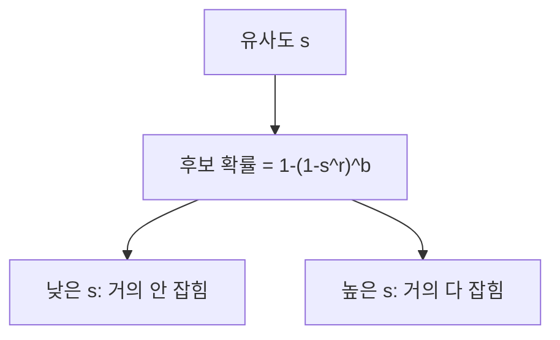

# MinHash·LSH

> 문서를 단어·글자 묶음의 집합으로 보고, 두 집합의 자카드 유사도를 짧은 지문(MinHash 서명)으로 근사한 뒤, 지문을 구간(band)으로 쪼개 비슷한 것끼리만 같은 통에 모이게 하는(LSH) 근접 중복 탐지 기법이다. 모든 쌍을 비교하지 않아도 된다.

## 쉽게 말하면
도서관에서 비슷한 책을 찾으려고 책마다 지문 카드를 만들고, 카드의 앞부분이 같은 책들만 같은 서가에 꽂는다. 그 서가 안에서만 자세히 비교하면 수백만 권을 일일이 비교하지 않고도 사실상 같은 책을 찾는다.

## 자세히
(datasketch 문서를 직접 열어 확인하고 코드를 직접 실행해 검증, 중복 제거 효과는 Lee 등의 논문 초록 확인.)
- **자카드 유사도**: 두 집합의 교집합/합집합. MinHash는 집합마다 `num_perm`개의 해시 최솟값을 모아 서명을 만들고, 서명이 일치하는 비율이 자카드 유사도의 추정치다.
- **LSH(지역성 민감 해싱)**: 서명 `num_perm`개를 `b`개 구간 × `r`행으로 나눠, **한 구간이라도 r개가 모두 같으면 후보**로 본다. 진짜 유사도 `s`일 때 후보가 될 확률은 `1 − (1 − s^r)^b` — 하드 컷오프가 아닌 S자 곡선이다.
- **datasketch 파라미터(문서)**: `threshold`(자카드 기준)와 `num_perm`(서명 길이, 클수록 경계가 선명하지만 메모리·삽입 시간 증가). 생성 후 변경 불가. `num_perm=128`에서 threshold 0.5이면 (b,r)=(25,5), 0.7이면 (14,9)를 자동 선택. `query`는 순서 없는 후보를 주므로 정확한 기준이 필요하면 `MinHash.jaccard`로 재확인.
- **직접 실행(datasketch, num_perm=128)**: 한 단어만 바꾼 두 문장은 MinHash 추정 0.836(실제 자카드 0.846), 전혀 다른 문장은 0.0. LSH(threshold 0.5)는 비슷한 쪽만 후보로 반환(b=25, r=5). 식으로 계산하면 s=0.2→0.8%, 0.5→54.8%, 0.8→약 100%.
- **왜 LLM 데이터에서 중요한가**: Lee 등(arXiv 2107.06499, 초록 확인)은 언어 모델 학습 데이터에 근접 중복과 긴 반복 구간이 많다고 보고했다. C4에서 61단어 문장 하나가 6만 번 넘게 등장, 모델 출력의 1% 이상이 학습 텍스트와 그대로 일치. 중복을 제거하면 암기된 텍스트 방출이 약 10배 감소하고, 검증 세트 4% 이상에서 학습-시험 겹침이 있었다. 이 논문은 두 도구를 쓴다: NearDup(MinHash 기반, 5-그램·서명 크기 9,000·b=20,r=450, 편집 유사도 0.8 초과를 중복으로 판정)과 [정확 부분 문자열 제거](#exact-substring-dedup)(본문 확인). NearDup은 C4 예제의 3.04%, RealNews 13.63%를 제거했다.
- 한계: 의미가 같지만 단어가 다른 문장(패러프레이즈)은 못 잡는다. 임계값과 `shingle` 크기에 민감하다(제안).

## 그림으로 보기



## 예시
```python
from datasketch import MinHash, MinHashLSH
def mh(text, n=128):
    m = MinHash(num_perm=n)
    for w in text.split(): m.update(w.encode())
    return m
lsh = MinHashLSH(threshold=0.5, num_perm=128)
lsh.insert("doc_b", mh(text_b))
print(lsh.query(mh(text_a)))     # ['doc_b']
```
- 사내 문서 50만 건에서 복사본·개정판 후보를 찾아 [문서 단위 분할](#document-level-split) 전에 같은 그룹으로 묶는다.

## 헷갈리는 것과 비교
| 개념 | 차이 |
|---|---|
| MinHash | 집합 유사도를 짧은 서명으로 근사 |
| LSH | 비슷한 서명을 같은 통에 모아 후보만 비교 |
| [정확 부분 문자열 제거](#exact-substring-dedup) | 긴 동일 구간을 정확히 찾아 제거 |
| [근접 중복 탐지](#near-duplicate-detection) | 목적(상위 개념) |
| 임베딩 유사도 | 의미 기반. 계산 비용이 더 큼 |

## 더 읽을거리
- [datasketch: MinHash LSH](https://ekzhu.com/datasketch/lsh.html) — 파라미터·밴딩·S자 곡선(열어 확인).
- [Deduplicating Training Data Makes Language Models Better (arXiv 2107.06499)](https://arxiv.org/abs/2107.06499) — 중복 제거 효과(초록 확인).
