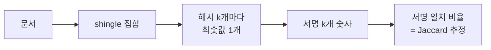
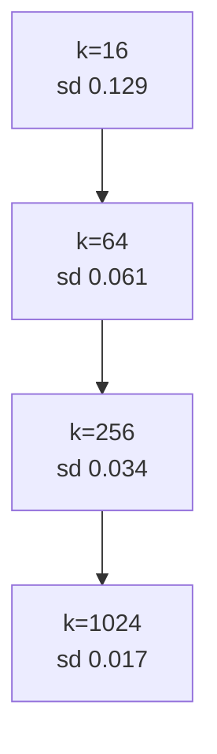

# MinHash

> MinHash는 큰 집합(문서의 단어 조각 모음)을 몇십~몇백 개 숫자로 된 짧은 서명으로 줄여, 두 집합이 얼마나 겹치는지(Jaccard 유사도)를 서명끼리 비교해 추정하는 기법이다.

## 쉽게 말하면
두 책이 얼마나 비슷한지 알려고 책 전체를 대조하는 대신, 각 책에서 "무작위 규칙으로 줄 세웠을 때 맨 앞에 오는 단어"를 100번 뽑아 두 책의 맨 앞 단어가 같은 횟수를 센다. 겹치는 단어가 많을수록 맨 앞 단어가 같아질 확률도 높아져, 그 비율이 곧 겹침 정도의 추정값이 된다.

## 자세히
- **핵심 성질(위키피디아 MinHash 문서, 열람)**: 무작위 순열에서 두 집합의 최솟값 해시가 같을 확률은 Jaccard 유사도 |A∩B| / |A∪B|와 같다. 해시 함수를 k개 쓰고 최솟값이 일치한 비율을 세면 불편 추정치가 되고, 기대 오차는 O(1/√k)다(문서 기준으로 오차 0.05에 약 400개 해시). 1997년 Broder가 제안했고 AltaVista가 중복 웹 페이지 제거에 썼다.
- **직접 구현해 본 실험(순수 파이썬, 3-단어 조각 shingle, 문장 A와 일부 단어를 바꾸고 3단어를 덧붙인 B, 진짜 Jaccard 0.483, 해시는 `(a·x+b) mod 2^61−1` 형태)**: 해시 수 16개일 때 추정치의 표준편차 0.129(이론값 √(J(1−J)/k)=0.125), 64개 0.061(0.062), 256개 0.034(0.031), 1,024개 0.017(0.016)이었다. 200번 반복한 평균은 모두 0.48대로 진짜 값과 맞았다. 이론과 실측이 일치하며 오차는 해시 수의 제곱근에 반비례한다.
- **절차**: ① 문서를 shingle(연속 n단어) 집합으로 ② 각 해시 함수로 모든 shingle을 해시해 최솟값만 기록 ③ k개 최솟값 = 서명 ④ 서명 일치 비율 = Jaccard 추정.
- **한계(해석)**: 철자·단어 수준 겹침만 본다. 의역은 못 잡는다([의미적 중복 제거](#semantic-deduplication)). 쌍마다 비교하면 여전히 문서 수 제곱 비용이라 LSH로 후보를 먼저 거른다([LSH 밴드·행 조정](#lsh-band-row-tuning)).
- **쓰임**: 웹 중복 제거, LLM 학습 데이터 중복 제거와 평가 오염 점검([학습 데이터 중복 제거](#training-data-deduplication)).

## 그림으로 보기

## 예시
- 코드 개요: `datasketch` 라이브러리의 `MinHash(num_perm=128)`로 서명을 만들고 `jaccard()`를 호출한다(사용법은 이 글에서 직접 실행하지 않았다).
- 교육 활용: 두 문장의 진짜 Jaccard와 해시 수별 추정치를 비교하며 "많이 뽑을수록 정확해진다"를 확인한다.

## 헷갈리는 것과 비교
| 개념 | 차이 |
| --- | --- |
| Jaccard | 두 집합의 정확한 겹침 비율 |
| MinHash | Jaccard를 짧은 서명으로 추정 |
| [LSH 밴드·행 조정](#lsh-band-row-tuning) | 서명으로 후보 쌍을 빠르게 찾기 |
| [의미적 중복 제거](#semantic-deduplication) | 임베딩으로 의역까지 |

## 더 읽을거리
- [Wikipedia: MinHash](https://en.wikipedia.org/wiki/MinHash) — 성질, 추정 오차, AltaVista 활용
