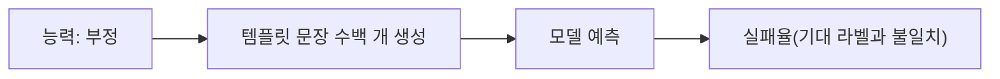
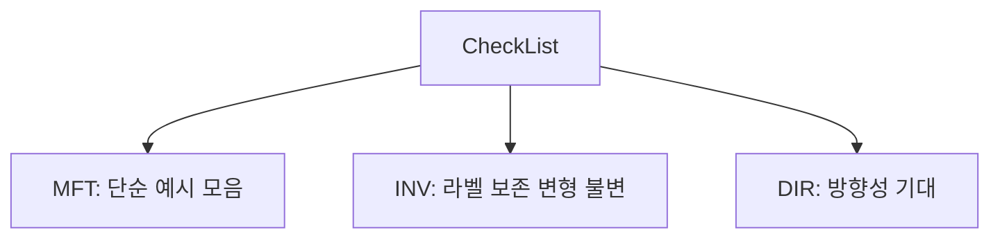

# 최소 기능 테스트(MFT)

> CheckList의 테스트 유형 하나로, 소프트웨어 단위 테스트처럼 작은 템플릿 문장들로 모델의 한 능력(예: 부정 처리)이 기본적으로 되는지 확인한다.

## 쉽게 말하면
계산기를 시험할 때 "2+2=4"가 맞는지부터 보는 것과 같다. 작지만 정답이 분명한 문제를 수백 개 자동으로 만들어 돌린다.

## 자세히
(Ribeiro 외 "Beyond Accuracy: Behavioral Testing of NLP Models with CheckList" ACL 2020, arXiv 2005.04118을 하위 에이전트가 원문으로 읽은 노트 기준.)
- **정의**: 소프트웨어 단위 테스트에서 영감을 얻은, 한 능력 안의 행동을 확인하는 단순한 예시(주로 템플릿) 모음.
- **예**: 템플릿 "I {NEGATION} {POS_VERB} the {THING}." (NEGATION = didn't, can't …, THING = food, flight, service …), 기대 라벨은 부정. 논문 그림의 한 모델에서 **실패율 76.4%**(어느 시스템인지는 추출 실패로 미확인).
- **다른 테스트 유형**: **INV**(불변성: 라벨을 보존하는 변형에 예측이 바뀌면 실패, 확률 변화 0.1 초과 기준), **DIR**(방향성: 변형이 알려진 방향으로 점수를 움직여야 함). 그림 예 실패율 INV 20.8%, DIR 34.6%.
- **능력 목록**: 어휘+품사, 분류 체계, 견고성, NER, 공정성, 시간, 부정, 공참조, SRL, 논리.
- **상용 감성 분석 결과**: Microsoft·Google·Amazon API(2019.11, 2020.4 비슷)와 SST-2로 미세조정한 BERT·RoBERTa(정확도 92.7%/94.8%). "The food is not poor"류 단순 부정에서 상용 두 모델 실패 54.2%·29.4%(어느 모델인지 미확인), 부정이 문장 끝에 오면 모든 상용 모델 실패가 거의 100%.
- **주의(논문)**: "테스트 실패가 없다고 공정하다는 뜻은 아니다."

## 그림으로 보기

## 예시
- 챗봇에 "배송이 안 늦었어요"(부정) 템플릿 100개를 넣고 감성 분류 실패율 측정.
- 교육 활용: 템플릿 하나를 직접 만들어 모델 약점을 찾는 활동.

## 헷갈리는 것과 비교
| 개념 | 차이 |
|---|---|
| MFT | 단순 예시로 기본 능력 확인 |
| INV | 불변성 확인 |
| 벤치마크 정확도 | 전체 평균(약점이 가려짐) |

## 더 읽을거리
- [CheckList (arXiv 2005.04118)](https://arxiv.org/abs/2005.04118) — 테스트 유형·결과.
