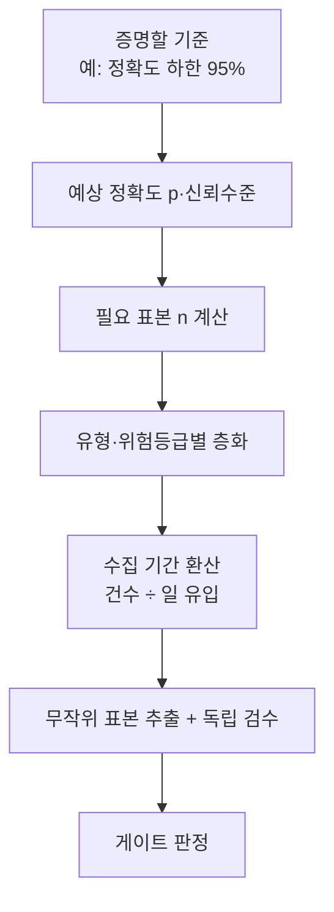

# 단계별 최소 표본 (게이트 판단용)

> AI 응대를 확대할지 정하는 **게이트 평가에 필요한 최소 문의 건수**. 표본이 작으면 "99% 정확"이라는 관측값도 신뢰할 수 없으므로, 기준을 증명하는 데 필요한 건수를 미리 계산해 둔다.

## 쉽게 말하면
국을 간 볼 때 한 숟가락으로 맛을 알 수 있지만, 솥이 크면 잘 저어야 한다. 표본이 너무 적으면 우연히 맛있는 부분만 맛볼 수 있다. 얼마나 맛봐야 "충분히 안심"인지 미리 정해야 한다.

## 자세히
출처: Wikipedia "Rule of three"와 "Binomial proportion confidence interval"의 공식(앞서 [승급 조건](#intent-promotion-criteria)에서 확인)을 적용한 **직접 계산**(2026-11-18). 목표 기준값(몇 %)은 조직이 정하는 값이며 아래는 설명용이다.
- **방법 1, 오류 0건일 때(3의 법칙)**: 95% 신뢰로 오류율 상한 U를 보이려면 n ≥ 3/U.
  - 5% → 60건, 2% → 150건, 1% → 300건, 0.5% → 600건. 오류가 1건이라도 나오면 이 계산은 성립하지 않는다.
- **방법 2, 오차 범위로 정하기**: 비율의 95% 신뢰구간 반폭을 E로 두면 n ≈ 1.96²·p(1−p)/E²(정규근사, 일반 통계 공식).

| 예상 정확도 p | 허용 오차 E | 필요 표본 n |
|---|---|---|
| 0.90 | ±2%p | 865 |
| 0.95 | ±2%p | 457 |
| 0.95 | ±1%p | 1,825 |
| 0.50 | ±5%p | 385 |

- **방법 3, 윌슨 하한이 기준을 넘도록**: 관측 정확도가 98%일 때 95% 하한이 95% 이상이 되려면 약 173건, 99%일 때 하한 97%를 보이려면 약 239건, 97%일 때 하한 95%는 약 414건(반복 탐색 계산, 정수 반올림에 따라 ±몇 건 달라진다).
- **층화 필요**: 문의 유형·위험 등급·채널·언어별로 각각 기준을 증명해야 하면 유형마다 표본이 필요하다. 유형이 10개면 건수가 10배가 된다. 희귀 유형은 기간을 늘려 모은다.
- **표본 추출**: 무작위(또는 시간·유형별 층화)로 뽑는다. 쉬운 건만 뽑으면 기준이 부풀려진다. 라벨(정답)은 독립 검수자가 만든다([라벨 품질 감사](#label-quality-audit)).
- **기간과 건수 환산**: 하루 문의가 100건이고 대상 유형이 전체의 5%라면 하루 5건 → 300건 모으는 데 60일. 이를 단계 일정에 반영한다([단계 전환 기준](#rollout-gates)).
- **한계**: 정규근사는 p가 0이나 1에 가까울 때 부정확하므로 윌슨·정확 구간을 쓴다. 표본이 독립이 아니면(같은 고객 반복) 유효 표본이 줄어든다.

## 그림으로 보기


## 예시
```python
from math import ceil
def n_for_margin(p, e, z=1.96):
    return ceil(z * z * p * (1 - p) / (e * e))
n_for_margin(0.95, 0.02)     # 457
def n_zero_errors(upper):    # 3의 법칙
    return ceil(3 / upper)
n_zero_errors(0.01)          # 300
```
교육 활용: 파일럿 계획서에서 "정확도 95% 달성" 같은 목표에 필요한 검수 건수와 기간을 계산해 보게 한다.

## 헷갈리는 것과 비교
| 개념 | 차이 |
|---|---|
| 최소 표본 | 기준을 증명하는 데 필요한 건수 |
| [승급 조건](#intent-promotion-criteria) | 승급 판단의 통계 기준 전체 |
| [단계 전환 기준](#rollout-gates) | 출시 범위 확대 조건 |
| 검정력 | 진짜 차이를 찾아낼 확률 |

## 더 읽을거리
- [Wikipedia: Rule of three](https://en.wikipedia.org/wiki/Rule_of_three_(statistics)) — 0건일 때 3/n 상한
- [Wikipedia: Binomial proportion confidence interval](https://en.wikipedia.org/wiki/Binomial_proportion_confidence_interval) — 윌슨 구간과 정규근사의 한계
