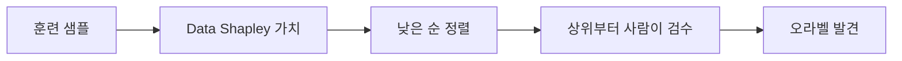
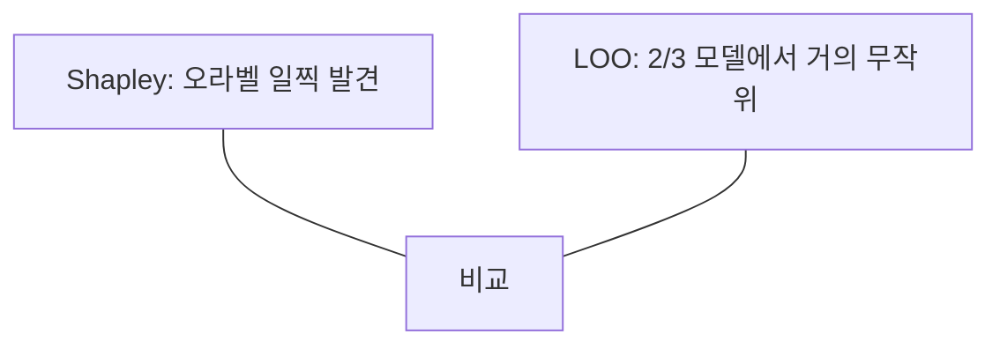

# 가치로 오라벨 찾기

> Data Shapley로 각 훈련 샘플의 가치를 매기면 잘못 라벨된 샘플이 가장 낮은 가치로 몰리는 경향이 있어, 가치가 낮은 순서대로 점검하면 오라벨을 효율적으로 찾을 수 있다.

## 쉽게 말하면
시험 점수를 올리는 데 가장 도움이 안 되는(오히려 방해하는) 문제부터 검토하면 오답이 적힌 문제를 빨리 찾는다.

## 자세히
(Ghorbani & Zou "Data Shapley" ICML 2019, arXiv 1904.02868을 하위 에이전트가 원문으로 읽은 노트 기준. 정확한 비율은 그림만 있어 **미확인**.)
- **방법**: 가치가 낮은 샘플부터 점검하며 찾은 오라벨 수를 센다(그림 2a, 부록 C).
- **세 실험**: ① 스팸 분류, 나이브 베이즈, 라벨 20% 뒤집음(600개) ② 꽃(5클래스), Inception-V3 특징 + 다항 로지스틱 회귀, 이미지 1,000장 중 100개(10%) 오라벨 ③ Fashion-MNIST 티셔츠 vs 셔츠, ConvNet, 1,000장 중 100개 오라벨.
- **결과**: Data Shapley에서는 오라벨이 낮은 가치 쪽에서 일찍 발견된다. **LOO(하나 빼기)는 로지스틱 회귀에서만 어느 정도 작동하고 나머지 두 모델에서는 거의 무작위**였다. G-Shapley는 TMC-Shapley와 비슷하며 LOO보다 낫다.
- **의미(제안)**: 대규모 데이터 정제에서 사람 검수 순서를 정하는 데 쓸 수 있다. 계산 비용이 크므로 소형 모델·표본으로 먼저 시험한다.

## 그림으로 보기

## 예시
- 라벨 5% 오류가 의심되는 감성 데이터에서 가치 하위 200건을 우선 검수.
- 교육 활용: 점검 순서를 정하면 검수 비용이 준다는 점 설명.

## 헷갈리는 것과 비교
| 개념 | 차이 |
|---|---|
| 가치 기반 탐지 | 모델 성능 기여로 순위 |
| 신뢰 학습(confident learning) | 예측 확률로 오라벨 추정(다른 접근) |
| [노이즈와 가치 추정](#training-noise-in-valuation) | 노이즈가 가치에 미치는 영향 |

## 더 읽을거리
- [Data Shapley (arXiv 1904.02868)](https://arxiv.org/abs/1904.02868) — 오라벨 탐지 실험.
