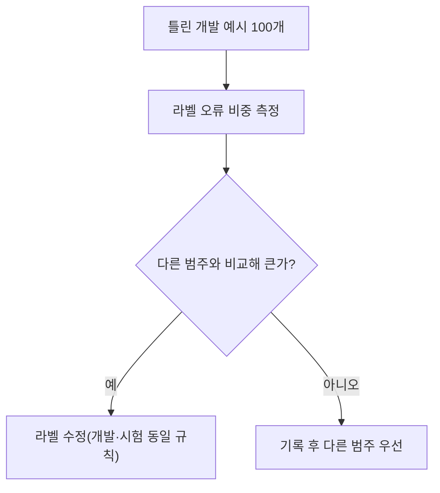
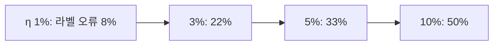

# 개발 세트 라벨 오류 수정 기준

> 개발 세트의 틀린 예시 중 **라벨 자체가 틀린 것이 얼마나 되는지**를 보고, 비중이 클 때만 라벨을 고치는 판단 기준이다. 무작위 라벨 오류는 모델 간 우열을 거의 뒤집지 않지만, 오류의 큰 몫을 차지하면 오류 분석이 왜곡된다.

## 쉽게 말하면
시험 채점표에 오답이 섞여 있어도 두 학생 점수 차이가 크게 안 변한다면 그냥 둬도 된다. 하지만 "틀린 문제"를 분석할 때 그 절반이 채점표 오류라면 학생 탓을 하며 엉뚱한 곳을 고치게 된다.

## 자세히
(직접 시뮬레이션: 이진 분류 20만 개, 모델 A 정확도 0.90, 모델 B 0.91 — 표본 실현값으로 진짜 차이 0.0076, 개발 라벨을 확률 η로 무작위로 뒤집음)
| 라벨 오류율 η | 관측 A / B | 관측 차이 | η=0 대비 차이의 비율 | **관측 오류 중 라벨 오류의 비중** |
|---|---|---|---|---|
| 0% | 0.9010 / 0.9086 | 0.0076 | 1.00 | 0% |
| 1% | 0.8932 / 0.9005 | 0.0073 | 0.96 | 8.2% |
| 3% | 0.8777 / 0.8844 | 0.0067 | 0.88 | 21.5% |
| 5% | 0.8603 / 0.8668 | 0.0065 | 0.86 | 32.8% |
| 10% | 0.8210 / 0.8277 | 0.0067 | 0.88 | 50.1% |
- **무엇이 보이나**: 이 설정(무작위·대칭 라벨 오류)에서는 η가 커져도 모델 간 **차이의 방향은 유지**되고 크기도 이론상 (1−2η)배로 소폭 줄 뿐이다(위 표의 비율은 표본 변동이 섞여 있다). 그러나 **오류 분석 관점**에서는 η=5%면 관측된 틀린 예시의 약 3분의 1, 10%면 절반이 모델이 아니라 라벨 문제다.
- **개발 세트 크기도 영향**: 시험 항목 수가 적으면 우열을 못 가린다. B가 A보다 높게 측정될 확률 — 라벨 오류 0%: n=500일 때 0.65, 2,000일 때 0.77, 5,000일 때 0.89. 라벨 오류 5%: 0.61, 0.75, 0.86. 라벨 오류는 소폭 낮추고 **표본 크기가 더 큰 영향**을 준다. 1%p 차이를 가르려면 수천 개가 필요하다.
- **수정 기준(제안, 절대 규칙 아님)**
  1. **라벨 오류 비중**을 측정: 틀린 개발 예시 100~200개를 보고 "라벨이 틀림" 범주의 비율을 센다([범주별 상한](#error-category-ceiling)).
  2. 그 비중이 **개선하려는 다른 범주들의 크기와 비슷하거나 더 크면** 라벨 수정이 가장 큰 이득이다(상한 비교).
  3. 모델 간 차이가 **라벨 오류율 크기와 비슷하면** 비교가 불안정하므로 수정한다.
  4. 오류가 **체계적**(특정 클래스·기기·라벨러에 몰림)이면 무작위 가정이 깨져 순위가 뒤집힐 수 있어 우선 수정([라벨 오류 순위 점검](#cleanlab-label-quality-score)로 후보 선정).
  5. 수정은 **개발·시험 세트 둘 다 같은 규칙**으로(분포 차이 방지). 학습 세트는 노이즈에 어느 정도 강건하므로 우선순위가 낮을 수 있다([모델 용량과 노이즈](#model-capacity-vs-noise)).
  6. 수정 과정은 [검수 순서](#human-relabel-triage)·[판정자](#adjudicator-role) 절차를 따르고 새 데이터셋 버전으로 기록.
- 비중이 작으면(예: 오류의 몇 %) 기록만 하고 넘어간다. 수치 기준은 과제 위험에 따라 정하며, 위 표의 비중(8%·22%·33%·50%)이 판단 재료다.

## 그림으로 보기

## 예시
- 챗봇 평가셋: 오답 100건 중 정답지가 틀린 것이 30건 → 가장 큰 범주이므로 정답지 수정이 모델 개선보다 먼저.
- 교육: "측정 도구(정답지)의 품질이 개선 우선순위를 바꾼다".

## 헷갈리는 것과 비교
| 개념 | 차이 |
|---|---|
| 무작위 라벨 오류 | 차이 방향 유지, 오류 분석 왜곡 |
| 체계적 라벨 오류 | 순위를 뒤집을 수 있음 |
| [수정된 시험 세트](#corrected-test-labels) | 벤치마크 수준의 사례 |
| 학습 세트 라벨 오류 | 모델이 외워 일반화 저하 |

## 더 읽을거리
- [Pervasive Label Errors in Test Sets (arXiv 2103.14749)](https://arxiv.org/abs/2103.14749) — 시험 세트 오류가 순위를 바꿀 수 있다는 보고(초록 확인).
- [Confident Learning (arXiv 1911.00068)](https://arxiv.org/abs/1911.00068) — 후보 탐지 방법(초록 확인).
