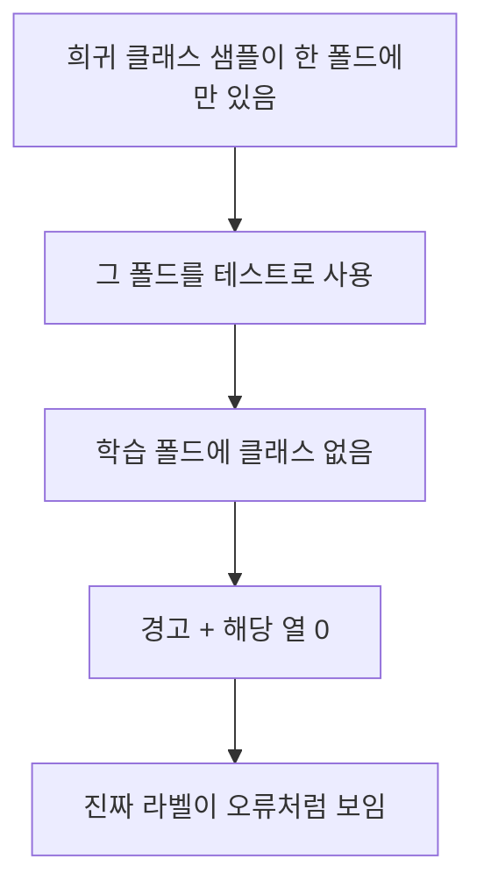

# 폴드에 클래스가 빠질 때

> 교차 검증에서 어떤 학습 폴드에 특정 클래스 샘플이 하나도 없으면, 그 폴드의 모델은 그 클래스를 모르기 때문에 `predict_proba`의 열 구성이 달라지거나 경고·오류가 생긴다. 희귀 클래스가 있는 데이터에서 자주 만나는 문제다.

## 쉽게 말하면
시험 범위 세 단원 중 한 단원을 빼먹고 공부한 학생이 "단원 3 문제의 정답 확률"을 물으면 0%라고 답할 수밖에 없다. 그 학생의 답을 그대로 모아서 평가하면 단원 3에 사는 문제는 억울하게 틀린 것이 된다.

## 자세히
- **문서의 설명(scikit-learn)**: 희귀 클래스가 있으면 학습·검증 폴드에 특정 클래스가 없을 수 있고, 이는 보통 ROC AUC 같은 지표가 정의되지 않거나, `fit` 호출에서 예외가 나거나, 폴드마다 다르게 학습된 다중 클래스 분류기의 `predict_proba`·`decision_function` 출력에 열이 빠지는 결과로 이어진다. 해결책으로 클래스 비율을 유지하는 `StratifiedKFold`, `StratifiedShuffleSplit`을 쓰라고 한다.
- **직접 실행해 본 결과(scikit-learn 1.9.1, 샘플 12개: 클래스 0·1이 5개씩, 클래스 2가 2개, `KFold(3)`)**: 클래스 2 샘플이 모두 마지막 폴드에 몰려, 그 폴드를 테스트로 쓸 때 학습 폴드에는 클래스가 2개뿐이었다. 경고 "Number of classes in training fold (2) does not match total number of classes (3). Results may not be appropriate for your use case."가 나왔고, 출력 배열 모양은 (12, 3)이었다. 마지막 두 샘플(진짜 클래스 2)의 확률은 `[0, 1, 0]`으로, 클래스 2 열이 0으로 채워졌다. 즉 모델이 모르는 클래스는 확률 0이 되어 그 샘플이 "클래스 1 확신"으로 보인다.
- **라벨 오류 탐지에 미치는 영향(해석)**: 이런 샘플은 확률이 0이라 거의 틀린 라벨처럼 점수가 매겨져 오탐이 된다([라벨 오류 오탐](#false-positive-label-issues)).
- **대응(해석)**: ① `StratifiedKFold`로 폴드마다 모든 클래스가 들어가게 한다 ② 폴드 수보다 클래스 샘플이 적으면 폴드 수를 줄이거나 희귀 클래스를 합친다 ③ 경고를 오류처럼 취급해 로그에서 확인한다.

## 그림으로 보기



## 예시
```python
from sklearn.model_selection import StratifiedKFold, cross_val_predict
cv = StratifiedKFold(n_splits=3, shuffle=True, random_state=0)
p = cross_val_predict(clf, X, y, cv=cv, method="predict_proba")
```
- 클래스당 샘플이 폴드 수보다 적으면 층화도 한계가 있다. 이때는 데이터를 더 모으거나 폴드 수를 줄인다.
- 교육 활용: 표본 12개 예제를 직접 손으로 나눠 보며 왜 클래스가 빠지는지 체험한다.

## 헷갈리는 것과 비교
| 개념 | 차이 |
| --- | --- |
| KFold | 순서대로/무작위로 나눔, 클래스 균형 보장 없음 |
| StratifiedKFold | 클래스 비율을 폴드마다 유지 |
| [cross_val_score vs predict](#cross-val-score-vs-predict) | 반환 값의 차이 |
| [라벨 오류 오탐](#false-positive-label-issues) | 열 누락이 일으킬 수 있는 오탐 |

## 더 읽을거리
- [scikit-learn Cross-validation 가이드](https://scikit-learn.org/stable/modules/cross_validation.html) — 클래스 누락 시 증상과 층화 분할
