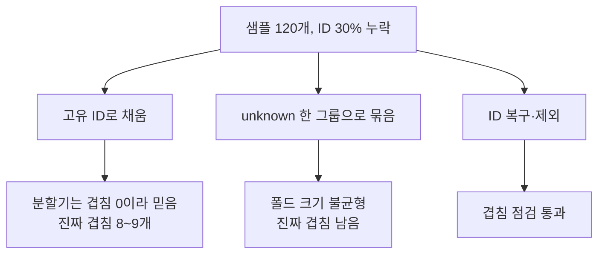
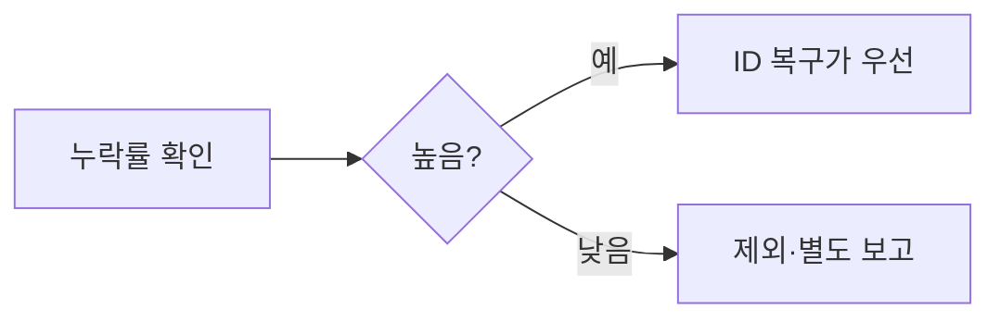

# 그룹 ID 누락 문제

> 샘플 일부에 그룹 ID(환자·사용자·문서 번호)가 비어 있거나 표기가 어긋나면 **그룹 분할을 써도 같은 개체가 학습·테스트로 갈라져 누수가 되살아난다.**

## 쉽게 말하면
반 배정에서 일부 학생의 가족 정보가 비어 있으면, 컴퓨터는 그 학생들을 "가족 없음"으로 보고 아무 반에나 넣는다. 형제가 같은 반에 있지 않게 하려던 규칙이 조용히 깨진다.

## 자세히
(scikit-learn 1.9.1 직접 실험: 그룹 30개×4샘플, 샘플의 30%에서 ID 누락.)
- **누락을 각자 고유 ID로 채운 경우**: 분할기는 겹침 0이라 믿지만, *진짜 그룹* 기준으로는 폴드마다 학습·테스트에 걸친 그룹이 **8~9개**였다. ID가 없는 것이지 그룹이 없는 것이 아니다.
- **누락을 하나의 "unknown" 그룹으로 묶은 경우**(32샘플): `GroupKFold`가 그 큰 그룹을 한 폴드에 몰아 진짜 겹침이 `[21,4,6,6,5]`로 남고 폴드 크기도 불균형해진다. (직접 확인한 한 번의 결과이며 데이터마다 다르다.)
- **다른 원인**: 표기 불일치(`P001` vs `p001` vs `P-001`), 병합 과정에서 ID가 바뀜, 한 개체에 ID가 두 개(재가입한 사용자), NaN이 문자열 "nan"으로 변환.
- **대응**
  1. 분할 전 **누락률을 먼저 보고**. 누락이 많으면 ID 복구(조인·규칙)가 분할 기법보다 우선이다.
  2. ID 정규화(공백·대소문자·접두사)와 `nunique` 확인.
  3. 복구 불가능한 샘플은 **제외하거나** 별도 보고. 한 그룹으로 몰아넣지 않는다.
  4. 다른 신호(이메일 해시, 기기 ID, 내용 유사도)로 같은 개체를 추정해 병합([근접 중복 탐지](#near-duplicate-detection)).
  5. 분할 후 [그룹 겹침 검증](#group-overlap-check)을 ID 열마다 실행.
- 공식 가이드의 원칙: 검증 폴드의 모든 샘플은 짝지어진 학습 폴드에 **전혀 나타나지 않은 그룹**에서 와야 한다. ID가 없으면 이 보장을 할 수 없다.

## 그림으로 보기

## 예시
- 상담 로그에서 비회원 대화 30%에 사용자 ID 없음 → 세션·기기 정보로 묶어 임시 ID 부여 후 분할, 복구 불가 로그는 평가에서 제외.
- 교육: "빈칸 데이터가 규칙을 무력화한다"는 데이터 품질 사례.

## 헷갈리는 것과 비교
| 개념 | 차이 |
|---|---|
| ID 누락 | 그룹 정보 자체가 없음 |
| [그룹 겹침 검증](#group-overlap-check) | 있는 ID 기준으로 겹침 확인 |
| [다축 그룹](#multi-axis-grouping) | ID가 여러 종류일 때 |
| 결측값 대치 | 값 채우기(ID에는 부적합) |

## 더 읽을거리
- [scikit-learn 교차검증 가이드 — 그룹 데이터](https://scikit-learn.org/stable/modules/cross_validation.html) — 그룹이 폴드 간 겹치지 않아야 한다는 원칙.
