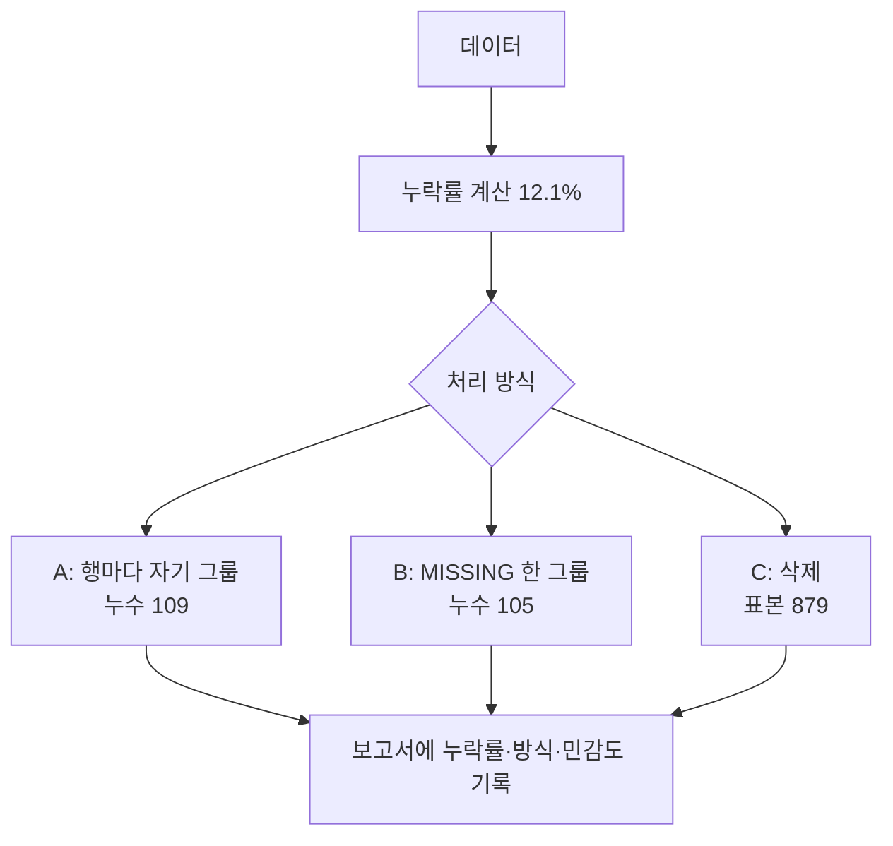
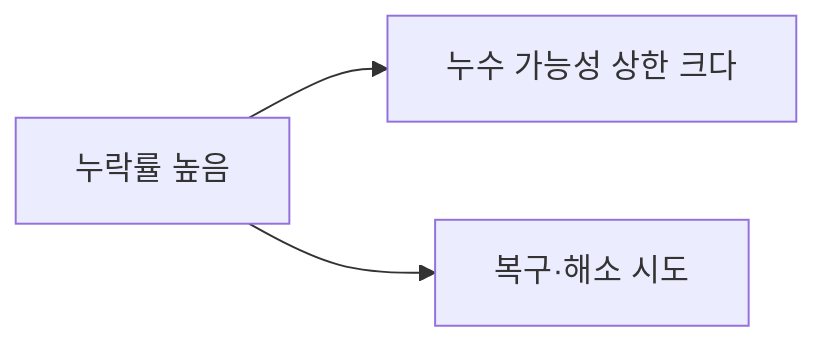

# ID 누락률 보고

> 그룹 단위 분할을 하기 전에 그룹 ID(환자·사용자·문서 ID)가 비어 있는 행이 얼마나 되는지 수치로 세어 보고서에 남기는 습관이다. 누락 행을 어떻게 처리하든 누수 위험이 남기 때문에 누락률은 결과 해석의 필수 맥락이다.

## 쉽게 말하면
출석부에 이름이 빠진 답안지가 12%나 되면, 그 답안지들이 누구 것인지 몰라 조 편성이 불완전하다. 몇 장이 이름 없는 답안지인지 먼저 세어 적어 두면, 나중에 "이 점수는 12%가 불확실한 상태에서 나온 값"이라고 정직하게 말할 수 있다.

## 자세히
- **직접 해 본 시뮬레이션(행 1,000개, 사람 100명, 무작위로 ID 12% 누락 = 121행)**: 누락 행을 처리하는 방식에 따라 결과가 달랐다. 정답 정보(실제 사람)를 알고 있는 시뮬레이션이라 누수를 직접 셀 수 있다.

| 처리 방식 | 결과 |
| --- | --- |
| A. 누락 행마다 자기만의 그룹 | 누락 121행 중 실제 사람이 학습 조각에도 있는 행 109개(누수) |
| B. 누락 행 전부를 "MISSING" 한 그룹 | 누수 105개, 그리고 한 그룹이 121행으로 한 폴드를 차지 |
| C. 누락 행 삭제 | 879행으로 줄고 누수는 없으나 표본 감소와 선택 편향 |

  A와 B 모두 누락 행의 약 9할(109/121, 105/121)에서 같은 사람이 학습에도 있어 누수가 남았다. 누락이 무작위가 아니라 특정 유형에 몰려 있다면 C의 삭제는 평가 편향을 만든다.
- **형식 함정(같은 실험)**: 그룹 열에 정수와 문자열이 섞이면 `GroupKFold`가 `'<' not supported between 'str' and 'int'` 오류로 멈춘다. 전체를 문자열로 맞추고 누락은 빈 값이 아니라 명시적 표시로 둔다.
- **보고할 항목(해석)**: ① 전체 행 수와 누락 행 수·비율 ② 누락이 몰린 구간(날짜·소스 시스템·클래스별 누락률) ③ 처리 방식 A/B/C와 이유 ④ 처리 방식을 바꿨을 때 점수 변화(민감도). 누락률이 높으면 "누수 가능성 상한"을 함께 적는다.
- **줄이는 법**: 원본 시스템에서 ID를 복구하거나 [엔티티 해소](#entity-resolution)로 추정한다. 추정한 ID는 "추정" 표시를 남긴다.

## 그림으로 보기

## 예시
- 분할 전에 `df["pid"].isna().mean()`과 소스별 누락률 표를 출력해 분할 기록에 붙인다([분할 기록 남기기](#split-report-logging)).
- 교육 활용: 같은 시뮬레이션에서 누락률을 2%, 12%, 30%로 바꿔 누수 행 수가 어떻게 변하는지 본다.

## 헷갈리는 것과 비교
| 개념 | 차이 |
| --- | --- |
| ID 누락률 | 얼마나 비었나 |
| [ID 정규화](#id-normalization) | 표기를 맞춤(비어 있진 않음) |
| [엔티티 해소](#entity-resolution) | 비거나 흩어진 ID를 복구·합치기 |
| [분할 단위 테스트](#split-assertion-test) | 분할 후 겹침 검증 |

## 더 읽을거리
- [scikit-learn: Cross-validation iterators for grouped data](https://scikit-learn.org/stable/modules/cross_validation.html) — 그룹 열이 분할에 쓰이는 방식
