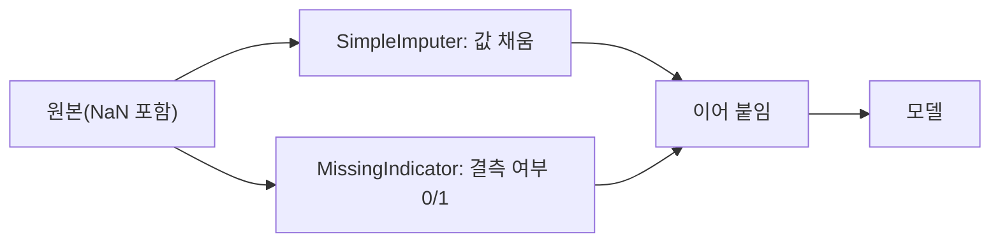
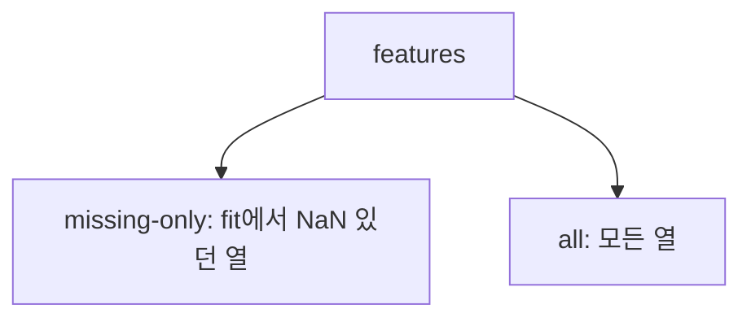

# MissingIndicator 사용법

> scikit-learn의 `MissingIndicator`는 "이 값이 비어 있었나"를 불리언 열로 바꿔 주는 변환기다. 결측 여부 자체를 모델 입력으로 주려고 쓴다. `SimpleImputer(add_indicator=True)`로 대체와 한 번에 쓸 수 있다.

## 쉽게 말하면
빈칸을 채우더라도 "원래 비어 있었다"는 사실에 노란 스티커를 붙여 두는 것이다. 비어 있었다는 사실이 정보일 수 있어서다.

## 자세히
(scikit-learn 문서를 하위 에이전트가 읽은 노트 기준.)
- **`features`**: 기본 `'missing-only'` — fit 때 NaN이 있던 열만 지표를 만든다. `'all'`은 모든 열.
- **출력**: 불리언 배열. **`error_on_new=True`**(기본)면 fit 때 NaN이 없던 열에서 transform 때 NaN이 나오면 오류.
- **`SimpleImputer(add_indicator=True)`**: 대체된 열 뒤에 지표 열을 붙여 반환. fit 때 NaN이 없던 열은 지표를 만들지 않는다.
- **주의(제안)**: 서빙 시 새 결측 패턴이 나오면 입력 차원이 어긋날 수 있으니 `features='all'`이나 파이프라인 점검. 결측이 정보인지(예: 소득 미기입) 도메인에서 확인([정보성 결측](#informative-missingness)).

## 그림으로 보기



## 예시
```python
from sklearn.impute import SimpleImputer
imp = SimpleImputer(strategy="median", add_indicator=True)
X2 = imp.fit_transform(X)
```
- 교육 활용: 지표 열을 넣었을 때 모델 성능과 해석이 어떻게 바뀌는지 비교.

## 헷갈리는 것과 비교
| 개념 | 차이 |
|---|---|
| MissingIndicator | 결측 여부만 출력 |
| SimpleImputer | 값을 채움 |
| add_indicator=True | 둘을 합침 |

## 더 읽을거리
- [MissingIndicator 문서](https://scikit-learn.org/stable/modules/generated/sklearn.impute.MissingIndicator.html) — 매개변수.
- [SimpleImputer 문서](https://scikit-learn.org/stable/modules/generated/sklearn.impute.SimpleImputer.html) — add_indicator.
