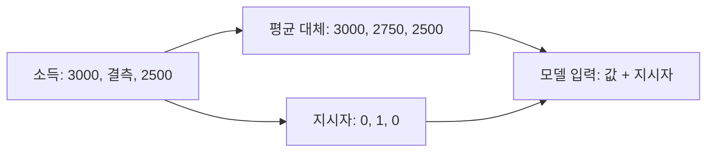
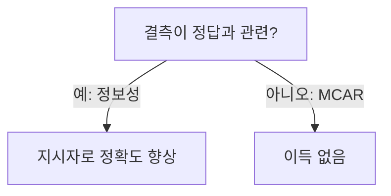

# 결측 표시 특징

> 결측값을 채운(대체한) 뒤에도 "이 값이 원래 비어 있었는가"를 0/1 열로 따로 모델에 입력하는 방식이다. 값이 비었다는 사실 자체가 정답과 관련 있을 때(정보성 결측) 성능을 높일 수 있다.

## 쉽게 말하면
설문에서 소득 칸을 비워 둔 사람이 대출 연체와 관련이 있다면, 소득을 평균으로 채우면 "비워 둔 사람"이라는 중요한 단서가 사라진다. "비워 뒀음" 표시를 같이 남기면 모델이 그 단서를 쓸 수 있다.

## 자세히
(scikit-learn 결측 대체 문서를 직접 열어 확인하고, 직접 실험을 실행.)
- **도구(문서)**
  - **`MissingIndicator`**: 결측 위치를 이진 행렬로 만든다. 기본 `features="missing-only"`는 fit 시 결측이 있던 특징의 열만, `features="all"`은 모든 특징의 열을 반환. 문서의 `-1` 자리표시자 예에서는 결측이 있던 0·1·3번 특징 3열이 나왔다.
  - **`add_indicator=True`**: `SimpleImputer`와 `IterativeImputer`에서 대체 결과 뒤에 지시자 열을 덧붙인다(기본 `False`). 문서의 예: 평균 대체 후 마지막 열이 결측 지시자.
  - 지시자와 대체 결과를 합치려면 `FeatureUnion`이나 `ColumnTransformer`를 쓰는 예가 있다.
- **직접 실험(scikit-learn, 6,000개, 로지스틱 회귀, 40% 시험)**
  | 설정 | 특징 수 | 시험 정확도 |
  |---|---|---|
  | 정보성 결측(양성일 때 결측 50%, 음성일 때 10%) — 평균 대체 | 1 | 0.748 |
  | 같은 설정 — 평균 대체 + 지시자 | 2 | **0.785** |
  | 무작위 결측(MCAR, 30%) — 평균 대체 | 1 | 0.677 |
  | 무작위 결측 — 평균 대체 + 지시자 | 2 | 0.676 |
  결측이 정답과 관련 있을 때 지시자 열이 정확도를 3.7%p 올렸고, 결측이 무작위면 이득이 없었다. 합성 데이터 한 번의 결과이며 크기는 설정에 달렸다.
- **언제 쓰나(제안)**: 예측이 목적이고 결측이 정보성일 가능성이 있을 때(소득·의료 검사 미시행·설문 무응답). 결측이 MNAR에 가까울수록 도움이 된다([MCAR·MAR·MNAR](#mcar-mar-mnar)). 통계적 추정(평균·계수의 편향 없는 추정)이 목적이면 이 방법만으로는 편향을 못 고치므로 [다중 대체](#multiple-imputation)나 민감도 분석이 필요하다.
- **주의(제안)**: ① 학습 때와 서빙 때 결측 패턴이 달라지면 지시자가 오히려 성능을 해칠 수 있다([학습-서빙 편향](#training-serving-skew)) ② 지시자 열은 해석 시 "결측이라서"를 뜻하므로 공정성 점검(특정 집단의 결측률이 높은지)이 필요 ③ 분할 후 학습 세트로만 fit([전처리 누수와 Pipeline](#preprocessing-leakage-pipeline)).
- **대안**: 트리 계열 모델은 NaN을 직접 받는 경우가 많다([NaN 직접 처리 모델](#native-nan-models)). 문서는 HistGradientBoosting·DecisionTree·RandomForest·ExtraTrees 등을 NaN 허용 목록에 둔다.

## 그림으로 보기



## 예시
```python
from sklearn.impute import SimpleImputer
imp = SimpleImputer(strategy="mean", add_indicator=True)
Z = imp.fit_transform(X_train)     # 마지막 열 = 결측 지시자
model.fit(Z, y_train)
model.predict(imp.transform(X_test))
```
- 대출 심사: "소득 미기재" 여부가 연체 위험과 관련 있어 지시자를 입력에 포함(공정성·규제 점검 필요).

## 헷갈리는 것과 비교
| 개념 | 차이 |
|---|---|
| 결측 표시 특징 | 결측 여부를 0/1로 추가 |
| 값 대체 | 빈칸에 값을 채움(결측 흔적 사라짐) |
| [다중 대체](#multiple-imputation) | 불확실성을 반영하는 통계적 방법 |
| 결측 행 삭제 | MCAR이 아니면 편향 |

## 더 읽을거리
- [scikit-learn: Imputation of missing values — Marking imputed values](https://scikit-learn.org/stable/modules/impute.html) — MissingIndicator·add_indicator·NaN 지원 목록(열어 확인).
