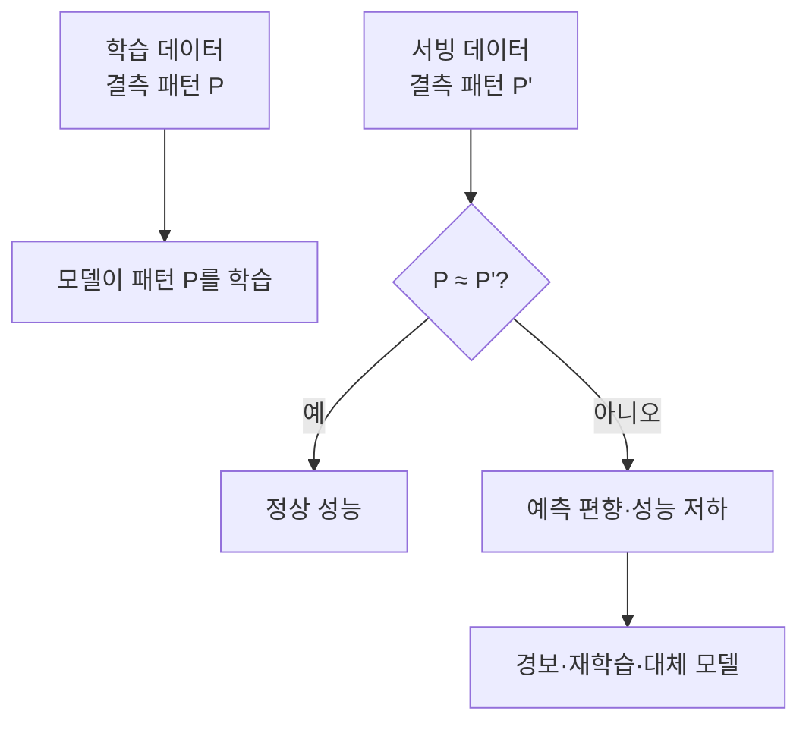
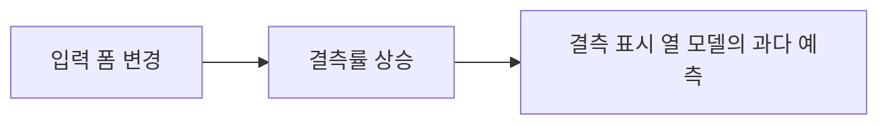

# 결측 패턴 드리프트

> 모델을 학습할 때와 실제로 서비스할 때(서빙)에서 **어떤 값이 얼마나 비는지의 패턴이 달라지는 현상**이다. 특히 결측 표시 열을 쓰는 모델은 학습 때의 결측 패턴에 의존하므로 패턴이 바뀌면 예측이 틀어질 수 있다.

## 쉽게 말하면
설문에서 "소득 칸을 비운 사람은 연체 가능성이 높더라"를 배운 모델이, 어느 날 입력 폼이 바뀌어 모든 사람이 소득 칸을 자주 비우게 되면 갑자기 모두를 위험하다고 판단한다. 단서의 의미가 바뀌었는데 모델은 모르는 것이다.

## 자세히
(TensorFlow Data Validation 시작 문서를 직접 열어 확인하고, 모델 영향은 직접 시뮬레이션.)
- **직접 시뮬레이션(2026-11-22, 로지스틱 회귀를 직접 구현)**: 특징 x1, x2(x2가 비면 0으로 대체). 학습 데이터에서는 **정보성 결측**을 가정: 양성이면 30%, 음성이면 5%만 x2가 빔. 결측 표시 열이 있는 모델의 해당 계수는 2.15로 크게 학습됨(표시 열 없는 모델은 대체값만 사용).
  | 서빙 상황 | 결측률 | 표시 열 없음 정확도 / 양성 예측률 | 표시 열 있음 정확도 / 양성 예측률 | 실제 양성률 |
  |---|---|---|---|---|
  | 학습과 같은 패턴 | 17.4% | 0.737 / 0.509 | **0.775** / 0.496 | 0.502 |
  | 무작위 30% 결측 | 30.0% | 0.728 / 0.518 | **0.689** / 0.586 | 0.501 |
  | 무작위 5% 결측 | 5.1% | 0.747 / 0.513 | 0.737 / 0.455 | 0.499 |
  패턴이 같으면 표시 열이 정확도를 높이지만(0.737→0.775), 결측이 라벨과 무관하게 바뀌면 오히려 표시 열 모델이 나빠지고(0.689) 양성을 과다 예측했다(0.586 vs 실제 0.501). 표시 열 없는 모델은 0.73~0.75로 안정적이다. 한 설정의 합성 실험이다.
- **서빙에서 어떻게 바뀌나(제안)**: 입력 폼·수집 시스템 변경, 센서 고장, 상류 데이터 파이프라인 오류로 필드가 비는 경우, 새 고객군 유입, 개인정보 동의 정책 변경 등.
- **탐지 도구(TFDV 문서)**: 스키마에서 특징의 존재 비율 `presence.min_fraction`(예: 필수 특징 1.0, 50% 이상이라면 0.5)을 설정해 두면 데이터가 스키마와 어긋날 때 이상(anomaly)으로 표시한다. 또한 학습-서빙 **치우침(skew)**과 날짜 간 **드리프트(drift)**를 비교기(comparator)로 검사한다 — 범주형은 L-무한대 거리(문서 예: 임계값 0.01), 숫자·범주형 모두는 젠슨-섀넌 발산 임계값. 문서의 설명이 결측 전용은 아니고 값의 분포 비교다. 결측 여부를 별도 지표로 만들어 비교하는 것은 제안이다. 데이터를 슬라이스(예: 국가별)로 나눠 통계를 계산할 수도 있어 **집단별 결측률** 감시에 쓸 수 있다.
- **운영 점검(제안)**: ① 변수별 결측률을 학습 시점과 서빙에서 일/주 단위로 비교 ② 결측률이 사전 정한 구간(예: 학습 대비 ±5%p)을 벗어나면 경보 ③ 결측 표시 열이 있는 모델은 성능 모니터링을 더 촘촘히 ④ 서빙 시점 결측 패턴이 바뀌었을 때를 대비한 **표시 열 없는 대체 모델**을 준비 ⑤ 재학습 데이터를 최근 패턴으로 갱신 ⑥ 결측이 늘어난 원인(수집 시스템)을 데이터 팀과 확인([결측 표시 특징](#missing-indicator-feature)).

## 그림으로 보기

## 예시
- 신용 평가 모델이 학습 때는 소득 결측 17%였는데 신규 앱에서 선택 입력으로 바뀌어 결측 30%가 되면, 표시 열 모델은 양성(위험) 예측을 과다하게 낸다 → 서빙 결측률 대시보드의 경보로 조기 발견.
- 교육 소재: "AI가 배운 단서의 의미가 바뀌는 순간"을 위 표로 시연(데이터 품질 모니터링 교육).

## 헷갈리는 것과 비교
| 개념 | 차이 |
|---|---|
| 결측 패턴 드리프트 | 결측 분포가 학습·서빙 간 달라짐 |
| [결측 표시 특징](#missing-indicator-feature) | 결측 여부를 입력 열로 쓰는 기법 |
| [결측률의 공정성 점검](#missingness-fairness-check) | 집단 간 결측률 차이 |
| 개념 드리프트 | 입력과 정답의 관계가 바뀜(결측 패턴은 입력 분포 변화) |

## 더 읽을거리
- [TensorFlow Data Validation 시작하기](https://www.tensorflow.org/tfx/data_validation/get_started) — 스키마 존재 비율, 치우침·드리프트 비교기, 슬라이스 통계(직접 확인).
