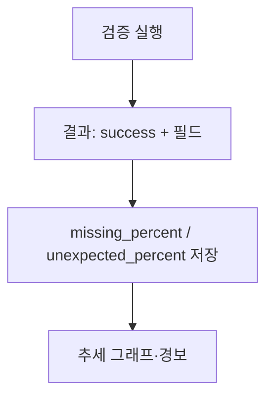
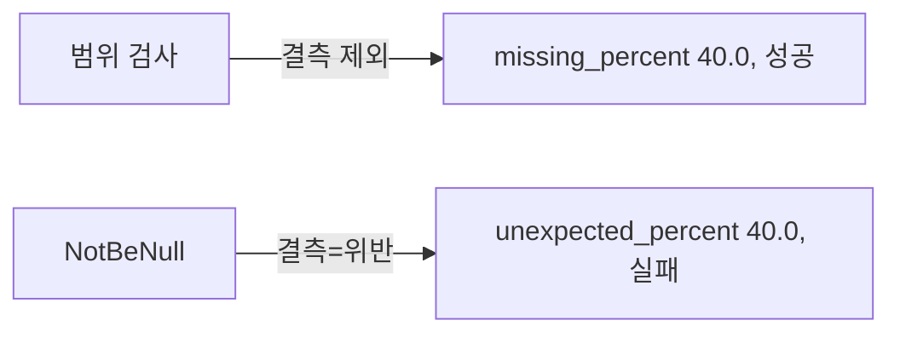

# 결측 비율 모니터링

> 데이터 검증 결과에서 **결측 비율(`missing_percent`)을 합격/불합격과 별도로 숫자로 기록해 추세를 보는 것**이다. 범위 검사 같은 값 기반 검사는 결측을 건너뛰고 통과시키므로, 결측이 늘어도 "성공"으로 나올 수 있다.

## 쉽게 말하면
시험 채점표에 "맞은 개수"만 적고 "답안을 안 쓴 칸 수"는 안 적으면, 백지가 늘어도 점수는 안 떨어지는 것처럼 보인다. 빈 칸 비율을 따로 적어 두어야 문제가 보인다.

## 자세히
(이 세션에서 Python 가상환경에 great_expectations 1.25.0과 pandas를 설치해 **직접 실행한 결과**. 공식 문서 페이지는 열렸지만 본문이 비어 있어 문서로는 확인하지 못했고, 동작은 실행으로 확인했다. 버전이 다르면 결과 필드가 다를 수 있다.)
- **실험 데이터**: `age=[25,41,None,29,None]`(결측 2), `score=[10,20,30,40,500]`, `email`(결측 1) — 각 5행.
- **관찰(실행 결과)**
  | Expectation | 결과 | 보고 필드 |
  |---|---|---|
  | `ExpectColumnValuesToBeBetween(age, 0~120)` | success=**True** | element_count 5, **missing_count 2, missing_percent 40.0**, unexpected 0 |
  | `ExpectColumnValuesToBeBetween(score, 0~100)` | False | missing 0, unexpected_count 1 (20.0%) |
  | `ExpectColumnValuesToNotBeNull(age)` | False | unexpected_count 2 (40.0%) — **missing_* 필드는 None** |
- **핵심**: 범위 검사는 결측을 위반으로 세지 않고 `missing_percent`로만 보고한다. 반면 `ExpectColumnValuesToNotBeNull`은 결측을 **위반(unexpected)**으로 센다(이 버전에서 `missing_*`는 None). 즉 같은 "결측"이 Expectation에 따라 다른 필드에 나타난다.
- **모니터링 방법(제안)**: 매 검증 결과에서 `missing_percent`(범위류)와 `unexpected_percent`(NotBeNull)를 지표 테이블에 저장해 **주간 추세**를 그리고, 평소 대비 급증하면 경보한다. 성공/실패만 저장하지 않는다.
- **임계값 표현**: `mostly`로 허용 비율을 명시할 수 있다 → [필수 컬럼 규칙 조합](#required-column-rules).

## 그림으로 보기

## 예시
- 주문 데이터의 `age`에 범위 검사만 있을 때, 결측이 0%→40%로 늘어도 검증은 계속 성공 — `missing_percent`를 대시보드에 올려 즉시 발견.
- 교육 활동: 5행 표를 직접 만들어 결측을 늘려 가며 두 Expectation의 결과 차이를 표로 정리.

## 헷갈리는 것과 비교
| 개념 | 차이 |
|---|---|
| missing_percent | 값이 비어 있는 행의 비율(범위류 결과) |
| unexpected_percent | 기대를 어긴 행의 비율 |
| [결측과 범위 검사의 차이](#gx-null-vs-range) | 결측이 통과로 처리되는 원리 |
| [필수 컬럼 규칙 조합](#required-column-rules) | 결측 방지 규칙을 같이 두는 설계 |

## 더 읽을거리
- [Great Expectations 문서](https://docs.greatexpectations.io/docs/) — Expectation·검증 결과 개요(이 노드의 수치는 직접 실행 결과이며 문서 본문을 근거로 하지 않음).
