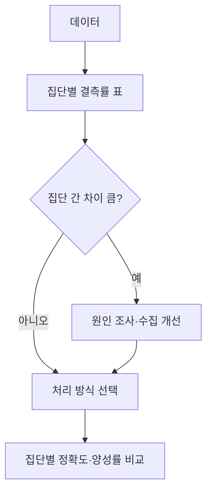
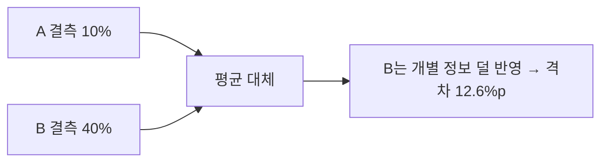

# 결측률의 공정성 점검

> 값이 비어 있는 정도(결측률)가 **집단마다 다르면**, 결측을 처리하는 방식(삭제·평균 대체·결측 표시 열 추가)이 집단별 예측 결과의 격차로 이어질 수 있다. 그래서 결측률을 집단별로 먼저 확인하고, 처리 방식을 바꿀 때 집단별 지표를 같이 본다.

## 쉽게 말하면
설문에서 어떤 집단은 소득 칸을 자주 비우고 다른 집단은 잘 채운다고 하자. 비운 사람을 모두 "평균 소득"으로 취급하면 자주 비우는 집단은 개인 정보를 덜 반영받고 평균적 판정을 받게 된다. 비워 둔 이유가 집단과 관련 있으면 불공정이 슬며시 생긴다.

## 자세히
(Bhatti 등 arXiv 2503.07313 PDF를 직접 읽어 확인하고, 집단별 결측률 효과는 직접 시뮬레이션.)
- **배경(논문)**: 결측이 완전 무작위(MCAR)라고 가정하는 경우가 많지만 현실에서는 결측 경향이 인구통계 특성과 연결되곤 한다. 이 논문은 결측 메커니즘(MCAR·MAR·MNAR) 세 가지로 인위적 결측을 만들고, 결측 처리(삭제·평균/최빈값·회귀·kNN 등)와 분류기별 공정성을 비교했다. 결과: **결측 메커니즘 자체는 공정성에 유의한 영향이 없었고**, 처리 기법 중 **목록 삭제(listwise deletion)가 평균적으로 공정성이 가장 높았으며**, 분류기 중에서는 랜덤 포레스트가 평균적으로 가장 공정했다. 처리 기법과 분류기의 **상호작용은 자주 유의**했다. 이는 벤치마크 3개 데이터셋 기준이라 모든 상황에 일반화하긴 어렵다. 이 논문이 결측 표시 열만 따로 평가했는지는 확인하지 못했다.
- **관련 연구 소개(같은 논문의 문헌 개관)**: 처리 방식만 다른 파이프라인이 집단 간 성능 격차를 다르게 만들 수 있다는 연구, 결측 값에 맞춰 재가중하는 방법이 MNAR 상황에서 공정성 개선 폭이 컸다는 연구 등이 소개된다(직접 원문을 열어 확인하지는 않음).
- **직접 시뮬레이션(2026-11-22, 로지스틱 회귀를 직접 구현)**: 특징 1개 x로 정답 y가 정해지고 두 집단의 x 관계는 같게 두었다. 결측은 평균(0)으로 대체하고 결측 표시 열을 추가.
  | 결측률 설정 | 양성 예측률 A / B | 격차(A−B) | 정확도 A / B |
  |---|---|---|---|
  | 둘 다 0% | 0.393 / 0.402 | −0.009 | 0.726 / 0.743 |
  | 둘 다 25% | 0.302 / 0.304 | −0.003 | 0.676 / 0.729 |
  | A 10%, B 40% | 0.382 / 0.255 | **+0.126** | 0.701 / 0.700 |
  결측률이 같으면 격차가 없지만(결측이 많아져도 두 집단이 똑같이 영향받음) **결측률이 다르면 12.6%p 격차가 생겼다.** 평균 대체된 결측자는 모두 거의 같은 점수를 받아(예: B 결측자 양성 예측률 0.0), 결측이 많은 집단이 개별 정보를 덜 반영받는다. 이번 설정에서는 결측 표시 열을 넣어도 계수가 −0.2로 작아 효과 차이는 거의 없었다 — 즉 문제의 원인은 지시자가 아니라 **집단별 결측률 차이 자체**였다. 합성 데이터의 한 설정이므로 크기는 달라질 수 있다.
- **점검 순서(제안)**: ① 변수별·집단별 결측률 표 ② 집단 간 결측률 차이가 크면 원인 조사(수집 방식, 입력 폼, 접근성) ③ 결측 처리 방식별로 **집단별 정확도·양성 예측률**을 비교(전체 평균만 보지 않기) ④ 결측 표시 열이 집단과 강하게 연관되면 대리 변수 위험 점검([결측 표시 특징](#missing-indicator-feature)) ⑤ 결측 자체를 줄이는 수집 개선이 우선.
- **한계**: 공정성의 정의(예: 양성 예측률 격차, 오류율 격차)에 따라 결론이 달라진다. 이 글의 지표는 양성 예측률 격차와 정확도다.

## 그림으로 보기

## 예시
- (가정 예시) 대출 심사 모델에서 소득 칸 결측률이 청년층 38%, 중장년층 9%인 경우: 결측자에게 같은 점수를 주는 평균 대체 대신 별도 설문 수집·추가 서류 요청 또는 결측 처리별 집단 비교를 먼저 실시.
- 교육 소재: "데이터가 비어 있는 방식이 공정성 문제가 된다"를 위 표로 설명(HR·마케팅 타깃팅 교육에도 적용).

## 헷갈리는 것과 비교
| 개념 | 차이 |
|---|---|
| 결측률의 공정성 점검 | 집단별 결측률·처리 효과를 점검 |
| [결측 표시 특징](#missing-indicator-feature) | 결측 여부를 열로 넣는 기법 |
| [결측 패턴 드리프트](#missing-pattern-drift) | 서빙 시 결측 패턴 변화 |
| 데이터 편향(표본 편향) | 누가 데이터에 들어오는지의 문제(결측은 값이 비는 문제) |

## 더 읽을거리
- [The influence of missing data mechanisms and simple missing data handling techniques on fairness (arXiv 2503.07313)](https://arxiv.org/abs/2503.07313) — 결측 메커니즘·처리 기법·공정성 비교(PDF 직접 확인).
- [Impact of Imputation Strategies on Fairness in Machine Learning (JAIR 2022)](https://www.jair.org/index.php/jair/article/view/13197) — 대체 방식이 공정성에 영향을 준다는 연구(검색 요약만 확인).
