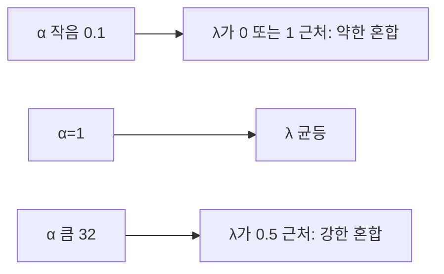
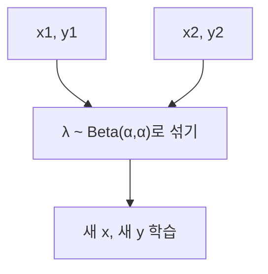

# MixUp의 Beta(α,α) 혼합 비율

> MixUp은 두 학습 예제를 섞는 비율 λ를 **Beta(α,α) 분포에서 뽑고**, 하이퍼파라미터 α가 "얼마나 세게 섞을지"를 정한다. α가 작으면 대부분 한쪽 예제에 가까운 약한 혼합, 크면 반반에 가까운 강한 혼합이다.

## 쉽게 말하면
주스를 섞는 비율을 주사위로 정한다고 하자. α가 작으면 거의 사과주스 100%나 포도주스 100%만 나오고 가끔 섞인다. α가 크면 항상 반반에 가까운 혼합 주스만 나온다.

## 자세히
- 식: λ ~ Beta(α, α), 새 입력 = λ·x₁ + (1−λ)·x₂, 새 라벨 = λ·y₁ + (1−λ)·y₂. α→0이면 섞지 않는 일반 학습(ERM)으로 수렴하고, α=1이면 λ가 0~1 균등분포다(Zhang 외 2017, arXiv 1710.09412 PDF 본문을 직접 읽음).
- 직접 계산(λ 20만 개 표본, numpy 난수): 

| α | 평균 max(λ,1−λ) | 0.4<λ<0.6 비율 | 한쪽이 90% 넘는 비율 |
|---|---|---|---|
| 0.1 | 0.941 | 3.7% | 81% |
| 0.2 | 0.899 | 6.5% | 67% |
| 0.4 | 0.840 | 11.0% | 48% |
| 1 | 0.750 | 20.1% | 20% |
| 2 | 0.687 | 29.8% | 5.7% |
| 8 | 0.598 | 57.4% | 0% |
| 32 | 0.550 | 89.2% | 0% |
- 논문의 권장: ImageNet에서 α∈[0.1, 0.4]가 ERM보다 성능을 높이고 α가 크면 **과소적합**이 생긴다. 용량이 큰 모델·긴 학습에서 이득이 크다(ResNet-101·ResNeXt-101은 90 epoch에서 0.5~0.6%). CIFAR 실험은 α=1로 고정했다.
- 라벨 노이즈 실험: 라벨 일부를 무작위로 바꾼 CIFAR-10에서, 논문은 α를 키우면(가설) 가상 예제가 실제 예제에서 멀어져 암기가 어려워진다고 보고 α∈{1, 2, 8, 32}를 시험했다. 큰 α(8, 32)의 mixup이 같은 조건의 드롭아웃보다 좋은 결과를 냈다고 쓴다.
- 요령(제안): 시작값 α=0.2~0.4, 과소적합 징후(학습 정확도가 안 오름)가 보이면 α를 낮춘다.

## 그림으로 보기

## 예시
- 이미지 분류 학습에서 α=0.2로 시작해 검증 정확도를 비교한다.
- 교육: Beta 분포 모양(U자 → 평평 → 종 모양)을 보여 주며 "섞는 강도 조절 손잡이"로 설명.

## 헷갈리는 것과 비교
| 개념 | 차이 |
|---|---|
| α | Beta 분포 모양을 정하는 값(강도) |
| λ | 매번 뽑히는 실제 혼합 비율 |
| [MixUp·CutMix](#mixup-cutmix) | 전체 방법 |
| 드롭아웃 | 일부 뉴런을 끔, 섞기와 다른 규제 |

## 더 읽을거리
- [mixup: Beyond Empirical Risk Minimization (arXiv 1710.09412)](https://arxiv.org/abs/1710.09412) — α 권장 범위와 실험(PDF 본문 읽음).
