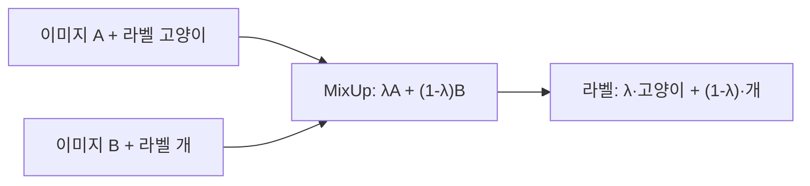
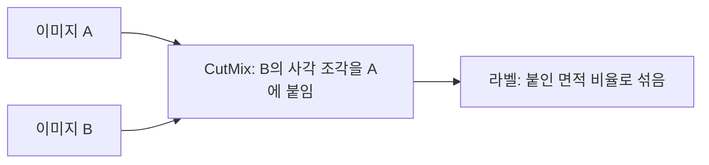

# MixUp·CutMix

> 학습 배치에서 두 샘플을 섞어 새 학습 샘플을 만드는 이미지 증강이다. MixUp은 두 이미지를 픽셀 단위로 가중 평균하고, CutMix는 한 이미지의 사각형 조각을 다른 이미지에 오려 붙이며, 둘 다 정답 라벨도 같은 비율로 섞는다.

## 쉽게 말하면
고양이 사진과 개 사진을 반투명 필름처럼 겹쳐 놓고 "이 그림은 고양이 70%, 개 30%"라고 가르치는 것이 MixUp이다. CutMix는 고양이 사진 한쪽 귀퉁이를 개 사진 조각으로 덮어 놓고 "개 조각이 차지한 넓이만큼 개"라고 가르친다.

## 자세히
(arXiv 초록 2건을 직접 열어 확인하고, 계산 부분은 numpy로 직접 실행.)
- **MixUp(Zhang 등, arXiv 1710.09412)**: 두 샘플과 두 라벨의 **볼록 결합(convex combination)** 으로 학습한다. x̃ = λ·xᵢ + (1−λ)·xⱼ, ỹ = λ·yᵢ + (1−λ)·yⱼ(λ는 보통 Beta(α, α)에서 뽑는다 — 수식은 일반 알려진 형태이며 초록에는 없음). 초록: 샘플 사이에서 선형에 가깝게 행동하도록 정규화하고, ImageNet-2012·CIFAR-10·CIFAR-100·Google Commands·UCI 데이터에서 일반화를 개선하며, **오염된 라벨의 암기를 줄이고** 적대적 예시 견고성을 높이고 GAN 학습을 안정화한다.
- **CutMix(Yun 등, arXiv 1905.04899)**: 학습 이미지 사이에 패치를 오려 붙이고 **라벨을 패치 넓이에 비례해 섞는다.** 기존 영역 드롭아웃은 패치를 검은 픽셀이나 노이즈로 지워 정보가 손실되지만 CutMix는 다른 이미지의 실제 픽셀로 채운다. 초록: CIFAR·ImageNet 분류에서 당시 최고 증강 기법들을 일관되게 앞서고, ImageNet 약지도 위치 찾기, Pascal 탐지·MS-COCO 캡셔닝으로의 전이, 입력 손상 견고성, 분포 밖 탐지도 개선(구체 수치는 초록에 없음).
- **직접 실행(numpy)**: MixUp에서 λ=0.987(Beta(0.2,0.2) 표본)이면 라벨이 [0.987, 0.013]. CutMix에서 λ=0.713이면 오려 붙인 면적 비가 의도(0.287)와 달리 경계 잘림으로 0.178이 되어, 라벨은 면적 기준으로 보정한 λ=0.822를 써야 한다 — **경계에서 잘린 만큼 라벨 비율을 다시 계산**해야 한다.
- 소프트 라벨(섞인 라벨)을 쓰므로 손실이 교차 엔트로피(소프트 타깃)여야 한다(제안).
- **주의(제안)**: 텍스트·표 데이터에는 직접 적용이 어렵다. 라벨이 바뀌면 안 되는 과제(예: 정확한 위치 회귀)에는 부적합. [라벨 보존 변환](#label-preserving-transform) 원칙과 달리 라벨을 일부러 섞는다는 점이 차이.
- 분할 규칙: 증강은 학습 세트에만 적용([증강본 그룹 누수](#augmentation-group-leak)).

## 그림으로 보기



## 예시
```python
import numpy as np
lam = np.random.beta(0.2, 0.2)
x = lam * x1 + (1 - lam) * x2          # MixUp
y = lam * y1 + (1 - lam) * y2          # 소프트 라벨
```
- 제조 불량 사진 분류에서 소량 데이터로 과적합될 때 정규화 수단으로 쓴다. 학습 세트에만 적용.

## 헷갈리는 것과 비교
| 개념 | 차이 |
|---|---|
| MixUp | 픽셀 가중 평균, 이미지가 전체적으로 흐려짐 |
| CutMix | 사각 조각 교체, 국소 질감 유지 |
| Cutout | 조각을 검은색으로 지움(정보 손실) |
| [RandAugment·AutoAugment](#randaugment-autoaugment) | 변환 정책을 무작위·학습으로 정함(라벨 유지) |

## 더 읽을거리
- [mixup: Beyond Empirical Risk Minimization (arXiv 1710.09412)](https://arxiv.org/abs/1710.09412) — 볼록 결합·견고성(초록 확인).
- [CutMix (arXiv 1905.04899)](https://arxiv.org/abs/1905.04899) — 패치 교체와 라벨 면적 혼합(초록 확인).
