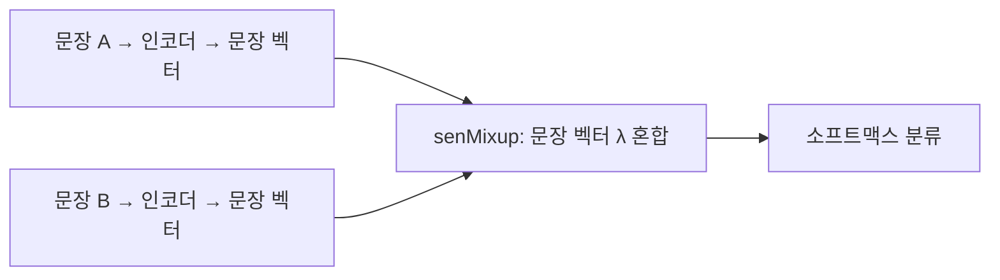

# 텍스트에서의 혼합 증강

> 문장은 이미지처럼 픽셀을 섞을 수 없으므로, **단어 임베딩 행렬이나 문장 임베딩 벡터를 섞고 라벨도 같은 비율로 섞는** 방식으로 MixUp을 텍스트에 옮긴다. Guo 외(2019)는 wordMixup과 senMixup 두 가지를 제안했다.

## 쉽게 말하면
"이 영화 최고예요"와 "정말 별로였어요"라는 두 문장을 글자로 섞을 수는 없다. 대신 두 문장의 "뜻 좌표"를 70:30으로 섞은 가상의 문장을 만들고, 정답도 "긍정 70%, 부정 30%"로 섞어서 학습한다.

## 자세히
(Guo, Mao, Zhang 2019, arXiv 1905.08941 PDF 본문을 직접 읽음)
- **wordMixup**: 모든 문장을 같은 길이로 패딩하고, 각 문장을 임베딩 행렬 B∈R^{N×d}로 만든 뒤 **단어 위치마다** B̃_t = λ·B^i_t + (1−λ)·B^j_t로 섞는다. 라벨도 ỹ = λy^i + (1−λ)y^j(원-핫 혼합). 섞인 (B̃, ỹ)로 학습한다.
- **senMixup**: 문장을 CNN/LSTM 인코더 f로 먼저 문장 임베딩 f(B)로 만든 뒤, 소프트맥스 직전의 **문장 벡터를 차원별로** 섞는다(라벨도 동일). 
- λ는 Beta(α,α)에서 뽑고(실험은 α=1 기본값), 원 MixUp처럼 드롭아웃·L2 제약을 쓰지 않았다([MixUp α](#mixup-beta-alpha)).
- 직접 계산(작은 예): 임베딩 행렬 3단어×2차원 두 개를 λ=0.7로 섞으면 단어마다 0.7·A+0.3·B 값이 나온다(예: [[0.7,0.3],[0.3,1],[0.3,0]]). 섞인 결과는 실제 단어에 대응되지 않는 가상 점이라 사람이 읽을 수 없다.
- 결과(논문): CNN과 LSTM 인코더, 5개 데이터셋(SST-1, SST-2, Subj, MR, Trec 등)에서 대체로 정확도가 개선됐다. 임베딩을 무작위로 시작해 학습하는 설정에서 SST-1·MR은 상대 3.3% 넘게 개선, LSTM에서는 Trec 4.62%·SST-1 5.22% 상대 개선. SST-2에서는 의미 있는 개선이 없었고(senMixup만 0.7%), 두 방법의 우열은 데이터셋마다 달랐다.
- 한계: 섞인 표본이 실제 문장이 아니라서 사람이 라벨 정당성을 검수하기 어렵다. 이 연구는 2019년의 CNN/LSTM 분류기 기준이며, 요즘 트랜스포머 기반 모델에서의 효과는 별도 검증이 필요하다(주장/제안).

## 그림으로 보기

## 예시
- 라벨이 적은 문의 분류(예: 5클래스)에서 wordMixup으로 학습 표본을 임베딩 공간에서 늘려 보고, 검증 정확도를 비교한다.
- 교육: 텍스트를 직접 섞을 수 없을 때 "표현(임베딩)을 섞는다"는 아이디어.

## 헷갈리는 것과 비교
| 개념 | 차이 |
|---|---|
| wordMixup | 단어 임베딩 행렬을 섞음(인코더 입력) |
| senMixup | 문장 임베딩 벡터를 섞음(인코더 출력) |
| [이미지 MixUp·CutMix](#mixup-cutmix) | 픽셀을 섞음 |
| [역번역](#back-translation) | 실제 문장(패러프레이즈)을 만드는 텍스트 증강 |

## 더 읽을거리
- [Augmenting Data with Mixup for Sentence Classification (arXiv 1905.08941)](https://arxiv.org/abs/1905.08941) — wordMixup·senMixup 식과 실험(PDF 본문 읽음).
