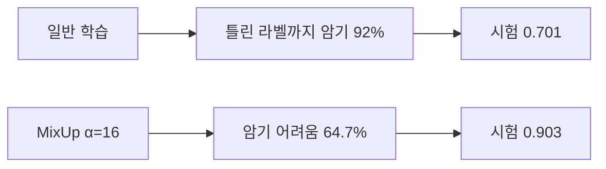
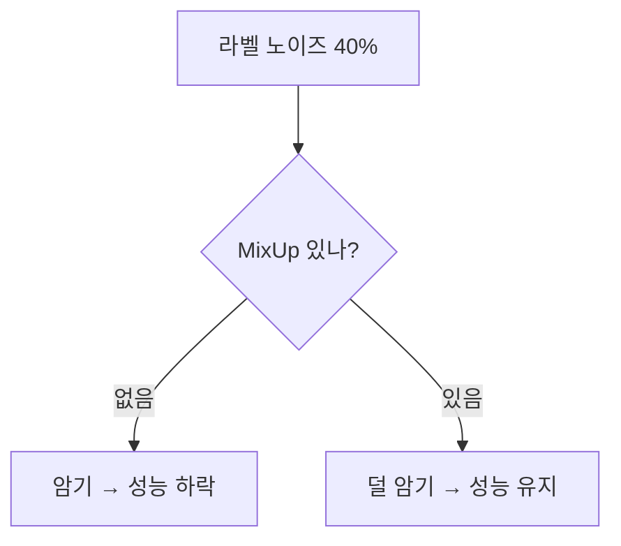

# MixUp과 라벨 노이즈

> 학습 데이터의 정답표가 일부 틀렸을 때, 일반 학습은 틀린 라벨까지 외워 버려 성능이 크게 떨어진다. MixUp은 두 예제와 라벨을 섞어 **틀린 라벨을 그대로 외우기 어렵게** 만들어 이 문제를 줄인다.

## 쉽게 말하면
교재의 정답이 일부 잘못 인쇄돼 있을 때, 학생이 문제와 답을 통째로 외우면 틀린 답까지 외운다. 문제를 반씩 섞어 풀게 하면 통째로 외울 수 없어서 틀린 답에 덜 끌려간다.

## 자세히
- **주장**(Zhang 외 2017 mixup 초록 확인): mixup은 훈련 예제 쌍과 라벨의 가중 평균으로 학습해 예제 사이에서 선형에 가까운 행동을 유도하며, 장점으로 **손상된 라벨의 암기 감소**를 든다.
- **직접 실행**(scikit-learn digits 1,797장, 학습 60%·시험 40%, 학습 라벨의 **40%를 무작위 숫자로 교체**(실제로 틀린 라벨은 약 36%), MLP 128, Adam 60 에폭, 3 시드 평균):

| α | 학습 라벨(노이즈 포함) 맞춤 | **진짜 라벨** 기준 학습 정확도 | 깨끗한 시험 정확도 |
|---|---|---|---|
| 0(MixUp 없음) | **0.920** | 0.696 | **0.701** |
| 0.2 | 0.834 | 0.777 | 0.780 |
| 1 | 0.715 | 0.887 | 0.862 |
| 4 | 0.659 | 0.934 | 0.897 |
| 16 | 0.647 | 0.942 | **0.903** |

- 해석: 일반 학습은 **틀린 라벨을 92%나 맞히도록 외워** 버렸고(진짜 라벨 기준으로는 0.696) 시험도 0.701에 그쳤다. α를 키울수록 노이즈 라벨 맞춤(0.920→0.647)은 줄지만 진짜 라벨 정확도와 시험 정확도는 **0.70→0.90**으로 올랐다. 노이즈가 없던 앞선 실험([MixUp 과소적합](#underfitting-from-mixup))에서는 큰 α가 오히려 손해였는데, 라벨 노이즈가 있으면 **큰 α가 이득**이 된다. 최적 α는 노이즈 정도에 따라 달라진다.
- **가설과 한계**: "암기하기 어렵게 만든다"는 해석은 저자의 설명이고, 이 실험은 현상(노이즈 라벨 맞춤 감소, 시험 개선)만 보였다. 작은 장난감 문제·MLP·무작위 노이즈(체계적 노이즈는 다를 수 있음)·3 시드 평균이다.
- **실무 함의(제안)**: 라벨 품질이 낮은 데이터(크라우드 라벨링, 자동 라벨)에서는 MixUp 같은 정칙화가 도움이 될 수 있다. 근본 처방은 라벨 정제([라벨 오류 탐지](#label-error-detection))이고 MixUp은 보완책이다.

## 그림으로 보기

## 예시
- 크라우드 라벨링 데이터에 오류가 의심될 때 α를 0.2→1→4로 올려 깨끗한 검증셋 정확도를 비교.
- 교육: 라벨을 일부러 깨뜨리고 MixUp 유무를 비교하는 30줄 실습.

## 헷갈리는 것과 비교
| 개념 | 차이 |
|---|---|
| 라벨 노이즈 | 정답표가 일부 틀림 |
| 암기(memorization) | 일반화 대신 특정 예제를 외움 |
| [MixUp 과소적합](#underfitting-from-mixup) | 노이즈 없을 때 큰 α의 부작용 |
| 라벨 정제 | 틀린 라벨을 찾아 고침. 근본 처방 |

## 더 읽을거리
- [mixup: Beyond Empirical Risk Minimization](https://arxiv.org/abs/1710.09412) — 손상 라벨 암기 감소 주장(초록 확인).
- [scikit-learn digits 데이터셋](https://scikit-learn.org/stable/datasets/toy_dataset.html) — 실험 데이터(열어 확인).
