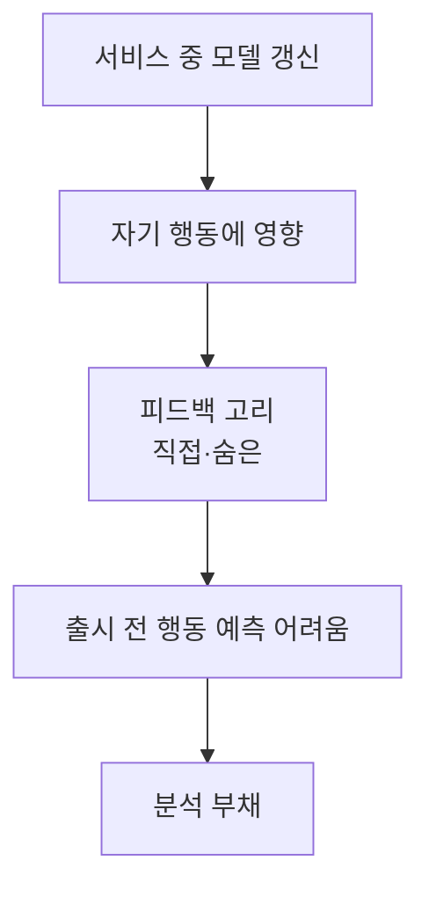
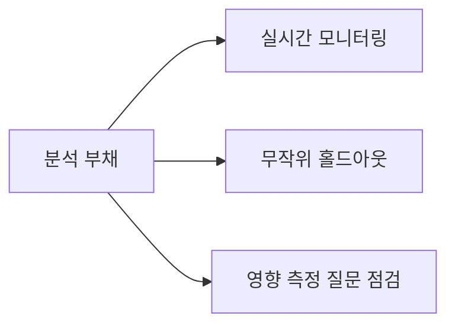

# ML 분석 부채

> 실제 서비스 중인 ML 모델이 갱신되며 **자기 행동에 영향을 주기 때문에, 출시 전에는 그 모델이 나중에 어떻게 행동할지 예측하기 어려워지는** 기술 부채다(Sculley 외 2015가 쓴 표현).

## 쉽게 말하면
시험 문제를 출제하는 사람이 학생들 반응에 따라 다음 문제를 바꾼다고 해 보자. 첫날 만든 시험 계획만 봐서는 일주일 뒤 시험이 어떻게 될지 알 수 없다. 출시 전 테스트로는 출시 후의 모습을 확신할 수 없는 상태가 분석 부채다.

## 자세히
(Sculley 외, "Hidden Technical Debt in Machine Learning Systems", NIPS 2015를 PDF에서 직접 읽었다.)
- **정의 위치**: 4절 Feedback Loops 첫머리 — 라이브 ML 시스템은 시간이 지나 갱신되면 자기 행동에 영향을 주어 "분석 부채"가 생기며, 변화가 서서히 쌓일수록(예: 모델을 드물게 갱신) 발견·처리가 더 어렵다. 원인이 되는 두 형태가 [직접 피드백 고리](#direct-feedback-loop)와 [숨은 피드백 고리](#hidden-feedback-loop)다.
- **상위 개념: ML 기술 부채**: 기술 부채는 Ward Cunningham이 1992년 소개한 비유로, 빨리 만든 대가로 장기 유지비가 늘어난다는 뜻이다. 논문은 ML 시스템이 일반 코드의 유지 문제에 더해 ML 특유의 문제를 갖고 시스템 수준에서 생겨 감지하기 어렵다고 주장한다. 숨은 부채는 조용히 복리로 불어난다.
- **관련 부채들(논문 목록)**: 경계 침식·얽힘(CACE: Changing Anything Changes Everything), 데이터 의존성, 설정(configuration) 부채, 추상화 부채, 데이터 테스트 부채, 재현성 부채, 프로세스 관리 부채, 문화 부채 등.
- **감시 방법(7절)**: 단위·종단 테스트만으로는 변하는 세상에서 충분하지 않아 **실시간 모니터링과 자동 대응**이 중요하다. 시작점으로 예측 편향(예측 라벨 분포 = 관측 라벨 분포인지, 차원별로 쪼개 보기) 등을 제시한다.
- **부채 측정 질문(결론, 직접 인용 아닌 요약)**: 완전히 새 알고리즘을 전체 규모로 시험하기 쉬운가, 데이터 의존성의 전이적 폐포는 무엇인가, 변경의 영향을 얼마나 정확히 측정할 수 있나, 한 모델 개선이 다른 모델을 악화시키지 않나, 새 팀원이 얼마나 빨리 적응하나. 기술 부채는 시간에 따라 추적할 엄밀한 지표가 없다고 인정한다.
- **한계**: 2015년 논문이라 LLM·에이전트 시대의 구체 사례는 없다. 그러나 피드백 고리·분석 곤란이라는 원리는 유효해 보인다(해석).

## 그림으로 보기

## 예시
- 추천 모델을 주 1회 갱신하면서 다양성 지표가 몇 달에 걸쳐 서서히 떨어지는데, 한 번의 출시 테스트에서는 이상이 없던 경우.
- 교육 소재: "AI도 정비 안 하면 서서히 이상해진다"를 자동차 정기 점검에 빗대어.

## 헷갈리는 것과 비교
| 개념 | 차이 |
|---|---|
| ML 분석 부채 | 출시 전 행동 예측이 어려운 부채 |
| [직접 피드백 고리](#direct-feedback-loop) | 분석 부채를 만드는 한 원인 |
| [숨은 피드백 고리](#hidden-feedback-loop) | 또 다른 원인(시스템 간 간접 영향) |
| 일반 코드 기술 부채 | 코드 수준, 리팩터링으로 상환 가능 |

## 더 읽을거리
- [Hidden Technical Debt in Machine Learning Systems (NIPS 2015)](https://proceedings.neurips.cc/paper/2015/file/86df7dcfd896fcaf2674f757a2463eba-Paper.pdf) — 분석 부채 정의와 모니터링 제안(직접 읽음).
