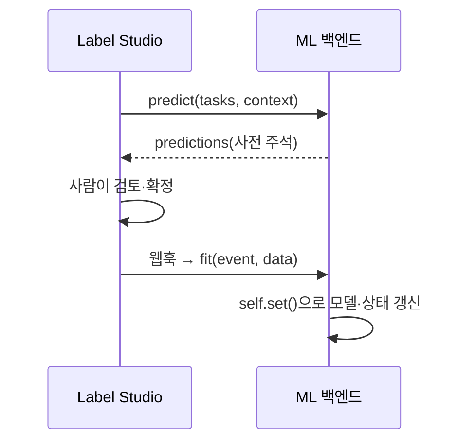
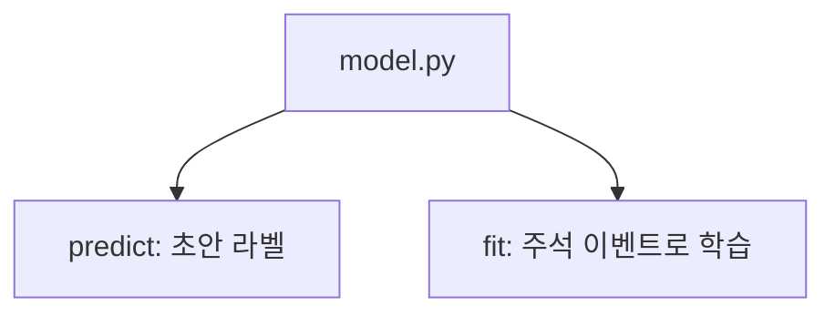

# predict·fit 구현

> Label Studio ML 백엔드는 `model.py`에서 `LabelStudioMLBase`를 상속해 `predict()`(사전 예측)와 `fit()`(주석 이벤트에 따른 학습)를 구현한다.

## 쉽게 말하면
라벨링 도구에 "조수 모델"을 붙이는 방법이다. 작업(task)이 들어오면 조수가 초안 라벨(`predict`)을 달고, 사람이 라벨을 확정하면 조수가 그 사실을 보고 스스로 공부한다(`fit`).

## 자세히
(Label Studio 문서 ml_create와 label-studio-ml-backend 저장소를 직접 열어 확인. 2026-11-21 기준.)
- **구조**: `model.py`의 클래스가 `LabelStudioMLBase`를 상속. 사용 가능한 멤버: `self.label_interface`(라벨링 설정), `self.model_version`.
- **`predict(self, tasks, context, **kwargs)`**: `tasks`는 작업 JSON 목록, 반환은 Label Studio predictions 형식. 일반 예측에서 `context`는 비어 있고, **대화형(interactive)** 요청에서는 `annotation_id`, `draft_id`, `user_id`, `result`가 채워진다(예: Alt+클릭의 음성 키포인트). 예측은 연결 후 **사전 주석(pre-annotation)**으로 보인다.
- **`fit(self, event, data, **kwargs)`**: `event`(예: `ANNOTATION_CREATED`/`UPDATED`)와 웹훅 `data`를 받는다. LS 1.4.1부터 ML 백엔드를 추가하면 주석 생성·수정 시 **웹훅이 자동 생성**된다. 기본 payload에는 주석 본문이 빠지므로 웹훅을 수정하거나 API/SDK로 가져와야 한다. 상태는 `self.set(k, v)`/`self.get(k)`로 저장하며 `predict`에서도 쓸 수 있다.
- **환경 변수**: `LABEL_STUDIO_URL`, `LABEL_STUDIO_API_KEY`(미디어·클라우드·로컬 데이터 접근).
- **실행**: `docker-compose up` → `http://localhost:9090`, 또는 `label-studio-ml start my_ml_backend -p 9091 --host 0.0.0.0`.
- 문서 페이지에는 골격 코드만 있고 predictions JSON 세부 스키마는 이번에 확인하지 못했다(저장소 예제 참고).

## 그림으로 보기

## 예시
- 텍스트 분류 프로젝트: `predict`가 확률 상위 라벨을 초안으로 제시, 라벨러는 수정·승인만.
- 교육 활용: 사람-AI 협업 라벨링의 구조를 보여 주는 시연.

## 헷갈리는 것과 비교
| 개념 | 차이 |
|---|---|
| predict | 입력 → 예측 반환 |
| fit | 주석 이벤트 → 모델 학습·갱신 |
| [사전 라벨 자동화 편향](#automation-bias-prelabel) | 초안을 그대로 승인하는 위험 |

## 더 읽을거리
- [Label Studio: ML 백엔드 만들기](https://labelstud.io/guide/ml_create) — predict·fit 개요.
- [label-studio-ml-backend (GitHub)](https://github.com/HumanSignal/label-studio-ml-backend) — 예제와 실행 방법.
