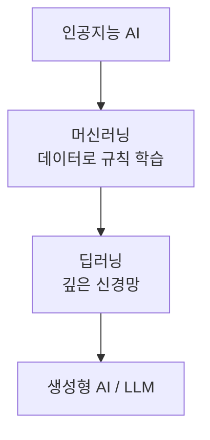
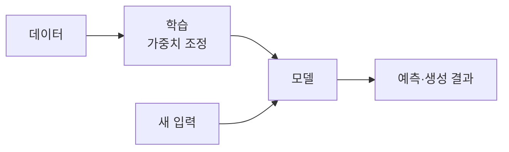

# 머신러닝·딥러닝 기초

> 머신러닝(ML)은 사람이 규칙을 일일이 쓰는 대신, 데이터에서 규칙(모델)을 스스로 찾아내게 하는 방법이다. 딥러닝은 층이 깊은 신경망을 쓰는 머신러닝이다.

## 쉽게 말하면
스팸 메일을 거르는 두 방법이 있다. ① "'무료'라는 단어가 있으면 스팸"처럼 규칙을 직접 쓴다. ② 스팸·정상 메일 수만 통을 보여 주고 차이를 스스로 찾게 한다. ②가 머신러닝이다. 규칙이 너무 복잡해 사람이 못 쓰는 문제(이미지 인식, 언어 이해)에서 ②가 압도적으로 강하다.

## 자세히
- **모델**: 데이터에서 관계를 배워 예측·생성을 하는 프로그램(Google 머신러닝 입문 기준). 사람이 정한 규칙이 아니라 학습된 **가중치(숫자 다발)** 로 동작한다.
- **포함 관계**: AI ⊃ 머신러닝 ⊃ 딥러닝. 딥러닝의 "deep"은 신경망의 층 수가 깊다는 뜻이다(IBM). 딥러닝은 원본 데이터(픽셀·글자)에서 특징을 자동으로 뽑지만 데이터가 많이 필요하다. → [AI·ML·DL의 관계](#ai-ml-dl-relation)
- **학습 방식 세 갈래** → [지도·비지도·강화학습](#supervised-unsupervised)
  - 지도: 정답이 붙은 데이터. 분류(스팸 여부)와 회귀(전력 사용량 예측).
  - 비지도: 정답 없이 군집 등 패턴 찾기.
  - 강화: 환경에서 행동하고 보상을 받으며 정책을 익힘(게임·로봇).
- **생성형 AI**는 대개 정답 없는 대량 데이터로 사전학습한 뒤 지도·강화학습으로 다듬는다 → [LLM과 생성형 AI](#llm-basics).
- 기초 개념: [신경망](#neural-network-basics), [과적합](#overfitting), [학습과 추론](#training-inference).

## 그림으로 보기

## 예시
- 분류: 고객 문의를 "환불/배송/기타"로 자동 분류.
- 회귀: 과거 매출로 다음 달 매출 예측.
- 군집: 수강생 학습 패턴을 비슷한 유형끼리 묶기.
- 강화: 바둑 AI가 스스로 대국하며 실력 향상.

## 헷갈리는 것과 비교
| 개념 | 차이 |
| --- | --- |
| 전통 프로그래밍 | 사람이 규칙 작성 → 데이터 처리 |
| 머신러닝 | 데이터(와 정답)로 규칙을 학습 |
| 딥러닝 | 머신러닝 중 깊은 신경망 사용 |
| [LLM](#llm-basics) | 딥러닝으로 만든 언어 모델 |

## 더 읽을거리
- [Google ML Crash Course: What is ML?](https://developers.google.com/machine-learning/intro-to-ml/what-is-ml) — 모델·지도/비지도/강화 정의
- [IBM: AI vs ML vs Deep Learning vs Neural Networks](https://www.ibm.com/think/topics/ai-vs-machine-learning-vs-deep-learning-vs-neural-networks) — 포함 관계 설명
