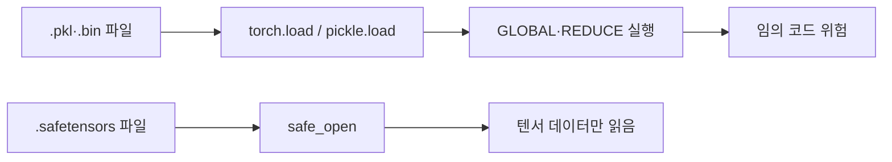

# 모델 파일 안전(pkl·safetensors)

> 모델 가중치 파일 중 pickle 기반(.pkl, PyTorch의 .bin·.pt)은 여는 순간 코드가 실행될 수 있고, safetensors는 텐서 데이터만 담아 이 위험을 피하도록 만든 형식이다.

## 쉽게 말하면
택배 상자를 열었더니 물건 대신 "열면 자동으로 작동하는 장치"가 들어 있는 경우와, 투명 상자에 물건만 담겨 와서 내용이 다 보이는 경우의 차이다. pickle은 앞쪽, safetensors는 뒤쪽이다.

## 자세히
Hugging Face 문서 기준:
- pickle은 ML에서 널리 쓰이고 **PyTorch 가중치의 기본 형식**이다. 로드 시 임의 코드 실행 공격이 가능하다.
- 원리: pickle은 opcode 스택이다. `GLOBAL`/`STACK_GLOBAL`이 모듈을 import하고 `REDUCE`가 호출한다. `exec`·`eval` 같은 내장 함수를 지명하면 임의 코드가 실행된다. (fickling 라이브러리로 악성 pickle을 만드는 시연이 문서에 있다.)
- Hub의 보안 스캐너: 올라온 파일에 ClamAV 검사와 **Pickle Import 스캔**(`pickletools.genops`로 코드를 실행하지 않고 import 목록 추출)을 돌려 의심 import를 표시한다. 문서는 "100% 완벽하지 않다"고 명시한다.
- 완화책: 신뢰하는 사용자·조직 것만 받기, 서명된 커밋 확인(출처 보증일 뿐 안전 보증은 아님), TF·Flax 체크포인트 변환(`from_tf`, `from_flax`), 다른 직렬화 형식 사용.
- **safetensors**: 텐서만 저장하는 단순한 형식으로, 안전하면서도 zero-copy라 빠르고 일부 텐서만 읽을 수도 있다. transformers·diffusers·ComfyUI·llama.cpp 등에서 쓴다. 코드를 담을 수 없으므로 로드가 곧 실행이 되지 않는다.
- 주의: 가중치가 안전해도 모델 저장소의 `trust_remote_code=True` 같은 설정은 별개로 코드를 실행한다.

## 그림으로 보기


## 예시
```python
from safetensors.torch import save_file
from safetensors import safe_open
save_file({"w": tensor}, "model.safetensors")
with safe_open("model.safetensors", framework="pt") as f:
    w = f.get_tensor("w")
```
출처 불명의 .pt 파일은 로드 전에 `pickletools.dis`로 import 목록부터 본다.

## 헷갈리는 것과 비교
| 개념 | 차이 |
| --- | --- |
| [pickle](#pickle-security) | 코드 실행 가능, 파이썬 전용 |
| safetensors | 텐서만, 빠르고 안전 지향 |
| [msgpack·JSON](#msgpack-vs-json) | 범용 데이터 형식, 텐서용은 아님 |

## 더 읽을거리
- [Hugging Face: Pickle Scanning](https://huggingface.co/docs/hub/security-pickle) — 공격 원리, 스캐너, 완화책
- [safetensors 문서](https://huggingface.co/docs/safetensors/index) — 사용법과 채택 프로젝트
