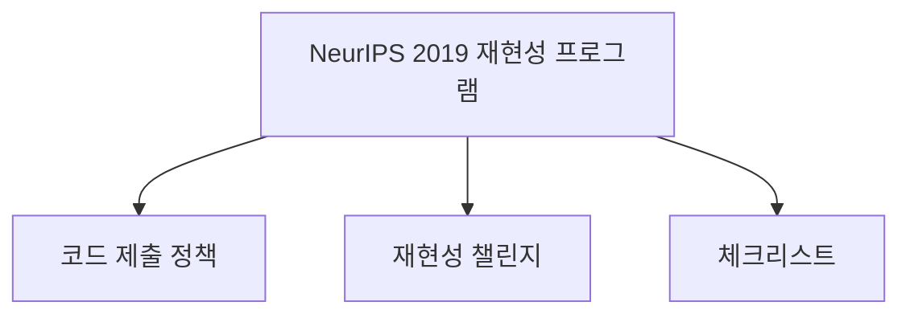

# ML 재현성 체크리스트

> 논문 제출 때 저자가 "수학적 설정 설명, 실험 방법 기술, 오차 막대, 코드" 같은 항목에 예·아니오·해당 없음으로 답하게 하는 점검표다. NeurIPS 2019 재현성 프로그램의 일부로 도입되었다(Pineau 외).

## 쉽게 말하면
비행 전 점검표(체크리스트)처럼, 빠뜨리기 쉬운 항목을 문항으로 만들어 두고 하나씩 확인하게 하는 도구다. 실험 보고서의 누락을 줄여 준다.

## 자세히
(Pineau 외 "Improving Reproducibility in Machine Learning Research" arXiv 2003.12206 전문을 직접 읽고 확인.)
- **프로그램 구성**: NeurIPS 2019는 ① **코드 제출 정책** ② 커뮤니티 전체 **재현성 챌린지** ③ **ML 재현성 체크리스트**를 논문 제출 과정에 포함했다. 코드 제출은 의무가 아니었다(정책은 카메라 레디 마감까지 권장).
- **체크리스트 운영**: 버전 1.2를 심사 과정에 적용, 저자는 **초기 제출(2019.5)과 카메라 레디(2019.10)** 두 번 답했다. CMT 플랫폼에서 각 문항에 "예/아니오/해당 없음"과 선택 의견란.
- **응답 결과**: 제출 논문의 **97%**가 "수학적 설정·알고리즘·모델의 명확한 설명"을 포함한다고 답했고, **89%**가 "실험을 어떻게 수행했는지 설명"에 "예"(이론 주제 논문 9%와 일관). "측정치·통계의 명확한 정의"에는 87%가 가치를 두면서도 **36%가 오차 막대는 해당 없음**이라고 답해 의문을 남겼다.
- **효과 단서**: "예" 응답이 더 높은 채택률과 연관되었으나 주제·심사자 기대 같은 교란이 배제되지 않았다. 심사자의 **34%**가 체크리스트 답변이 유용했다고 응답했고 유용하다고 한 심사자는 점수가 더 높았다. 한편 인과 효과는 후속 과제로 남겼다.
- **구성 항목 예(논문 문항)**: 수학적 설정 설명, 실험 수행 방법, 측정·통계 정의, 오차 막대, 중심 경향·변동(평균·표준편차) 기술.
- **실무 적용(제안)**: 사내 실험 보고 템플릿에 시드·반복 횟수·오차·환경([환경 고정](#environment-pinning))·데이터 버전·코드 링크 항목을 포함.

## 그림으로 보기

## 예시
- 사내 모델 보고서에 "여러 시드의 평균±표준편차, 데이터 버전, 환경 파일"을 필수 항목으로 둠.
- 교육 활용: 체크리스트 항목마다 "이 항목이 없으면 어떤 문제가 생기나" 토론.

## 헷갈리는 것과 비교
| 개념 | 차이 |
|---|---|
| 재현성 체크리스트 | 보고 항목 점검표 |
| 코드 공개 | 하나의 항목(의무는 아님) |
| [시드 기록](#random-seed-protocol) | 체크리스트 항목의 한 예 |

## 더 읽을거리
- [Improving Reproducibility in Machine Learning Research (arXiv 2003.12206)](https://arxiv.org/abs/2003.12206) — NeurIPS 2019 보고서.
