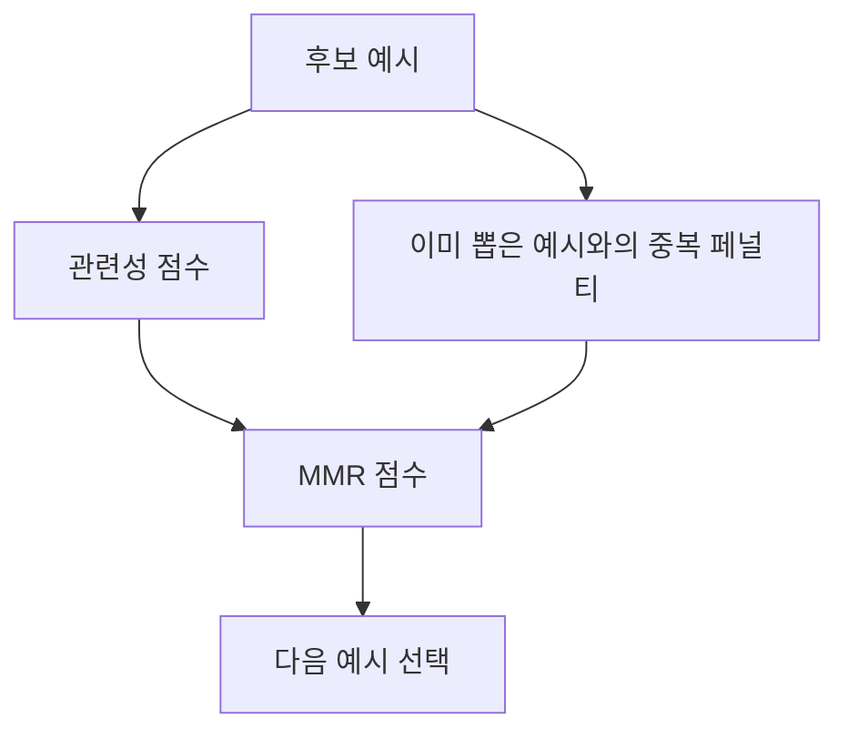

# MMR 다양성 선택

> few-shot 예시를 **관련성과 상호 보완성(서로 다른 요령)을 함께 고려해** 고르는 방식(maximal marginal relevance)이다. 비슷한 예시만 쌓이는 것을 막는다.

## 쉽게 말하면
신입에게 사례를 줄 때 같은 유형 5개를 주지 않고, 서로 다른 요령이 드러나는 사례를 섞어 주는 것이다.

## 자세히
(Ye 외, "Complementary Explanations for Effective In-Context Learning"(ACL Findings 2023, arXiv 2211.13892) **초록 페이지만** 읽었다. 본문의 수치·λ 설정은 읽지 못했다.)
- **연구(초록)**: 세 통제 과제에서 프롬프트의 설명을 변형해 보고, **계산 흔적(풀이 분해)**과 **자연어 표현**이 모두 효과에 기여함을 발견했다.
- **방법(초록)**: 이를 바탕으로 MMR에 기반한 선택 방식을 제안해, **관련 있으면서 서로 보완적인(다양한 추론 기술을 보여 주는)** 예시를 고른다.
- **결과(초록)**: 3개 실제 과제·여러 LLM에서 성능을 향상시켰다고 한다. 구체 수치는 읽지 못했다.
- **관련성-다양성 가중치(검색 요약, 원문 미확인)**: λ 같은 가중으로 조절한다고 설명된다.

## 그림으로 보기

## 예시
- 고객 응대 프롬프트에 환불·교환·불만 사례를 각각 하나씩 섞어 넣는다(제안).

## 헷갈리는 것과 비교
| 방법 | 초점 |
|---|---|
| [kNN](#knn-example-retrieval) | 유사도만 |
| MMR | 유사도 + 다양성 |
| [Skill-KNN](#skill-knn) | 필요 기술에 맞춘 유사도 |

## 더 읽을거리
- [Ye et al. — Complementary Explanations](https://arxiv.org/abs/2211.13892) — 초록만 읽음.
