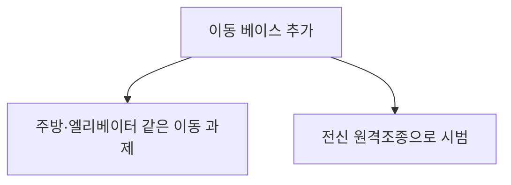

# Mobile ALOHA

> 양팔 원격조종 시스템 ALOHA에 **이동 베이스를 붙여 전신 원격조종으로 이동 조작 데이터를 모으고**, 지도학습 행동 복제로 학습한 시스템(arXiv 2401.02117, 초록 읽음).

## 쉽게 말하면
책상 위에서만 일하던 로봇 팔 두 개를 바퀴 달린 수레에 올려, 주방이나 엘리베이터처럼 돌아다니며 하는 일까지 사람이 몸으로 시범을 보이게 한 것이다.

## 자세히
- 구성: [ALOHA](#aloha-act)의 양팔 구조 + 이동 베이스, **저비용·전신 원격조종**. 달러 가격은 초록에 없다.
- 학습: 지도학습 행동 복제([행동 복제](#behavior-cloning)). 핵심 발견은 기존 **정적 ALOHA 데이터와 함께 학습(co-training)**하면 성능이 오른다는 것. 과제당 **시연 50개**로 co-training이 **성공률을 최대 90%까지 높일 수 있다**고 저자들이 보고했다.
- 자율 수행 과제(초록): **새우 요리**, **양문 캐비닛을 열어 무거운 냄비 보관**, **엘리베이터 호출·탑승**, **사용한 팬을 수도꼭지에서 헹구기**.
- 의미: 데이터가 적어도 기존 데이터를 섞어 쓰면 새 과제에 빨리 적응한다는 사례([데이터 풀링](#data-pooling-robotics)과 같은 맥락, 해석).
- 한계: "최대 90%"는 가장 큰 개선 사례를 가리키는 표현이며 평균 개선폭과 과제별 절대 성공률은 초록에 없다(본문 미열람). 과제와 환경이 제한적이다.

## 그림으로 보기

## 예시
- 시범자가 로봇을 몰며 팬을 헹구는 장면 50회를 기록해 정책을 학습.
- 교육: 새 업무를 가르칠 때 기존 매뉴얼 데이터와 소량의 새 사례를 함께 쓰는 방식에 빗대어 설명.

## 헷갈리는 것과 비교
| 개념 | 차이 |
|---|---|
| Mobile ALOHA | 이동 베이스+양팔, 이동 조작 |
| [ALOHA](#aloha-act) | 고정 양팔 |
| [Open X-Embodiment](#open-x-embodiment) | 여러 기관 데이터 풀링 |

## 더 읽을거리
- [Mobile ALOHA 논문](https://arxiv.org/abs/2401.02117) — co-training과 과제(초록 읽음).
