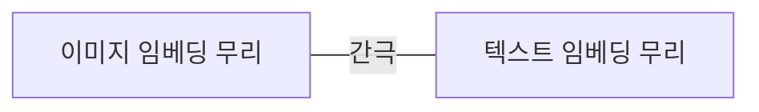
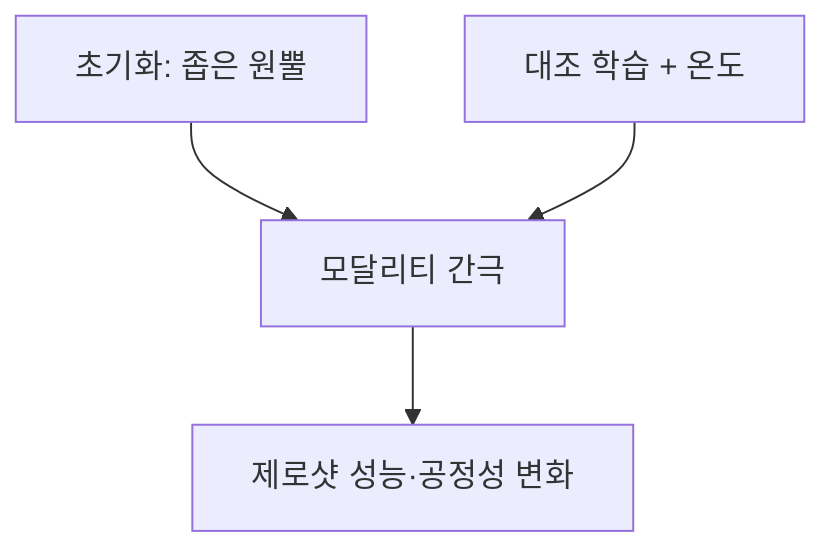

# 모달리티 간극

> **모달리티 간극(modality gap)** 은 CLIP 같은 멀티모달 모델에서 이미지와 텍스트 임베딩이 **공유 공간 안에서도 서로 멀찍이 떨어진 두 무리**로 놓이는 현상이다.

## 쉽게 말하면
같은 방에 모인 한국인 손님과 외국인 손님이 서로 반대편 구석에 모여 앉은 모습이다. 같은 뜻의 "개 사진"과 "개라는 글"도 가까운 쪽끼리 짝을 이루지만, 사진 무리와 글 무리 사이에는 빈 공간이 있다.

## 자세히
(Liang 외, arXiv 2203.02053, NeurIPS 2022 초록 확인)
- 현상: 다중 모달 대조 학습 모델은 서로 다른 모달리티를 공유 표현 공간에서 **일정 거리를 두고** 임베딩한다.
- **원인 두 가지**: ① **초기화** — 깊은 네트워크의 표현이 좁은 원뿔 영역에 갇혀 두 인코더가 처음부터 떨어져 시작 ② **대조 학습** — 손실의 **온도(temperature)** 에 영향을 받는 거리로 모달리티가 분리된 채 유지.
- 영향: 간극 거리를 바꾸면 **제로샷 분류 성능과 공정성**이 크게 달라진다. 초록에 구체 수치는 없다.
- 실무 함의(일반 지식): 이미지-텍스트 유사도 절대값을 모달리티 간 비교에 그대로 쓰거나 임계값을 정할 때, 같은 모달리티 내부 유사도와 스케일이 다름을 감안한다([제로샷 분류](#zero-shot-image-classification), [이미지 벡터 검색](#image-text-retrieval-vector-db)).

## 그림으로 보기

## 예시
- 이미지 검색에서 글 질의-이미지 유사도 점수가 대체로 낮게 나오는 이유를 설명할 때(점수는 같은 모달리티끼리보다 작음).
- 교육 활용: "같은 공간에 있어도 같은 자리가 아니다"라는 임베딩 직관.

## 헷갈리는 것과 비교
| 개념 | 차이 |
|---|---|
| 모달리티 간극 | 이미지·텍스트 임베딩 무리의 분리 |
| 도메인 격차 | 데이터 분포 차이 |
| [현실 격차](#sim-to-real-gap) | 시뮬과 현실의 차이 |
| 임베딩 정렬 | 간극을 줄이거나 맞추려는 시도 |

## 더 읽을거리
- [Mind the Gap: Understanding the Modality Gap in Multi-modal Contrastive Representation Learning](https://arxiv.org/abs/2203.02053)
