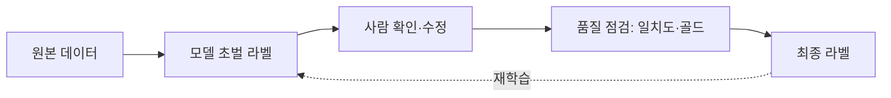
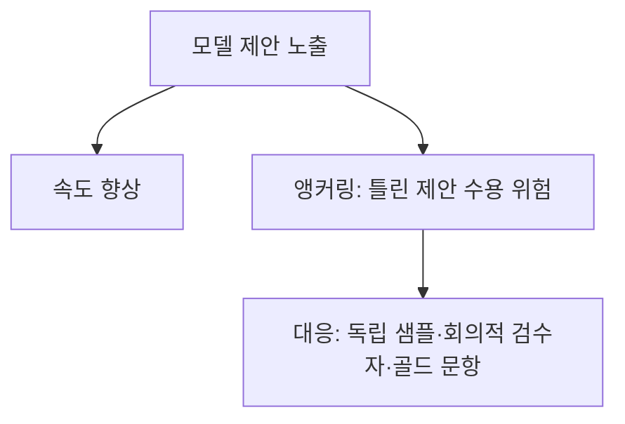

# 모델 보조 사전 라벨링

> 모델이 먼저 초벌 라벨을 붙이고 사람이 확인·수정하는 방식이다. 보통 라벨링이 빨라지지만, 사람이 모델의 틀린 제안을 그냥 받아들이는 "앵커링·자동화 편향"을 따로 관리해야 한다.

## 쉽게 말하면
내비게이션이 미리 잡아 준 경로를 운전자가 확인만 하는 것과 같다. 대부분 편하고 빠르지만, 길이 틀렸는데도 "기계가 말했으니 맞겠지" 하고 따라가면 사고가 난다. 틀린 안내를 잡아내는 사람의 주의력이 핵심이다.

## 자세히
(연구 초록을 직접 열어 확인. 결과는 과제·전문성에 따라 달라 일반화에 주의.)
- **속도·품질 쪽 증거**: Fort·Sagot와 Rosset 등 과거 연구는 결과가 엇갈렸고, 2019년 전문가 영역 담화 분석 과제 연구(arXiv:1906.02564, 초록 확인)는 자동 제안이 주석 속도를 높이고 주석자 성능을 향상시켰으며 "주목할 만한 편향"은 없었다고 보고했다.
- **앵커링·과신 쪽 증거(Beck 등 2025, arXiv:2509.08514, 초록 확인)**: 2,784명 무작위 실험에서 처음 3개 사례의 AI 제안 품질, 수정 작업량, 성과 기반 보상을 달리했다. 결과: 플래그된 AI 오류를 반드시 고치게 하면 오히려 참여가 줄고 틀린 제안을 받아들일 확률이 올랐고, 자동화에 호의적인 참가자는 "위험한 과신"을 보였다. **AI에 회의적인 참가자가 오류를 더 잘 잡아 정확도가 높았고**, AI에 대한 태도가 인구통계보다 성과를 더 잘 예측했다. 저자들은 다양한 평가자 표본, AI에 대한 태도 측정, 인지 편향을 상쇄하는 작업 흐름을 권고한다.
- **LLM 제안(검색 결과 요약)**: 전문가 주제 모델링 연구에서 LLM 제안이 작업을 훨씬 빠르게 만들지만 앵커링 편향이 관찰됐다고 한다(논문 arXiv:2410.04699, 본문 미열람). 모델의 설명(reasoning)에 노출되는 것도 별도 앵커링 위험이라는 2026년 연구가 있다는 요약이 있다(미확인).
- **실무 설계 포인트(제안)**
  - 모델 제안을 보여 줄지(사전 라벨) 숨길지 비교하는 **표본 실험**을 먼저 한다.
  - 일부 샘플은 제안 없이 독립 라벨링해 편향을 점검하고 [보정 문항](#calibration-items)으로 활용.
  - 제안의 **확신도 낮은 것만** 사람에게 보내는 방식은 능동 학습과 연결된다.
  - 속도 이득만 보지 말고 [일치도·골드 문항](#data-labeling-qa)으로 정확도를 같이 본다.
- **언제 유리한가(벤더 글 요약)**: 작업이 반복적이어서 모델이 초벌을 잘 붙일 때. 도메인 판단이 필요하고 물량이 안정적이면 관리형 인력이 낫다는 정리도 있다([데이터 라벨링](#data-labeling)).

## 그림으로 보기

## 예시
- 상담 문의 1만 건: 분류 모델이 초벌 → 확신도 0.9 미만만 사람이 전수 검토, 0.9 이상은 5% 표본만 검토(제안 규칙, 임계값은 예시).
- 라벨러 교육 때 "AI 제안이 일부러 틀린 사례" 퀴즈를 넣어 틀린 제안을 잡는 연습을 시킨다(제안).

## 헷갈리는 것과 비교
| 개념 | 차이 |
|---|---|
| 모델 보조 사전 라벨링 | 모델 초벌 + 사람 검수 |
| [데이터 프로그래밍(Snorkel)](#programmatic-labeling-snorkel) | 규칙으로 노이즈 라벨 생성, 사람 검수는 표본 |
| 능동 학습 | 불확실한 샘플부터 사람에게 |
| 자동화 편향 | 자동 제안을 과신하는 인간 경향 |

## 더 읽을거리
- [Bias in the Loop (arXiv:2509.08514)](https://arxiv.org/abs/2509.08514) — 2,784명 실험, 과신·회의적 검수자 효과(초록 직접 확인).
- [Analysis of Automatic Annotation Suggestions (arXiv:1906.02564)](https://arxiv.org/abs/1906.02564) — 제안이 속도·품질에 미친 영향(초록 직접 확인).
