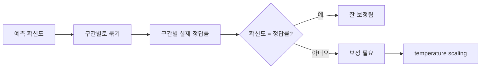

# 모델 보정

> 모델 보정(calibration)은 모델이 말하는 확신도가 실제로 맞는 비율과 일치하는 정도다. "90% 확신"이라고 한 예측 100개 중 약 90개가 맞으면 잘 보정된 모델이다.

## 쉽게 말하면
일기예보가 "비 올 확률 70%"라고 한 날이 100일이라면 그중 약 70일에 비가 와야 믿을 만하다. 정답률이 높은 것과, 자기 확신을 정확히 아는 것은 별개의 능력이다.

## 자세히
- Guo 외(2017, ICML) "On Calibration of Modern Neural Networks"는 보정을 "참일 가능성을 대표하는 확률 추정"으로 정의하고, 현대 신경망이 10여 년 전 모델과 달리 보정이 나쁘다고 보고한다. 깊이·너비·weight decay·Batch Normalization이 보정에 영향을 준다고 짚는다.
- 해결책으로 **temperature scaling**(Platt scaling의 단일 파라미터 변형)이 "놀랄 만큼 효과적"이라고 보고했다. 학습이 끝난 뒤 검증 데이터로 [로짓](#logits)을 나눌 T 하나만 맞춘다. 순위는 그대로라 정확도는 변하지 않는다.
- 보정은 신뢰도 곡선(reliability diagram)으로 본다. 예측 확신도 구간별 실제 정답률을 그린다(ECE 같은 요약 지표도 흔히 쓴다. 이 글 출처에서는 확인하지 않음).
- 확신도가 의사결정에 쓰이는 곳(의료·자동 승인·에이전트가 사람에게 넘길 시점 판단)에서 중요하다.

## 그림으로 보기

## 예시
- 분류기가 확신도 0.95 이상일 때만 자동 처리, 나머지는 사람 검토로 보낸다. 보정이 나쁘면 이 임계값이 의미를 잃는다.
- 검증 세트로 T를 맞춘 뒤 같은 임계값으로 다시 평가한다.

## 헷갈리는 것과 비교
| 개념 | 차이 |
| --- | --- |
| 정확도 | 얼마나 맞히나 |
| 보정 | 확신도가 얼마나 정직한가 |
| [과신](#overconfidence) | 보정이 나쁜 대표 형태 |
| [레이블 스무딩](#label-smoothing) | 학습 중 확신을 억제하는 기법 |

## 더 읽을거리
- [On Calibration of Modern Neural Networks (arXiv 1706.04599)](https://arxiv.org/abs/1706.04599) — 보정 문제와 temperature scaling
