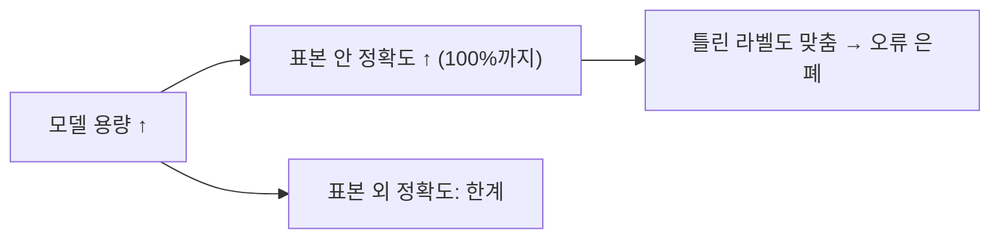
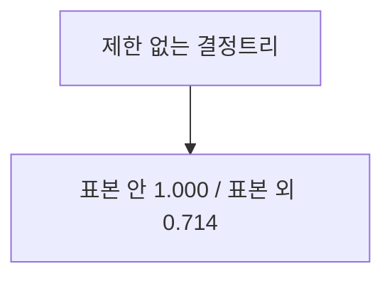

# 용량에 따른 표본 안 예측 차이

> 표본 안(in-sample) 예측은 학습에 쓴 데이터를 다시 예측한 결과다. 모델 용량이 클수록 학습 데이터를 외워 표본 안 예측이 실제보다 훨씬 좋아 보이므로, 라벨 오류 탐지에 쓰면 위험하다.

## 쉽게 말하면
문제집을 통째로 외운 학생에게 그 문제집 문제로 시험을 보면 100점이다. 외우는 능력(용량)이 클수록 이 점수는 실력과 멀어진다.

## 자세히
- **직접 해 본 실험(scikit-learn 1.9.1, 가상 데이터 2,000개·특징 20개·라벨 15% 무작위 뒤집기, 5-fold 층화 교차 검증, 정확도/평균 최대 확률)**:

| 모델 | 표본 안 정확도 | 표본 안 자신감 | 표본 외 정확도 | 표본 외 자신감 |
| --- | --- | --- | --- | --- |
| 로지스틱 회귀 | 0.753 | 0.733 | 0.745 | 0.735 |
| 깊이 3 결정트리 | 0.803 | 0.803 | 0.773 | 0.786 |
| 깊이 제한 없는 결정트리 | 1.000 | 1.000 | 0.714 | 1.000 |
| 랜덤 포레스트(200그루) | 1.000 | 0.887 | 0.826 | 0.753 |

  용량이 작은 로지스틱 회귀는 표본 안·밖 차이가 거의 없지만, 제한 없는 트리는 표본 안 정확도 100%인데 표본 외는 0.714로 떨어지고 표본 외 자신감도 1.000이다. 랜덤 포레스트도 표본 안 정확도가 100%지만 표본 외는 0.826이다. (한 번의 가상 데이터 실험이며 수치는 설정에 따라 달라진다.)
- **라벨 오류 탐지에 주는 의미**: 표본 안에서 100% 맞히는 모델은 틀린 라벨도 맞히므로 "라벨이 맞다"고 답한다. 오류가 숨는다([노이즈 라벨 암기](#memorization-of-noisy-labels)). cleanlab 문서도 같은 데이터에 대한 예측을 쓰지 말고 교차 검증으로 표본 외 예측을 쓰라고 한다.
- **해석**: 용량이 큰 모델일수록 반드시 [표본 외 예측 절차](#oof-predictions-workflow)를 지켜야 한다.

## 그림으로 보기

## 예시
- 코드: `m.fit(X,y).predict_proba(X)`(표본 안, 오류 탐지에 부적합)와 `cross_val_predict(m,X,y,cv=cv,method="predict_proba")`(표본 외) 비교.
- 교육 활용: 위 표를 빈칸으로 두고 학습자가 용량 순서대로 어떤 값이 나올지 예측한 뒤 실제 결과를 확인한다.

## 헷갈리는 것과 비교
| 개념 | 차이 |
| --- | --- |
| 표본 안 예측 | 학습한 샘플에 대한 예측, 낙관적 |
| 표본 외 예측 | 학습에 안 쓴 샘플에 대한 예측 |
| [보정 과대평가](#calibration-overestimate) | 표본 안의 자신감이 과도한 문제 |
| [표본 외 예측 절차](#oof-predictions-workflow) | 올바르게 표본 외 확률 얻기 |

## 더 읽을거리
- [cleanlab pred_probs 교차 검증 튜토리얼](https://docs.cleanlab.ai/stable/tutorials/pred_probs_cross_val.html) — 같은 데이터 예측 금지 원칙
- [scikit-learn Cross-validation 가이드](https://scikit-learn.org/stable/modules/cross_validation.html) — cross_val_predict
