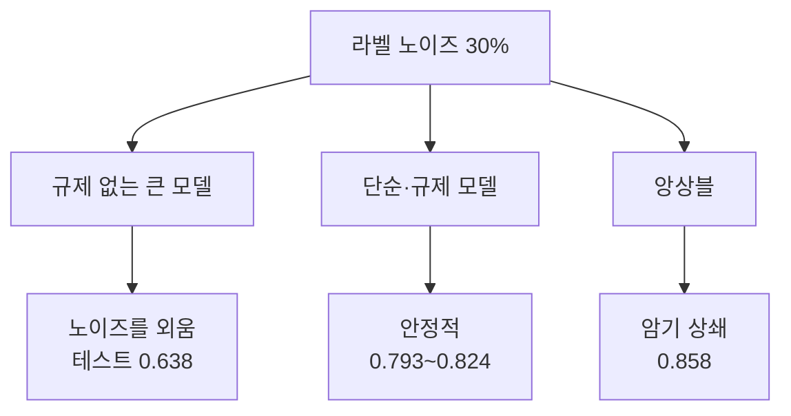

# 모델 용량과 노이즈

> 라벨 노이즈가 많은 데이터에서는 **용량이 큰 모델이 노이즈까지 외워 성능이 크게 떨어질 수 있고**, 규제가 있거나 단순한 모델이 더 안정적일 수 있다. 다만 "작은 모델이 항상 낫다"는 뜻은 아니다.

## 쉽게 말하면
틀린 문제집을 한 글자도 안 빼고 통째로 외우는 학생은 틀린 풀이까지 외워 실전에서 틀린다. 핵심 원리만 잡는 학생은 문제집 오류에 덜 흔들린다.

## 자세히
- **논문의 관찰(arXiv 2103.14749 초록 확인)**: 시험 세트의 라벨 오류가 늘면 ImageNet에서 ResNet-18이 ResNet-50을, CIFAR-10에서 VGG-11이 VGG-19를 앞설 수 있다. 저자들은 용량이 큰 모델이 체계적 라벨 오류에 더 민감하다고 주장한다. 이 글의 대상은 *학습* 라벨 노이즈라 같은 논지의 연장선이지만 원 논문은 *시험* 세트 오류가 중심이다.
- **직접 실험(scikit-learn 1.9.1, 이진 분류 합성 3,000개, 학습 라벨을 무작위로 뒤집기, 5개 시드 평균, 정확도는 깨끗한 테스트에서)**
  | 학습 라벨 노이즈 | 로지스틱 회귀 | 결정트리 깊이 3 | 결정트리 제한 없음 | 랜덤 포레스트(200) |
  |---|---|---|---|---|
  | 0% | 0.840 | 0.832 | 0.882 | 0.927 |
  | 10% | 0.835 | 0.830 | 0.798 | 0.921 |
  | 20% | 0.833 | 0.827 | 0.716 | 0.905 |
  | 30% | 0.824 | 0.793 | **0.638** | 0.858 |
  제한 없는 결정트리는 노이즈 속에서도 **학습 정확도가 1.0**(노이즈까지 외움)이며 테스트 정확도는 0.882→0.638로 급락했다. 로지스틱 회귀와 얕은 트리는 0.840→0.824, 0.832→0.793으로 완만했다.
- **반례(중요)**: 랜덤 포레스트는 용량이 큰 모델이지만 노이즈 30%에서도 0.858로 **가장 높았다**. 평균(앙상블)이 개별 트리의 암기를 상쇄한다. 즉 문제는 용량 자체보다 *규제 없이 노이즈에 맞춰 외우는 것*이다.
- **대응 도구**: 규제(깊이 제한, 가중치 감쇠), 조기 종료, 앙상블, 노이즈에 강한 손실, 라벨 정리([검수 순서](#human-relabel-triage)), 더 큰 데이터. 큰 신경망도 조기 종료로 암기 시점 전에 멈추면 효과가 있다는 관찰이 있다(일반 지식, 원문 미열람).
- 이 수치는 쉬운 합성 이진 문제의 한 설정이며 일반 법칙이 아니다.

## 그림으로 보기

## 예시
- 라벨 품질이 불확실한 데이터로 첫 모델을 만들 때는 규제된 단순 모델을 기준선으로 두고 큰 모델이 정말 나은지 비교.
- 교육: "복잡한 모델이 항상 좋은 것은 아니다"를 노이즈 실험으로 보여 주기.

## 헷갈리는 것과 비교
| 개념 | 차이 |
|---|---|
| 과적합 | 일반 개념: 학습 데이터에 지나치게 맞춤 |
| 노이즈 암기 | 틀린 라벨까지 맞추는 과적합의 한 형태 |
| [작은 k 편향](#pessimistic-bias-small-k) | 평가 방식의 편향 |
| [시험 세트 오류](#corrected-test-labels) | 평가 정답이 틀림 |

## 더 읽을거리
- [Pervasive Label Errors in Test Sets (arXiv 2103.14749)](https://arxiv.org/abs/2103.14749) — 용량과 라벨 오류 민감도 주장(초록 확인).
- [Confident Learning (arXiv 1911.00068)](https://arxiv.org/abs/1911.00068) — 노이즈 라벨 학습·정리 방법.
