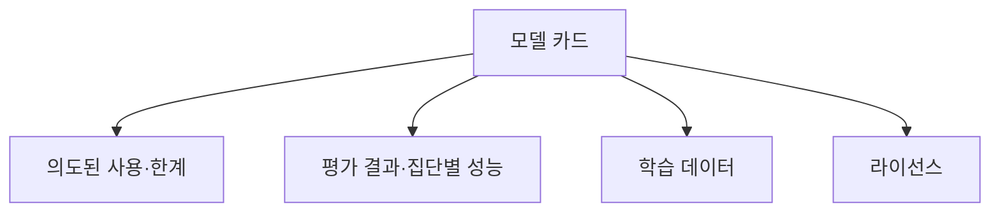

# 모델 카드의 데이터 출처 표시

> 모델을 공개할 때 **어떤 데이터로 학습했고 그 데이터의 라이선스·출처가 무엇인지 모델 카드에 적는 관행**. 사용자가 모델의 한계와 권리 문제를 판단하는 단서가 된다. (법률 자문이 아니다.)

## 쉽게 말하면
식당 메뉴판에 "재료 원산지"를 적는 것과 같다. 어떤 재료로 만들었는지 알아야 알레르기도, 원산지 표시 의무도 확인할 수 있다. 모델도 "무슨 데이터로 키웠나"를 밝히는 것이 기본 예의이자 투명성이다.

## 자세히
- **모델 카드의 뿌리(Mitchell 외, "Model Cards for Model Reporting", FAT* 2019, arXiv 1810.03993, 초록 직접 읽음)**: 학습된 모델에 붙는 짧은 문서로, 의도된 사용 맥락, 평가 절차, 문화·인구·표현형 집단별(교차 집단 포함) 성능을 보고해 투명성을 높이고 부적합한 사용을 막자는 제안이다. 웃는 얼굴 탐지기와 독성 댓글 분류기의 예시 카드를 보였다.
- **Hugging Face 모델 카드(공식 문서, 직접 읽음)**: 카드는 모델 설명, 의도된 사용과 한계(편향·윤리 고려 포함), 학습 파라미터·실험 정보, **어떤 데이터셋으로 학습했는지**, 평가 결과를 담아야 한다고 안내한다. YAML 메타데이터에 `license`, `datasets`(예: `HuggingFaceFW/fineweb`), `base_model`, `language` 등을 적고, `datasets`를 쓰면 모델 페이지에 "Datasets used to train:" 문구와 링크가 생기며 데이터셋별 필터링이 된다. 라이선스가 목록에 없으면 `license: other`와 이름·링크를 쓴다.
- **데이터 출처 표시와 라이선스 연결**: FineWeb 같은 ODC-By 데이터는 공개 사용 시 출처·라이선스 표시가 요구된다([FineWeb 이용 조건](#fineweb-license-terms), [산출물 고지 규칙](#produced-work-notice-rule)). 모델 카드의 `datasets` 필드와 데이터 섹션에 데이터셋 이름과 라이선스를 적는 것은 이 요구를 실무적으로 충족하는 방법 중 하나다. 다만 학습된 모델이 "산출물"인지 "파생물"인지, 어떤 고지가 법적으로 충분한지는 이번에 확인하지 못했다([학습 모델은 파생물인가](#model-as-derivative-question)).
- **카드에 쓸 데이터 항목(제안)**: ① 데이터셋 이름·버전·링크·라이선스 ② 사용한 부분집합과 필터링 ③ 개인정보 처리 수준 ④ 알려진 편향·한계 ⑤ 평가에 쓴 데이터와의 겹침(오염) 점검 결과 ⑥ 데이터 카드 링크([데이터 카드 읽기](#data-card-reading)).
- **한계**: 카드는 제작자의 자기 보고이고 학습 데이터 전체 목록 공개는 보장되지 않는다. 어떤 모델은 데이터를 구체적으로 밝히지 않는다(일반 설명).

## 그림으로 보기



## 예시
```yaml
---
license: apache-2.0
datasets:
- HuggingFaceFW/fineweb
base_model: your-org/base-model
language:
- ko
---
```
| 항목 | 카드에 적는 내용 |
|---|---|
| 데이터 | 이름·버전·라이선스(ODC-By 등) |
| 처리 | 필터링·PII 마스킹 범위 |
| 한계 | 편향·오염 점검 결과 |
- 업무 장면: 사내 교육용 파인튜닝 모델을 공유할 때 모델 카드에 데이터 출처와 라이선스, 개인정보 처리 수준을 한 표로 정리한다.

## 헷갈리는 것과 비교
| 개념 | 차이 |
|---|---|
| 모델 카드 | 모델의 용도·한계·학습 데이터 설명서 |
| [데이터 카드](#data-card-reading) | 데이터셋의 설명서 |
| [Datasheets for Datasets](#datasheets-for-datasets) | 데이터 설명서의 원조 제안 |
| [산출물 고지 규칙](#produced-work-notice-rule) | 출처 고지의 라이선스상 근거 |

## 더 읽을거리
- [Model Cards for Model Reporting (arXiv 1810.03993)](https://arxiv.org/abs/1810.03993) — 모델 카드 제안(초록 직접 읽음).
- [Hugging Face Model Cards 문서](https://huggingface.co/docs/hub/model-cards) — `datasets`·`license` 메타데이터(직접 읽음).
