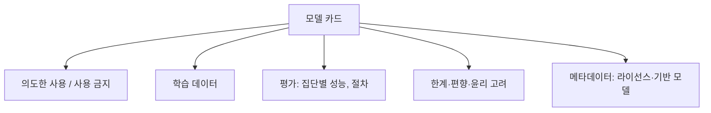

# 모델 카드(Model Card)

> AI 모델에 붙이는 "설명서". 무엇에 쓰도록 만들었는지, 어떤 데이터로 어떻게 평가했는지, 어떤 집단·상황에서 성능이 떨어지는지, 쓰면 안 되는 곳은 어디인지를 짧은 문서로 적어 둔다.

## 쉽게 말하면
약 상자 안의 설명서와 같다. 효능(용도), 성분(학습 데이터), 부작용·주의사항(한계와 편향), 복용 금지 대상(부적절한 사용)이 적혀 있어야 안전하게 쓴다. 설명서 없이 약을 받는 사람은 감으로 먹을 수밖에 없다.

## 자세히
- **제안**: Mitchell 외 "Model Cards for Model Reporting"(arXiv 1810.03993, 2018년 10월, FAT* '19 발표). 학습된 모델과 함께 짧은 문서를 배포해 모델이 어디에 적합하고 어디에 쓰지 말아야 하는지 알리자는 제안이다.
- **담는 정보(논문)**: 의도한 사용 사례와 맥락 / 인구통계·문화·표현형 집단(인종, 지역, 성별, 피부색 등)별 벤치마크 성능 / 교차 집단(나이×인종 등) 성능 / 평가 절차 상세 / 기타. 예시 카드로 웃는 얼굴 검출기와 독성 댓글 검출기를 제시했다.
- **Hugging Face 허브의 모델 카드**: 모델 저장소의 `README.md`가 곧 모델 카드. 맨 위 YAML 메타데이터에 `license`, `datasets`, `base_model`, `pipeline_tag`, `library_name`, 평가 결과(`model-index`) 등을 적는다. 메타데이터는 검색 필터와 라이선스 표시, 학습 데이터 링크에 쓰인다. 본문에는 모델 설명, 의도한 사용과 한계(편향·윤리 포함), 학습 파라미터, 학습 데이터셋, 평가 결과를 쓰도록 안내한다. `not-for-all-audiences` 태그로 부적합 대상 표시도 가능하다.
- **하나의 짝**: 데이터에는 [데이터시트](#datasheets-for-datasets), 모델에는 모델 카드가 대응한다([데이터 출처](#data-provenance)).
- **기업 도입에서의 쓰임**: 모델 선정 시 체크리스트 — 의도한 용도와 내 용도가 맞는가, 평가 집단에 내 사용자가 포함되는가, 알려진 한계는 무엇인가, 라이선스는 상업 사용을 허용하는가.
- **한계**: 카드가 자발적 문서라 부실하거나 홍보성일 수 있다. 수치 평가 조건(프롬프트·시행 횟수)이 빠지면 비교가 어렵다([평가에서 반복 실행과 신뢰구간](#sampling-temperature-eval)). 거대 모델 업체는 모델 카드 대신 더 긴 "시스템 카드"를 내기도 한다(형식은 업체마다 다르다).

## 그림으로 보기



## 예시
- 오픈 모델 도입 전 점검: 허깅페이스 모델 페이지에서 License(상업 사용 가능 여부), Datasets used to train, base_model(파생 관계), 평가표, "Limitations" 절을 읽고 사내 체크리스트에 기록한다.
- 자체 모델 배포 시 템플릿(요약):
```
# 모델명 / 버전 / 날짜
## 의도한 용도, 사용 금지 용도
## 학습 데이터(출처·기간·라이선스)
## 평가(데이터셋, 지표, 집단별 결과, 측정 조건)
## 알려진 한계·편향
## 문의·갱신 이력
```

## 헷갈리는 것과 비교
| 개념 | 차이 |
|---|---|
| 모델 카드 | 모델의 용도·평가·한계 설명서 |
| [데이터시트](#datasheets-for-datasets) | 데이터셋의 동기·구성·수집 설명서 |
| 시스템 카드 | 더 큰 시스템·모델의 안전 평가를 길게 서술한 업체 문서 |
| [공정성 지표](#fairness-metrics) | 모델 카드에 담길 집단별 성능 비교의 수치 도구 |

## 더 읽을거리
- [Model Cards for Model Reporting (arXiv 1810.03993)](https://arxiv.org/abs/1810.03993) — 원 제안
- [Model Cards (Hugging Face Hub 문서)](https://huggingface.co/docs/hub/model-cards) — 메타데이터와 작성 항목
