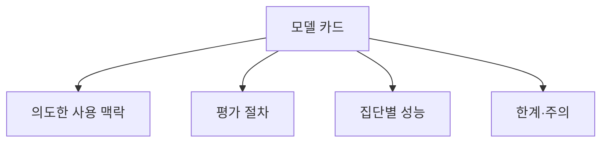

# 모델 카드

> 학습된 모델에 붙는 짧은 설명 문서다. 모델이 어떤 집단·상황에서 어떤 성능을 내는지, 어떤 용도에 맞는지, 어떻게 평가했는지를 적어 잘못된 상황에서 쓰이는 것을 막는다.

## 쉽게 말하면
약의 설명서와 같다. 효능뿐 아니라 "어떤 사람에게 효과가 적은지", "누가 먹으면 안 되는지"를 적어 두는 것이다. 설명서가 없으면 약이 잘 맞지 않는 사람에게 처방될 수 있다.

## 자세히
(Mitchell 등, "Model Cards for Model Reporting", arXiv:1810.03993, 2018-10 제출·2019-01 개정, 초록 직접 확인.)
- **정의(초록)**: "학습된 머신러닝 모델에 딸린 짧은 문서". 모델의 **벤치마크 성능을 여러 집단별로** — 인구·문화·표현형 집단과 그 교차 집단 — 보고하고, **의도한 사용 맥락**과 **평가 절차** 등 관련 정보를 담는다.
- **목적**: 모델 보고의 투명성을 높이고 의도한 용도를 분명히 해서 부적합한 맥락에서 쓰일 위험을 줄이는 것. 저자들은 이를 AI의 책임 있는 민주화로 가는 한 걸음으로 제시하고, 모델 공개 시 상세한 평가 결과를 함께 내라고 권한다.
- **데이터시트와의 관계**: 데이터시트가 데이터셋의 동기·구성·수집 과정을 설명한다면([데이터시트](#datasheets-for-datasets)), 모델 카드는 만들어진 모델의 용도·성능·한계를 설명한다. 두 문서를 짝으로 쓰는 것이 흔한 관행이다(일반적 설명).
- **카드 안에 보통 들어갈 항목(제안, 논문 전체는 미열람)**: 모델 개요·버전·날짜, 의도 용도와 비의도 용도, 평가 데이터와 지표, 집단별 성능, 학습 데이터 개요, 윤리적 고려와 한계. 정확한 절 구성은 원 논문에서 확인해야 한다.
- **운영 팁**: 사내 모델마다 카드를 두고 버전별로 업데이트하며, 집단별 성능 표는 [분포 편향 점검](#data-distribution-bias)과 [데이터 슬라이싱](#data-slicing)의 결과로 채운다.
- **한계**: 카드가 있다고 모델이 안전해지는 것은 아니다. 기재 내용의 정확성은 작성자의 책임이다.

## 그림으로 보기

## 예시
- 사내 이탈 예측 모델 카드: "대상=가입 6개월 이상 개인 고객, 비대상=법인, 지표=AUC·재현율, 연령대별 재현율 표, 주 1회 드리프트 점검".
- 교육 소재: 모델 카드를 보고 "이 모델을 우리 업무에 써도 되는지" 판단하는 체크 실습.

## 헷갈리는 것과 비교
| 개념 | 차이 |
|---|---|
| 모델 카드 | 모델의 용도·성능·한계 |
| [데이터시트](#datasheets-for-datasets) | 데이터셋의 동기·구성·수집 |
| [사내 데이터 카드](#internal-data-card) | 사내 데이터의 출처·허용 용도 |
| 시스템 카드 | 모델 + 주변 시스템을 설명하는 더 넓은 문서(일반적 용어) |

## 더 읽을거리
- [Model Cards for Model Reporting (arXiv:1810.03993)](https://arxiv.org/abs/1810.03993) — 정의와 목적(초록 직접 확인).
- [Datasheets for Datasets (arXiv:1803.09010)](https://arxiv.org/abs/1803.09010) — 짝이 되는 데이터셋 문서화(초록 직접 확인).
