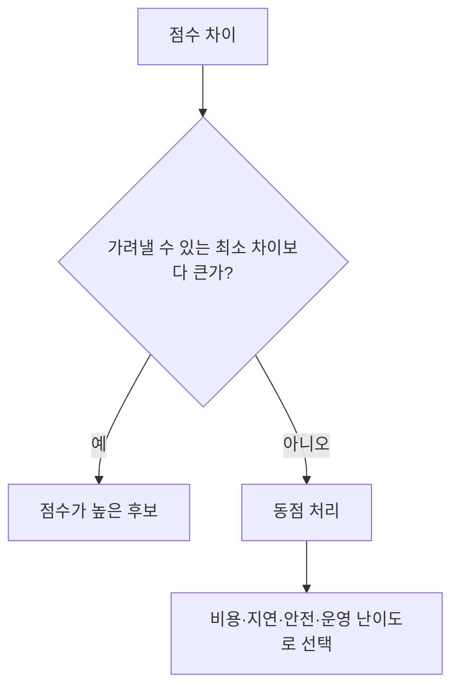
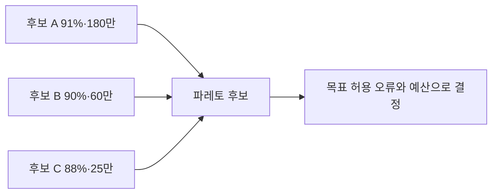

# 작은 차이를 넘는 모델 선택

> 평가 점수 차이가 작아서 통계적으로 구분되지 않을 때는 점수 순위 대신 비용·지연·안전성·운영 난이도 같은 다른 기준으로 모델을 고른다. 점수가 사실상 같다면 더 싸고 빠르고 단순한 쪽이 이긴다.

## 쉽게 말하면
시험 점수가 비슷한 두 후보라면 출퇴근 거리·연봉·팀 분위기로 결정하는 것과 같다. 점수 1점 차이로 서열을 세우는 것은 의미가 없다. 오차 범위 안에 있으면 "동점"으로 보고 다른 기준을 본다.

## 자세히
- **공식 안내의 접근(Anthropic Choosing the right model, 2026-11 열람)**: 모델 선택의 기준은 능력·속도·비용이고, 일부 모델은 노력(effort) 매개변수로 한 모델 안에서 지능과 지연·비용을 교환한다. 문서는 "노력 조절이 모델을 바꾸는 것보다 나은 수단인 경우가 많다"고 쓰며 기본값에서 시작해 평가에 따라 올리거나 내리라고 안내한다.
- **시작 방식 두 가지(같은 문서)**: 효율 우선은 가장 빠르고 저렴한 모델(Haiku 5.5)에서 시작해 필요할 때만 올리는 방식이고, 능력 우선은 강한 모델(Opus 5.5)에서 시작해 프롬프트를 다듬은 뒤 노력을 낮추거나 모델을 내리는 방식이다. 그래도 부족하면 더 강한 모델(Fable 5.2)로 간다. 이는 Anthropic 모델 계열에 관한 안내이며 모델과 버전은 빨리 바뀐다.
- **선택 매트릭스(같은 문서)**: 최고 능력 → Fable 5.2, 복잡한 에이전트 코딩·기업 업무 → Opus 5.5, 일상적 코딩·에이전트·기업 업무 → Sonnet 5.5, 최저 지연·가격 → Haiku 5.5. 문서는 "대부분의 작업은 Opus 5.5에서 시작"이라고 한다.
- **결정 방법(같은 문서)**: 사용 사례 전용 벤치마크를 만들고 실제 프롬프트·데이터로 모델 간 정확도·응답 품질·예외 처리를 비교하고 성능·비용 절충을 따진다. "좋은 평가 세트가 가장 중요한 단계"라고 한다. 모델을 섞는 전략(저비용 모델이 대부분을 처리하고 어려운 판단만 고급 모델에 올리거나, 오케스트레이터가 저비용 작업자에게 위임)도 소개한다.
- **통계적으로 구분이 안 될 때(해석)**: ① [평가셋 크기 계획](#eval-set-size-planning)으로 이 크기에서 가려낼 수 있는 최소 차이를 먼저 확인한다 ② 차이가 그 이하이면 점수는 동점으로 보고 비용·지연·안전 기준으로 선택한다 ③ 비용·정확도 평면에서 다른 후보보다 모든 면에서 나쁜 후보는 제외한다(파레토 최적 후보만 남김) ④ 나머지는 운영 난이도, 데이터 반출 제약, 모델 교체 용이성으로 결정한다.
- **가상 예시(직접 구성, 수치는 설명용)**: 후보 3개의 정확도가 91%·90%·88%인데 평가셋(300문항)의 95% 구간이 ±3%p라면 91%와 90%는 구분되지 않는다. 월 비용이 각각 180·60·25만 원이라면 90% 후보가 비용 대비 합리적이고, 88%는 비용이 가장 낮으니 안전 마진이 충분한지 본다.
- **재평가 시점(해석)**: 모델과 가격은 빨리 바뀌므로 분기마다 같은 평가셋으로 다시 비교한다.

## 그림으로 보기

## 예시
- 고객 문의 분류에 후보 모델 3개가 통계적으로 같은 정확도라면 가장 싸고 빠른 모델로 시작하고, 평가셋이 늘어 차이가 드러나면 재평가한다.
- 교육 활용: 점수·비용·지연이 다른 가상 후보 5개를 두고 구분 안 되는 그룹을 나눈 뒤 선택 근거를 말하게 하는 토론.

## 헷갈리는 것과 비교
| 개념 | 차이 |
| --- | --- |
| [평가셋 크기 계획](#eval-set-size-planning) | 어느 차이까지 가릴지 정하는 사전 계획 |
| [통계적으로 구분 안 되는 그룹](#statistically-indistinguishable-groups) | 순위 대신 겹치는 구간 그룹으로 해석 |
| 노력(effort) 조절 | 같은 모델 안에서 지능·지연·비용 교환 |
| 모델 혼합 | 쉬운 일은 저비용 모델, 어려운 판단은 고급 모델 |

## 더 읽을거리
- [Anthropic: Choosing the right model](https://platform.claude.com/docs/en/about-claude/models/choosing-a-model) — 기준·시작 방식·선택 매트릭스·비교 절차
