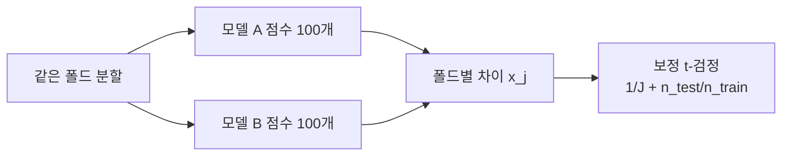
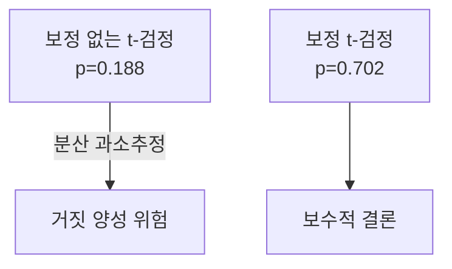

# 교차검증으로 모델 비교

> 두 모델의 교차검증 평균 점수 차이가 우연인지 알려면 같은 분할에서 폴드별 점수 차이를 쌍으로 비교하되, 폴드끼리 학습 데이터가 겹치는 효과를 보정해야 한다. 보정 없는 t-검정은 차이를 지나치게 유의하다고 판정한다.

## 쉽게 말하면
같은 학생 10명에게 두 교재를 번갈아 쓰게 하고 점수를 비교한다. 그런데 학생들의 공부 내용이 서로 많이 겹치면 10명이 사실 10개의 독립된 증거가 아니다. 겹침을 무시하고 "표본이 10명이니 확실하다"고 하면 과신하게 된다.

## 자세히
- **같은 분할 사용**: 두 모델에 똑같은 폴드를 쓰고 폴드별 점수 차 x_j를 만든다(쌍 비교). 어려운 폴드는 두 모델 모두에게 어려워 상관이 높기 때문이다.
- **왜 보정하나(scikit-learn 예제 문서, 열람)**: 반복 교차검증의 점수들은 학습 데이터가 겹치고 같은 분할을 공유해 독립이 아니다. 그 문서의 예제에서 모델 간 점수 상관이 최대 0.88이었고, 독립을 가정한 t-검정은 분산을 과소추정해 거짓 양성이 늘어난다고 설명한다.
- **보정 재표집 t-검정(Nadeau & Bengio, 문서의 공식)**: t = 평균(x_j) / √[(1/J + n_test/n_train) · s²]. J = K×R, n_test/n_train은 학습 겹침을 반영한 항이다. 문서의 예제에서 보정 전 p=0.005, 보정 후 p=0.227로 결론이 뒤집혔다.
- **직접 해 본 실험(유방암 데이터 569개, 표준화+로지스틱 회귀 vs 표준화+SVC, 10겹×10회=100개 점수)**: 평균 정확도 0.9788 대 0.9765, 차 0.0023. 보정 없는 t=1.33(p=0.188), 보정 후 t=0.38(p=0.702). 이 데이터에서는 두 방식 모두 차이가 유의하지 않았고, 보정하면 p가 훨씬 커졌다(보정 방향이 예상대로 보수적). 논문과 같은 효과의 방향을 확인한 것이지 한 번의 측정이다.
- **베이즈 대안(같은 문서)**: 평균 차의 사후분포를 보정 분산으로 구성하고 ROPE(예: ±0.01) 안의 확률로 "실질적으로 같다"를 말할 수 있다. 빈도주의 검정은 "같다"를 주장하기 어렵다. 여러 모델을 쌍으로 비교하면 다중 비교 보정(문서는 Bonferroni)이 필요하다.
- **실무 규칙(해석)**: 차이가 표준편차보다 작으면 같은 수준으로 보고 더 단순·싼 모델을 고른다.

## 그림으로 보기

## 예시
- 코드: `d = scores_a - scores_b` 후 `d.var(ddof=1) * (1/J + n_test/n_train)`로 보정 분산을 만들어 t를 계산한다.
- 실무: 두 프롬프트 템플릿의 정답률 차이가 0.2%p라면 같은 분할 100개 점수의 보정 검정으로 "차이 없음"을 확인하고 비용이 싼 쪽을 쓴다. 교육 활용: "점수 높은 쪽이 항상 더 좋다"는 오해를 숫자로 교정한다.

## 헷갈리는 것과 비교
| 개념 | 차이 |
| --- | --- |
| 보정 없는 쌍체 t-검정 | 독립 가정, 과신 |
| 보정 재표집 t-검정 | 겹침 보정, 보수적 |
| [점수 비독립성](#score-non-independence) | 보정이 필요한 이유 |
| [RepeatedKFold](#repeated-kfold) | 점수를 100개로 만드는 반복 |

## 더 읽을거리
- [scikit-learn: Statistical comparison of models using grid search](https://scikit-learn.org/stable/auto_examples/model_selection/plot_grid_search_stats.html) — 보정 t-검정, 베이즈·ROPE 예제
