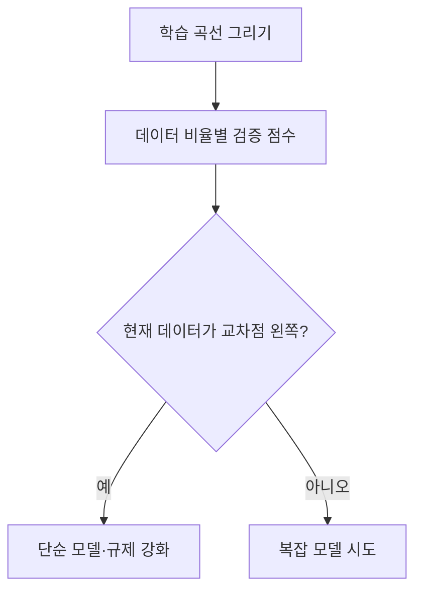

# 모델 교차점

> 데이터가 적을 땐 단순 모델이 이기고, 데이터가 늘면 복잡한 모델이 역전하는 **학습 곡선의 교차 지점**. "항상 복잡한 모델이 낫다"는 통념이 소표본에서는 틀릴 수 있음을 보여 준다.

## 쉽게 말하면
초보자에게 레시피 5개만 주면 "소금 적당히" 같은 단순 규칙을 가진 요리사가 정교한 요리사보다 낫다. 레시피가 5,000개가 되면 정교한 요리사가 훨씬 앞선다. 둘의 실력이 같아지는 레시피 수가 교차점이다.

## 자세히
- **고전 결과(Ng & Jordan, NIPS 2001, 초록 확인)**: 나이브 베이즈(생성 모델)와 로지스틱 회귀(판별 모델)를 비교해 "판별 모델이 거의 항상 낫다"는 통념에 반박했다. 학습 데이터 크기가 커지면 **두 영역(regime)** 이 나타나고 각 알고리즘이 한 영역에서 이긴다. 판별 모델은 **점근 오차(데이터가 많을 때 오차)가 낮지만**, 나이브 베이즈는 더 높은 오차 수준에서 멈추는 대신 **그 수준에 훨씬 빨리 도달**해 데이터가 적을 때 로지스틱 회귀를 이길 수 있다.
- **표본 복잡도**: 기억에 따르면 나이브 베이즈는 특징 수 n에 대해 약 log n 개, 로지스틱 회귀는 약 n개 예제가 필요하다는 결과가 논문 본문에 있으나 검색 결과로는 확인하지 못했다 — 인용 전에 논문 3절을 확인할 것(미확인 주장).
- **후속**: 2023년 Zheng 등(arXiv 2302.02334)은 이 결과를 다중 클래스로 일반화하고, 실무 로지스틱 회귀는 0-1 손실이 아니라 대리 손실(surrogate loss)을 최적화한다는 점을 반영했다.
- **교차점을 찾는 법: 학습 곡선**
  1. 학습 데이터를 10%, 20%, …, 100%로 늘려 가며 두 모델의 **검증 점수**를 그린다.
  2. 곡선이 만나는 지점이 교차점. 그보다 데이터가 적으면 단순 모델, 많으면 복잡 모델.
  3. 현재 데이터 양이 교차점 어느 쪽인지, 데이터를 더 모으면 역전될지를 판단.
- **LLM 맥락**: 라벨 몇십 개일 땐 프롬프트·퓨샷이나 단순 분류기, 수천 개 이상이면 미세 조정이 앞서는 경향이 흔하다(일반 경험칙, 과제별로 확인 필요).
- **주의**: 교차점은 과제·특징·규제 강도에 따라 달라지고, 곡선 자체가 [불확실성](#independent-uncertainty-estimate)을 가진다. 점 하나의 차이로 결론 내리지 않는다.

## 그림으로 보기



## 예시
```python
from sklearn.model_selection import learning_curve
sizes, tr, va = learning_curve(model, X, y, train_sizes=[0.1,0.2,0.4,0.7,1.0], cv=5)
# 두 모델의 va 평균을 같은 그래프에 그려 교차점 확인
```
- 문서 분류에서 라벨 200개일 땐 나이브 베이즈, 20,000개일 땐 로지스틱 회귀/트랜스포머가 앞서는 식의 곡선을 그려 투자 판단(라벨링 더 할지)에 쓴다.

## 헷갈리는 것과 비교
| 개념 | 의미 |
|---|---|
| 점근 오차 | 데이터가 무한할 때의 오차 |
| 수렴 속도 | 점근 오차에 가까워지는 빠르기 |
| 교차점 | 두 모델 곡선이 만나는 데이터 양 |
| [단순 기준선](#baseline-first) | 비교의 바닥 |

## 더 읽을거리
- [Ng & Jordan 2001 초록(NIPS)](https://papers.nips.cc/paper/2001/hash/7b7a53e239400a13bd6be6c91c4f6c4e-Abstract.html) — 두 영역 결과(열어 확인).
- [Revisiting Discriminative vs. Generative Classifiers (arXiv 2302.02334)](https://arxiv.org/pdf/2302.02334) — 후속 연구(검색 결과로만 확인).
