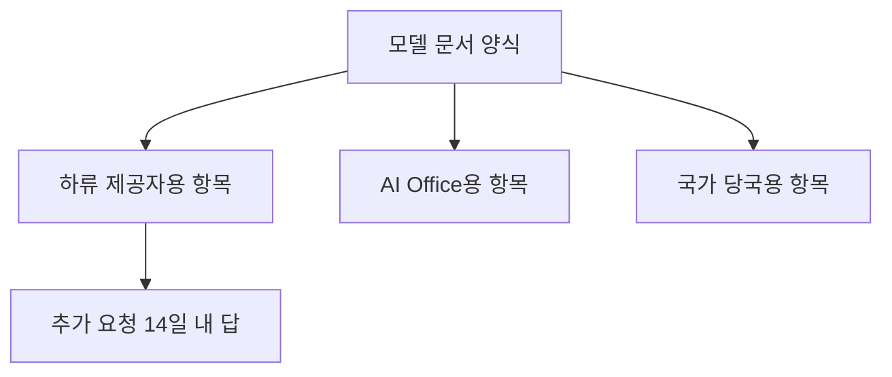
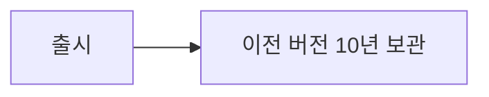

# 모델 문서 양식 (Model Documentation Form)

> GPAI 행동강령 투명성 장이 제공하는 문서 양식(DOCX). AI Act가 요구하는 모델 정보를 한 틀에 기록하게 해 주고, 항목마다 누구(하류 제공자·AI Office·국가 당국)를 위한 정보인지 표시한다.

## 쉽게 말하면
의약품 설명서에 "환자용, 의사용, 규제 당국용" 칸이 나뉘어 있는 것과 같다. 모델 개발사는 한 양식에 적고 받는 쪽마다 필요한 부분만 건넨다.

## 자세히
출처는 code-of-practice.ai의 투명성 장(앞부분 열람)과 집행위 안내 페이지(열람), 부속서 XI(열람). 행동강령은 자발적 도구이고 법률 자문이 아니다.
- **약속 1(문서화)**: 서명자는 모델 문서를 작성·최신 유지(1.1), 하류 제공자와 AI Office에 요청 시 관련 정보를 제공(1.2), 품질·보안·무결성을 보장(1.3)한다. AI Act 53조 2항에 따라 요건을 충족하는 자유·오픈소스 모델에는 이 조치가 적용되지 않으나 시스템 리스크 모델은 예외다.
- **양식의 지위**: 서명자는 시장 출시 전 적어도 양식의 정보를 문서화해야 하며, 양식을 쓸 수 있다. 양식은 각 항목이 하류 제공자, AI Office, 국가 당국 중 누구를 위한 것인지 표시한다. 항목별 구분은 양식 이미지에만 있어 이번에 읽지 못했다.
- **수령자별 제공**
  - 하류 제공자: 요청용 연락처를 공개하고 하류용 최신 정보와 모델 능력·한계 이해에 필요한 추가 정보를 제공. 추가 요청은 예외 상황이 없으면 14일 이내에 답한다.
  - AI Office: 91조 또는 75조 3항에 따른 요청 시 최신 형태로 AI Office가 정한 기한 안에 제공.
  - 국가 당국: 엄격히 필요할 때 AI Office를 통해(예: 다른 제공자 모델 위에 만든 고위험 시스템 평가).
  - 공개: 가능한 경우 공개를 권장. 학습 콘텐츠 요약은 53조 1항 d에 따라 별도로 필수.
- **보관**: 문서의 이전 버전은 모델 시장 출시 후 10년간 보관한다.
- **품질·무결성·보안**: 품질과 무결성을 점검하고 준수 증거로 보관하며 의도치 않은 변경으로부터 보호한다. 수령자는 78조의 기밀 유지를 지키고 영업비밀 보호와 적절한 사이버 보안 조치를 적용한다.
- **부속서 XI와의 관계(해석)**: 양식은 부속서 XI·XII의 정보를 기록하는 실무 도구로 쓰이도록 만들어졌다. 정확한 칸 구성은 양식 원본으로 확인해야 한다.

## 그림으로 보기

## 예시
- 하류 기업이 모델의 한계에 관한 추가 정보를 요청하면 제공자는 공개된 연락처로 받아 14일 안에 답한다(행동강령 구조에 따른 설명 예).
- 교육 실습: 가상 모델의 사양을 하류 제공자용·AI Office용·공개용 세 칸으로 나눠 어떤 정보가 어디에 해당할지 추정.

## 헷갈리는 것과 비교
| 개념 | 차이 |
|---|---|
| 모델 문서 양식 | 행동강령의 기록 도구 |
| [부속서 XI 기술 문서](#annex-xi-documentation) | 법이 요구하는 문서 항목 |
| 학습 데이터 요약 | 공개용 별도 의무 |
| [안전·보안 장](#safety-security-chapter) | 시스템 리스크 모델용 다른 장 |

## 더 읽을거리
- [Code of Practice 투명성 장](https://code-of-practice.ai/?section=transparency) — 문서화 약속(앞부분 열람)
- [Commission: GPAI Code of Practice 안내](https://digital-strategy.ec.europa.eu/en/policies/contents-code-gpai) — 양식 소개(열람)
