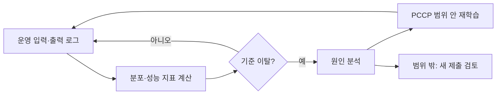

# 모델 드리프트 모니터링

> 배포 뒤 입력 데이터나 환경이 바뀌어 모델 성능이 서서히 떨어지는 것(드리프트)을 지표로 감시하는 활동. 규제 의료 AI에서는 시판 후 감시 전략의 핵심이다.

## 쉽게 말하면
학교에서 만점 받은 학생이 사회에 나가 시험 유형이 바뀌면 점수가 떨어지듯, 모델도 현장 데이터가 달라지면 성능이 떨어진다. 체중계를 정기 점검하듯 정기적으로 재야 한다.

## 자세히
- **종류(일반 개념)**: 입력 분포 변화(데이터 드리프트: 새 스캐너·환자군), 입력-정답 관계 변화(개념 드리프트: 진료 지침 개정), 라벨 분포 변화.
- **규제 맥락**: PCCP의 수정 프로토콜은 변경 후 안전·효과를 보는 시판 후 감시 전략을 요구한다(해설 요약, [수정 프로토콜](#modification-protocol)). NIST AI RMF도 운영 중 새로 나타나는 위험을 실제 성능으로 추적하라고 한다([위험 추적](#risk-tracking-over-time)).
- **감시 지표 예(일반 실무)**: 입력 통계(해상도·장비 제조사 비율), 출력 분포(양성률), 사람 판독과의 일치율 표본 점검, 사용자 신고, 오류 사례.
- **대응**: 경고 임계값 → 원인 분석 → 재학습(PCCP 범위 안이면 계획대로, 밖이면 새 제출 검토) → 라벨·통지 갱신.
- **어려움**: 정답 라벨이 늦게 도착(진단 확정까지 시간) → 입력 통계와 대리 지표를 먼저 본다. 병원별로 다른 분포 → 현장별 모니터링.
- 이 노드의 구체 임계값은 일반론이며 FDA 지침의 수치가 아니다.

## 그림으로 보기

## 예시
- 병원이 CT 장비를 교체한 뒤 AI의 양성 판정률이 15% → 25%로 변하면 드리프트 경보. 표본 200건을 의사가 재판독해 일치율 하락을 확인하고 제조사에 통보.

## 헷갈리는 것과 비교
| 개념 | 차이 |
|---|---|
| 데이터 드리프트 | 입력 분포 변화 |
| 개념 드리프트 | 정답 규칙 변화 |
| 사고 대응 | 이미 발생한 문제 처리 |
| [위험 추적](#risk-tracking-over-time) | 위험 관리 관점의 상위 개념 |

## 더 읽을거리
- [NIST AI RMF Core](https://airc.nist.gov/airmf-resources/airmf/5-sec-core/) — MEASURE 3 운영 중 추적
- [McDermott PCCP 해설](https://www.mcdermottlaw.com/insights/fda-issues-final-guidance-on-predetermined-change-control-plans-for-ai-enabled-devices/) — 변경 후 시판 후 감시 요구
