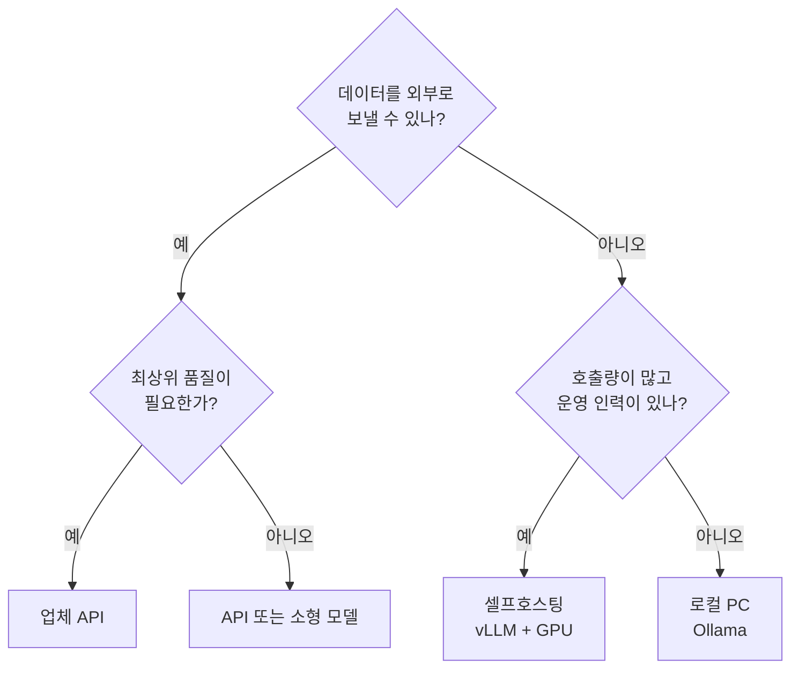
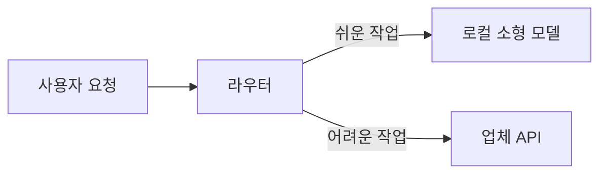

# 모델 호스팅 선택지

> AI 모델을 어디서 돌릴지의 선택지: ①업체 API ②클라우드 GPU에 직접 띄우기 ③내 PC·사내 서버(로컬) ④기기 안(엣지). 비용, 속도, 데이터 통제, 운영 부담이 서로 다르다.

## 쉽게 말하면
커피가 필요할 때 선택지는 같다. 카페에서 사 마신다(API), 공유 주방을 빌려 직접 내린다(클라우드 GPU), 집에 머신을 들여놓는다(로컬), 텀블러에 담긴 걸 들고 다닌다(엣지). 가끔 마시면 카페가 싸고, 하루 수백 잔이면 머신이 낫고, 남에게 레시피를 못 보여 주면 집에서 내려야 한다.

## 자세히
| 선택지 | 대표 도구·서비스 | 장점 | 단점 |
|---|---|---|---|
| **업체 API** | Claude·OpenAI·Gemini API | 가장 높은 성능 모델, 운영 없음, 쓴 만큼 과금 | 데이터가 외부로 나감, 속도 제한, 업체 의존 |
| **클라우드 GPU 셀프호스팅** | vLLM·클라우드 GPU 임대 | 오픈 모델 선택·미세조정 자유, 데이터 통제 | GPU 비용·운영 인력 필요 |
| **로컬(PC·사내 서버)** | Ollama, llama.cpp | 인터넷 없이 가능, 개인정보 보호, 실험 무료 | 하드웨어 한계, 작은 모델 위주 |
| **엣지(기기 내)** | 스마트폰·로봇 내장 소형 모델 | 지연 최소, 오프라인 | 가장 작은 모델만 가능 |

**도구 두 가지(공식 문서 기준)**
- **Ollama**: MIT 라이선스 오픈소스. 설치 후 `ollama run gemma4`처럼 한 줄로 모델을 내려받아 대화한다. `localhost:11434` REST API(`/api/chat`)와 Python·JS 라이브러리가 있다. GitHub 별 약 18.7만 개(2026-11 확인).
- **vLLM**: UC 버클리 Sky Computing Lab에서 시작한 추론·서빙 라이브러리. PagedAttention으로 어텐션 키·값 메모리를 효율적으로 관리하고, 연속 배칭·청크 프리필·프리픽스 캐시, 양자화, 텐서·파이프라인 병렬, OpenAI 호환 API 서버를 제공한다. 공식 문서는 최고 수준의 서빙 처리량을 주장한다. 여러 사용자 동시 서비스에 맞는 도구다.

**고르는 기준**
1. **데이터 민감도**: 외부 전송이 불가하면 셀프호스팅·로컬(또는 업체의 전용 엔드포인트·데이터 거주 옵션).
2. **품질 요구**: 최상위 성능이 필요하면 API가 유리하다. 작은 오픈 모델은 단순 분류·추출엔 충분한 경우가 많다.
3. **호출량**: 소량은 API, 대량·상시 부하는 [손익분기](#api-vs-self-host)를 계산해 본다(GPU 가동률이 낮으면 셀프호스팅이 오히려 비싸다).
4. **운영 역량**: 셀프호스팅은 모니터링·업데이트·보안 책임이 따른다.
5. **혼합**: 쉬운 요청은 소형 로컬 모델, 어려운 요청은 API로 보내는 [모델 라우팅](#model-routing).

## 그림으로 보기

## 예시
- 개인 노트 정리 앱: 노트북에서 `ollama run`으로 소형 모델을 돌려 외부 전송 없이 요약.
- 사내 문서 검색 봇 수천 명 사용: vLLM으로 사내 GPU 서버에 오픈 모델을 서빙하고 OpenAI 호환 API로 연결.
- 스타트업 초기 제품: 우선 API로 시작해 호출량이 늘면 일부 작업만 자체 호스팅으로 옮긴다.

## 헷갈리는 것과 비교
| 개념 | 차이 |
|---|---|
| Ollama | 쉬운 로컬 실행·개발용에 적합 |
| vLLM | 다수 동시 요청을 높은 처리량으로 서빙하는 운영용 |
| [API vs 셀프호스팅](#api-vs-self-host) | 비용·통제의 큰 갈림길 |
| [로컬 LLM](#local-llm) | 내 기기에서 돌리는 방식 전반 |

## 더 읽을거리
- [Ollama GitHub](https://github.com/ollama/ollama) — 설치·실행 명령
- [vLLM 문서](https://docs.vllm.ai/en/latest/) — 서빙 기능과 시작 가이드
