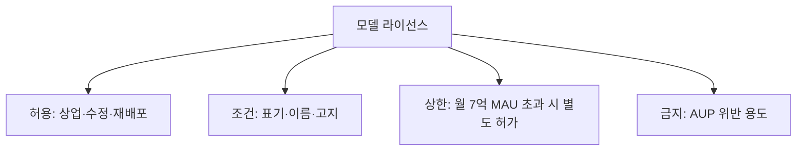
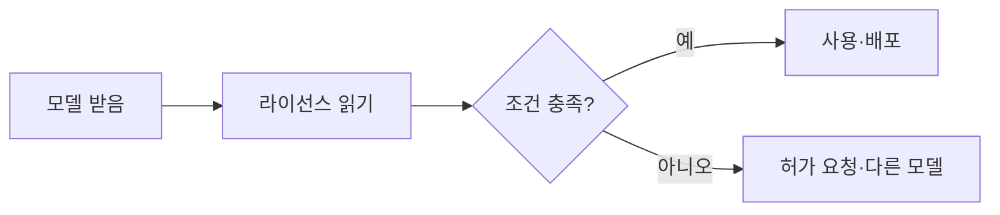

# 모델 라이선스 읽기

> 모델을 내려받을 수 있어도 **어떻게 써도 되는지는 라이선스가 정한다.** 상업 이용, 사용자 수 상한, 표기 의무, 금지 용도, 파생 모델 이름 규칙을 점검한다.

## 쉽게 말하면
렌터카를 빌릴 때 "누가 운전해도 되나, 어디까지 가도 되나, 반납 때 뭘 표시해야 하나"를 계약서에서 확인하는 것과 같다. 차(모델 파일)를 손에 쥐었다고 마음대로 쓸 수 있는 건 아니다.

## 자세히
Llama 3.1 커뮤니티 라이선스 원문(meta-llama/llama-models의 LICENSE, 직접 읽음, 열람 2026-11-28)에서 확인한 조항:
- **재배포 의무**: Llama 자료를 배포하거나 이를 포함한 제품·서비스(다른 AI 모델 포함)를 제공하면 계약서 사본을 함께 제공하고 웹사이트·UI·문서 등에 **"Built with Llama"**를 눈에 띄게 표시해야 한다.
- **파생 모델 이름**: Llama 자료나 그 출력으로 AI 모델을 만들거나 개선해 배포하면 모델 이름 **맨 앞에 "Llama"**를 붙여야 한다.
- **Notice 파일**: 배포 사본에 "Llama 3.1 is licensed under the Llama 3.1 Community License, Copyright © Meta Platforms, Inc."라는 고지를 유지.
- **허용 이용 정책(AUP)**: 관련 법규와 별도의 Acceptable Use Policy 준수를 계약에 편입.
- **추가 상업 조건**: Llama 3.1 출시일 기준 직전 달 월간 활성 사용자가 **7억 명 초과**면 Meta에 별도 라이선스를 요청해야 하고, Meta가 재량으로 허가할 때까지 권리를 행사할 수 없다.
- 한계: 이 글은 Llama 3.1 한 건만 읽었다. 다른 모델(Apache 2.0, MIT 등 허용적 라이선스, Llama 4, 제한적 연구용 라이선스)은 각각 원문을 읽어야 한다. 이는 법률 자문이 아니다.
- 점검표(내 정리): ① 상업 이용 가능? ② 사용자·매출 상한? ③ 표기·이름 규칙? ④ 금지 용도? ⑤ 출력으로 다른 모델 학습 가능? ⑥ 버전별로 조건이 바뀌는가?

## 그림으로 보기

## 예시
- Llama 3.1을 미세조정해 `my-model`로 배포하려면 이름을 `Llama-my-model`처럼 시작해야 한다.
- 교육: 후보 모델 3개의 라이선스를 위 점검표로 표에 채우는 실습.

## 헷갈리는 것과 비교
| 개념 | 차이 |
|---|---|
| 라이선스 | 사용 조건을 법적으로 규정 |
| [오픈 가중치](#open-weights) | 공개 방식의 분류 |
| [OSI 정의](#osi-open-source-ai) | "오픈소스"라 부를 자격 기준 |

## 더 읽을거리
- [Llama 3.1 LICENSE 원문](https://github.com/meta-llama/llama-models/blob/main/models/llama3_1/LICENSE) — 조항 확인(읽음).
