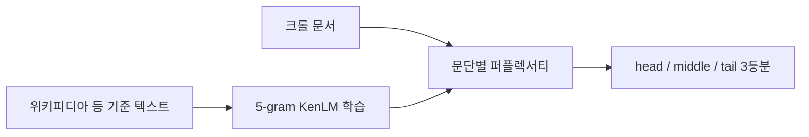
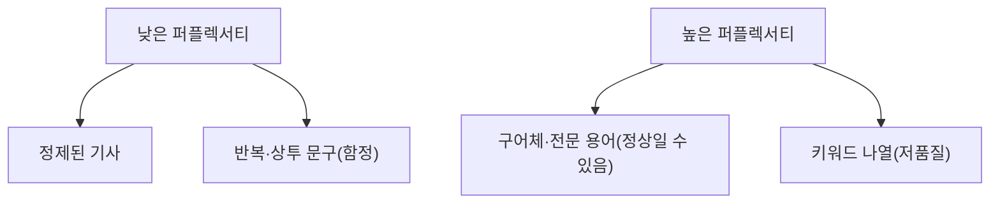

# 모델 우도 필터링

> 기준이 되는 좋은 텍스트(예: 위키피디아)로 작은 언어 모델을 학습시키고, 그 모델이 각 문서에 매기는 확률(퍼플렉서티)로 "기준과 얼마나 비슷한가"를 점수화해 문서를 거르거나 등급을 나누는 방식이다.

## 쉽게 말하면
위키피디아만 읽고 자란 사람에게 글을 읽혀 "이 글은 얼마나 낯선가"를 묻는 것과 같다. 위키피디아와 비슷한 단정한 글은 익숙하게(낮은 퍼플렉서티) 느끼고, 키워드 나열이나 은어 가득한 글은 낯설어한다. 다만 낯설다고 해서 나쁜 글은 아니다.

## 자세히
(CCNet 논문 arXiv 1911.00359 PDF 본문과 Gopher 논문 부록 A.1, Longpre 등 arXiv 2305.13169 초록을 직접 열어 확인.)
- **CCNet(Wenzek 등, 2019)**: 대상 영역(위키피디아)의 텍스트로 **5-그램 Kneser-Ney 언어 모델**(KenLM)을 학습하고, 페이지를 SentencePiece로 토큰화한 뒤 문단별 **퍼플렉서티**를 계산한다. 낮을수록 대상 영역과 비슷하다. 언어별로 말뭉치를 **head·middle·tail 세 등분**한다(임계값은 언어마다 달리, 세 부분의 크기가 같도록).
- **CCNet이 본 장단점**: 퍼플렉서티는 품질의 "비교적 좋은 대리 지표"였다 — 기자·정제된 글은 head로 간다. 반면 **키워드 나열 문서가 중복 제거와 언어 판별을 통과해 높은 퍼플렉서티를 받는 경우**도 있고, 정상 글인데 위키피디아와 어휘가 달라(구어체 블로그 댓글, 전문 용어 포럼) tail로 가는 경우도 있다. 그래서 **LM 점수만으로 삭제하지 않고** 특정 용도에 유용할 수 있어 버킷으로 남겼다. 언어마다 위키 크기가 달라 분포가 달라서(영어 LM 534M 텍스트 대 구자라트어 12M) 언어별 임계값을 썼다.
- **Gopher의 입장(논문)**: 모델로 문서를 우도 순으로 랭킹하는 방식도 고려했지만, **높은 우도가 고품질을 뜻하지 않는다** — 반복적인 텍스트가 대표적. 또한 많은 문서에 대해 우도를 추론하는 비용이 크고 의도치 않은 편향 위험이 있다고 보고 쓰지 않았다([Gopher·MassiveText](#gopher-massivetext)).
- **필터링 일반 결과(Longpre 등 초록)**: 1.5B 디코더 모델 28개를 시기·품질/독성 필터·도메인 구성만 바꿔 학습. 품질·독성 필터링은 벤치마크 성능과 독성 생성 위험 사이의 **트레이드오프**이고, "모든 상황에 맞는 단일 해법은 없다". 필터 효과는 텍스트 도메인 특성만으로 예측할 수 없다.
- **정리(제안)**: 모델 우도 필터링은 ① 기준 코퍼스가 편향을 만들 수 있고 ② 사전 지식과 다른 정상 글을 낮게 평가하며 ③ 반복·상투적 글을 높게 평가한다. 그래서 점수로 즉시 삭제하기보다 샘플링 점검과 함께 등급 분리(CCNet) 또는 다른 필터와 조합(규칙+분류기)해 쓴다([교육 품질 분류기](#educational-quality-classifier)).

## 그림으로 보기

## 예시
- 사내 공지문을 기준 텍스트로 작은 LM을 학습하고, 외부 수집 문서를 점수화해 상위 1/3을 우선 사용한다. 다만 낮은 점수 문서 중 전문 용어 문서를 사람이 샘플 점검(제안).
- 교육 활용: "AI가 좋은 글을 어떻게 고르는가" 질문에 대한 간단한 설명 — 좋은 글과 얼마나 비슷한가를 확률로 계산.

## 헷갈리는 것과 비교
| 개념 | 차이 |
|---|---|
| 모델 우도(퍼플렉서티) 필터링 | 기준 LM과의 유사도로 등급화 |
| [교육 품질 분류기](#educational-quality-classifier) | LLM이 매긴 점수를 회귀로 학습 |
| 규칙 기반 필터([C4](#c4-dataset)) | 사람이 정한 단순 규칙 |
| 분류기(고품질 vs 일반) | 이진 분류. 기준 코퍼스 편향 위험 |

## 더 읽을거리
- [CCNet (arXiv 1911.00359)](https://arxiv.org/abs/1911.00359) — 퍼플렉서티 기반 3등분과 장단점(PDF 본문 확인).
- [A Pretrainer's Guide to Training Data (arXiv 2305.13169)](https://arxiv.org/abs/2305.13169) — 필터링 트레이드오프(초록 확인).
- [Gopher 논문 (arXiv 2112.11446)](https://arxiv.org/abs/2112.11446) — 우도 필터링을 쓰지 않은 이유(PDF 본문 확인).
