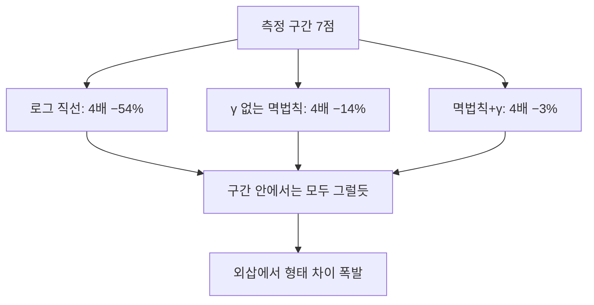
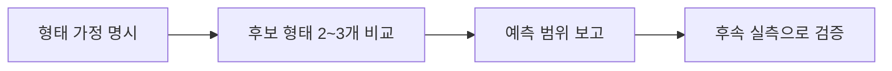

# 맞춤 형태 오지정

> 학습 곡선에 **틀린 함수 형태**(예: 로그 직선, γ 없는 멱법칙)를 맞추면 측정 구간 안에서는 그럴듯해도 외삽할수록 **한 방향으로 체계적으로 틀린다.** 잡음이 아니라 형태 선택의 문제이므로 점을 늘려도 사라지지 않는다.

## 쉽게 말하면
처음 일주일 기온이 매일 1도씩 오른다고 직선을 그어 한 달 뒤를 예측하면 한겨울에 40도가 나온다. 직선이라는 형태가 틀렸기 때문에 데이터가 아무리 깨끗해도 예측이 벗어난다.

## 자세히
- **직접 시뮬레이션(순수 파이썬, 200회 반복)**: 진짜 곡선 ε = 2.0·m^(−0.35) + 0.05(곱셈 잡음 2%), 2배 간격 7점(10³~6.4×10⁴)에 세 가지 형태를 맞추고 측정 최대의 4배·16배·100배 지점의 **평균 상대 오차(예측−진짜)/진짜**를 쟀다.
  | 맞춘 형태 | 4배 | 16배 | 100배 |
  |---|---|---|---|
  | 로그 직선 ε = a + b·ln m | **−54.3%** | −115.6% | −219.2% |
  | 멱법칙(γ 없음) ε = a·m^(−β) | −13.9% | −27.0% | −45.0% |
  | 멱법칙 + 상수 γ(올바른 형태) | −3.2% | −6.2% | −10.3% |
  (음수는 실제보다 **오류를 낮게**, 즉 낙관적으로 예측했다는 뜻.) 로그 직선은 16배 지점에서 오류가 음수가 되는 불가능한 예측(−115%)을 낸다. γ 없는 멱법칙은 바닥(0.05)을 무시해 점점 더 낙관적이다. 올바른 형태도 소표본 잡음 때문에 약간 낙관적이다([외삽 낙관 편향](#extrapolation-optimism)).
- **왜 구간 안에서는 못 알아채나**: 7점 안에서는 세 형태가 모두 곡선을 비슷하게 따라간다. 형태 차이는 **측정 범위 밖**에서 드러난다.
- **Hestness 외(arXiv 1712.00409)가 보여 주는 형태 선택의 민감성**: 단일 모델군의 학습 곡선은 "멱법칙 + 상수"로 잘 표현되지만 서로 다른 모델 크기의 최적 곡선을 조합하면 상수 없이 더 긴 멱법칙 영역(β≈−0.128로 투영)이 보인다고 서술한다. 같은 현상도 어느 곡선을 대상으로 하느냐에 따라 형태가 다르다.
- **점검법**
  1. **잔차 패턴**: 맞춘 곡선의 잔차가 로그-로그에서 체계적으로 휘면 형태 오류 신호(위 3형태 비교 시 잔차를 그려 본다).
  2. **구간별 지수**: 인접 점 쌍의 국소 기울기가 일정한지([맞춤 범위 안정성](#fit-range-stability)).
  3. **후속 측정**: 외삽이 가리키는 구간의 일부를 실제로 재서 맞는지 확인([후속 실측 검증](#follow-up-measurement)).
  4. **형태 비교**: 후보 형태 2~3개를 같이 맞추고 외삽 예측의 **범위**를 본다(범위가 넓으면 형태 불확실).
- **보고 원칙**: 형태 가정을 명시하고, 형태에 따라 예측이 달라지는 범위를 같이 적는다. 부트스트랩 구간은 형태 오류를 담지 못한다([곡선 맞춤 부트스트랩](#curve-fit-uncertainty-bootstrap)).
- **한계**: 위는 진짜 곡선을 알고 있는 가상 실험이며 실제 곡선은 도메인에 따라 다르다.

## 그림으로 보기



## 예시
```python
cands = {"loglin": loglin_fit, "power": power_fit, "power+c": power_const_fit}
for name, f in cands.items():
    print(name, f(sizes, errors).predict(4 * sizes[-1]))     # 형태별 외삽 범위
```
- 데이터 4배 외삽에서 세 형태가 오류 4.8%, 5.4%, 6.9%를 내면 "5~7%"로 보고하고 결정에는 높은 쪽을 쓴다.

## 헷갈리는 것과 비교
| 오류 | 원인 | 점 증가로 해결 |
|---|---|---|
| 측정 잡음 | 점의 흩어짐 | 부분적으로 |
| 맞춤 불확실성 | 모수 추정 오차 | 점 증가로 감소 |
| 형태 오지정 | 함수 형태 틀림 | 해결 안 됨 |
| [외삽 거리](#extrapolation-distance-limit) | 거리에 따른 증폭 | 거리를 줄임 |

## 더 읽을거리
- [Deep Learning Scaling is Predictable, Empirically (arXiv 1712.00409)](https://arxiv.org/abs/1712.00409) — 단일/조합 학습 곡선의 형태 차이(PDF 본문 확인). 형태별 오차 표는 이 글의 직접 시뮬레이션.
