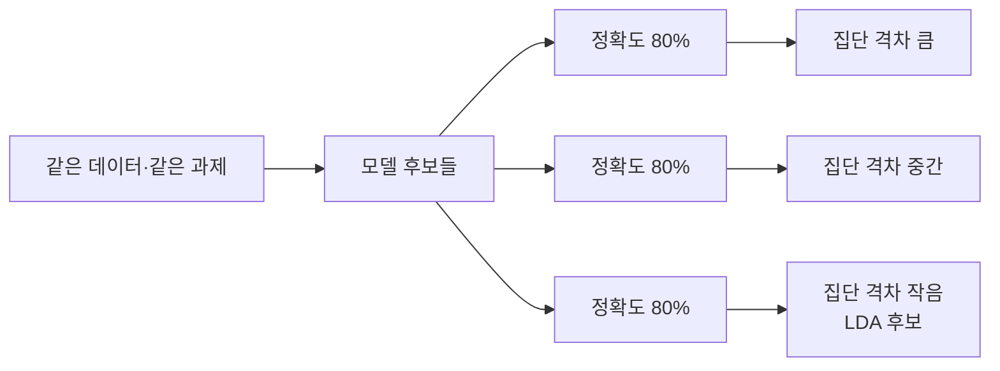

# 모델 다중성 (Model Multiplicity)

> 같은 예측 문제에서 **성능이 거의 같은 모델이 여러 개 존재**하는 현상. "라쇼몽 효과(Rashomon effect)"라고도 한다. 같은 성능이어도 사람마다 예측이 다르고 집단별 영향도 달라질 수 있다.

## 쉽게 말하면
서울에서 부산까지 걸리는 시간이 같은 길이 여러 개 있다고 하자. 어느 길을 타도 도착 시각은 같지만, 지나가는 마을은 다르다. 모델도 정확도가 같아도 "어떤 사람을 합격시키는가"는 다를 수 있다.

## 자세히
출처: Black 외, "The Legal Duty to Search for Less Discriminatory Algorithms"(arXiv 2406.06817 v1, FAccT 2024 비아카이벌 요약판; HTML 본문 확인, 2026-11-18). 수치로 된 실증 결과는 거기엔 거의 없다.
- **정의**: 대상 지표(논문은 설명용으로 정확도)가 정해진 임계값 ϵ 안에 있으면 두 모델을 동등한 성능으로 본다. 현상의 이름으로 Rashomon effect(Breiman 2001 인용), 예측 다중성(predictive multiplicity), 모델 다중성이 소개된다.
- **핵심 함의**: 동등 정확도 모델들은 같은 사람에게 다른 예측을 낼 수 있고, 집계하면 집단별 영향이 달라진다. 그래서 격차가 있는 모델에는 성능은 비슷하고 격차는 더 작은 [덜 차별적 대안](#less-discriminatory-alternative)이 존재할 수 있다.
- **근거**: 논문은 이 현상이 이론과 실제에서 확인된다며 Rodolfa 외(2021, 공공정책 ML에서 공정성-정확도 트레이드오프가 거의 없다는 관찰), Coston 외(2021), Auerbach 외(2024)를 인용한다. 본문의 수치는 가상 예시(정확도 80%인 두 모델)뿐이다.
- **왜 눈에 안 띄나**: 개발자는 보통 지표 하나를 최적화한다. 의도적 탐색 없이는 대안을 발견하기 어렵다는 것이 논문의 서술이다.
- **구분**: 다중성은 "존재한다"는 현상이고, 그 안에서 고르는 것이 [LDA 탐색 절차](#lda-search-process)다.
- **한계**: 동등 성능의 기준(ϵ)이 모호하고, 모든 문제에서 격차가 줄어든 모델이 있다고 보장되지는 않는다(논문도 한계를 인정).

## 그림으로 보기

## 예시
- 대출 승인 모델을 하이퍼파라미터만 바꿔 50번 학습 → 모두 AUC 0.80±0.002인데 집단 간 승인율 격차는 3%p~9%p로 갈린다면 다중성 사례(가상 시나리오, 이 값은 설명용).
- 교육 활용: "정확도가 같으면 모델도 같다"는 오해를 깨는 도입 질문으로 쓴다.

## 헷갈리는 것과 비교
| 개념 | 차이 |
|---|---|
| 모델 다중성 | 동등 성능 모델이 여럿 존재함 |
| [덜 차별적 대안](#less-discriminatory-alternative) | 그중 격차가 작은 모델 |
| 앙상블 | 여러 모델을 합치는 기법, 다중성은 현상 |
| 과적합 | 학습 데이터에만 맞는 문제, 무관 |

## 더 읽을거리
- [arXiv 2406.06817](https://arxiv.org/html/2406.06817v1) — LDA 의무 논문(FAccT 2024 요약판), 다중성 정의
- [Georgetown Law Journal 113권 논문 원문 PDF](https://www.law.georgetown.edu/georgetown-law-journal/wp-content/uploads/sites/26/2024/11/Black-et-al._LessDiscriminatory.pdf) — 전체 논증(검색 결과로만 확인, 본문은 열지 않음)
