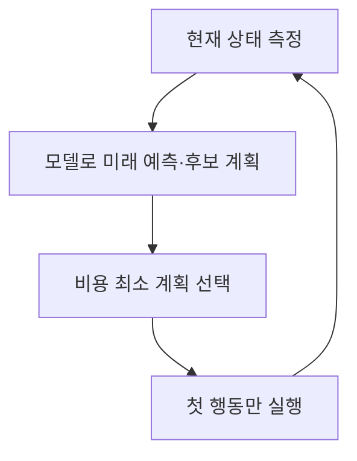

# 모델 예측 제어(MPC)

> **MPC**는 시스템 모델로 가까운 미래를 예측해 **여러 행동 후보 중 비용이 가장 낮은 계획**을 고르고, 그 **첫 행동만 실행한 뒤 다시 계획**하는 제어 방식이다. 월드 모델과 결합해 로봇 계획에 쓰인다.

## 쉽게 말하면
내비게이션이 앞길 몇 킬로미터를 계산해 최적 경로를 정하지만, 실제로는 지금 한 구간만 가고 다시 위치를 확인해 경로를 새로 계산하는 것과 같다. 계획을 끝까지 믿지 않고 계속 갱신한다.

## 자세히
(Wikipedia "Model predictive control" 확인)
- **모델 기반**: 내부 모델로 입력 변화에 따른 출력을 예측한다(전통적으로 선형 경험 모델이 흔함).
- **유한 구간 최적화**: 매 단계 현재 상태를 측정하고 짧은 미래 구간에서 비용(목표와의 차이, 급격한 입력 변화)을 최소화하는 문제를 푼다.
- **제약 조건**을 최적화에 넣어 입력·출력 한계를 지킨다.
- **첫 행동만 실행하고 반복**: 상태를 다시 재서 창을 한 칸 밀어 재최적화한다. 그래서 **후퇴 구간 제어(receding horizon control)** 라고도 한다.
- 미리 내다보므로 PID가 못 하는 미래 대응이 가능하다. 1980년대부터 화학 공장·정유 공정에 쓰였고 전력 계통 균형, 전력 전자에도 적용된다.
- 월드 모델 연결(일반 지식): 학습한 월드 모델로 여러 행동열을 "상상"해 점수를 매기고 최선을 고르는 방식을 로봇에 쓴다. 이 글에서 구체 논문은 확인하지 않았다. 모델이 틀리면 예측이 어긋나는 점은 [예측 오차 누적](#compounding-error)과 연결된다.

## 그림으로 보기

## 예시
- 자율주행: 앞 3초 궤적을 계획하고 첫 0.1초만 실행, 반복.
- 로봇 팔: 월드 모델로 20개 행동열을 상상해 목표에 가까운 것을 고름(개념 예).

## 헷갈리는 것과 비교
| 개념 | 차이 |
|---|---|
| MPC | 계획을 반복 갱신, 제약 처리 |
| PID | 현재 오차 기반 반응형 |
| 강화학습 정책 | 학습된 정책이 즉시 행동 출력 |
| [JEPA](#jepa) | 예측 모델의 한 형태, 제어는 별도 |

## 더 읽을거리
- [Model predictive control (Wikipedia)](https://en.wikipedia.org/wiki/Model_predictive_control)
