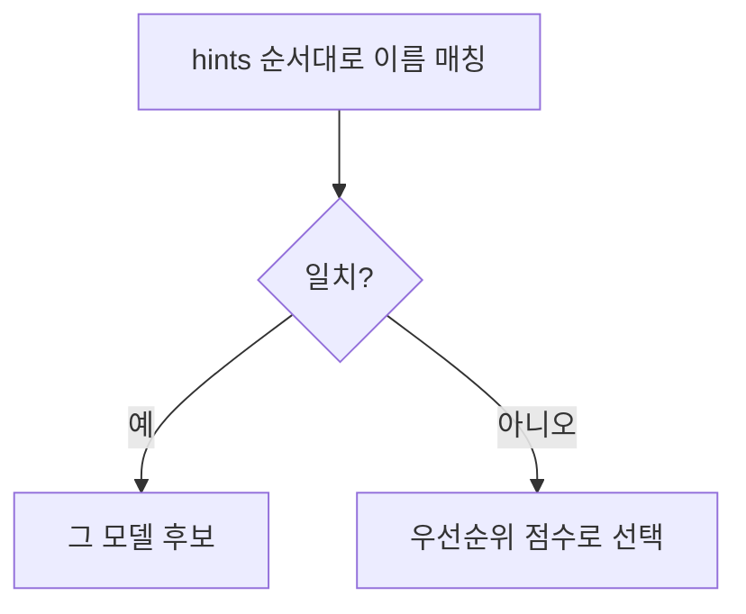

# modelPreferences

> MCP sampling 요청에서 서버가 "어떤 모델이 좋겠다"를 모델 이름이 아닌 비용·속도·지능 우선순위(0~1)와 이름 힌트로 전하는 필드.

## 쉽게 말하면
택시를 부를 때 차종을 못 박는 대신 "싸게(0.3), 빨리(0.8), 똑똑한 기사(0.5)" 정도로 취향만 말하는 것과 같다. 어떤 차를 보낼지는 배차 센터(클라이언트)가 가진 차량 중에서 정한다.

## 자세히
- 이유: 서버는 클라이언트가 어떤 모델·제공사를 쓰는지 모른다. 이름 지정만으론 안 맞을 수 있어 추상 우선순위로 말한다.
- `costPriority`(싼 모델 선호), `speedPriority`(낮은 지연), `intelligencePriority`(고급 능력), 각 0~1.
- `hints`: `[{"name":"claude-3-sonnet"},{"name":"claude"}]`처럼 **부분 문자열**을 우선순위 순으로. 클라이언트는 다른 제공사의 비슷한 모델(예: Gemini 계열)로 매핑해도 된다(MAY).
- 힌트는 권고일 뿐 최종 선택은 클라이언트. 응답의 `model`에 실제 쓴 모델이 담긴다.
- 스펙 2025-06-18 기준. 예시의 모델명은 스펙 예시이며 현재 라인업과 다를 수 있다.

## 그림으로 보기

## 예시
- 분류 같은 단순 작업: `costPriority 0.9, speedPriority 0.8, intelligencePriority 0.2`.
- 코드 리뷰 요약: `intelligencePriority 0.9, costPriority 0.2`.

## 헷갈리는 것과 비교
| 개념 | 차이 |
|---|---|
| modelPreferences | 취향 전달, 클라이언트가 결정 |
| 모델 ID 고정 | 특정 모델 강제. MCP는 이를 피함 |
| [Sampling](#mcp-sampling) | 이 필드를 담는 요청 자체 |

## 더 읽을거리
- [MCP Sampling 스펙 — Model Preferences](https://modelcontextprotocol.io/specification/2025-06-18/client/sampling) — 우선순위·힌트 정의
