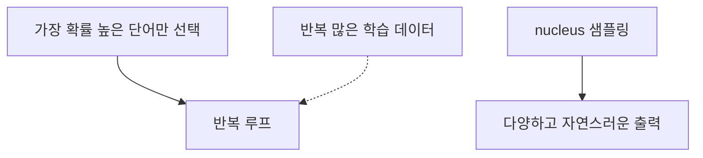
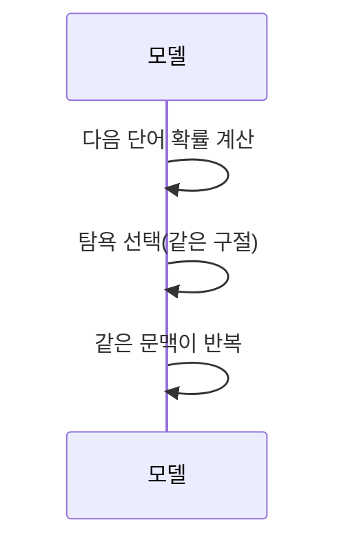

# 모델의 자기 반복 실패

> 언어 모델이 글을 생성하다가 같은 단어·문장을 되풀이하는 현상이다. 원인은 디코딩 방식에 크게 있고, 반복이 많은 학습 데이터도 한몫할 수 있다고 본다.

## 쉽게 말하면
말을 이어 가다 막히면 "그래서 그래서 그래서…" 하며 같은 말을 반복하는 사람과 비슷하다. 가장 안전한 다음 단어만 계속 고르면 안전하지만 지루한 반복의 늪에 빠진다.

## 자세히
(Holtzman 외 arXiv 1904.09751 초록, Gopher 논문 arXiv 2112.11446 부록을 직접 열어 확인.)
- **디코딩 원인**: 가능도를 최대화하는 디코딩(탐욕·빔 탐색)은 학습 때는 잘 맞지만 생성에서는 "밋밋하고 이상하게 반복적인" 텍스트를 만든다. 같은 모델도 디코딩 전략만으로 품질이 크게 달라진다. 제안된 해법 **nucleus(top-p) 샘플링**은 확률 꼬리를 잘라내고 남은 고확률 질량에서 뽑는다.
- **데이터 원인(Gopher)**: 저자들은 반복 많은 문서를 걸러 내는 이유로 "모델의 자기 반복은 반복적인 학습 데이터에서 일부 기인할 수 있다"고 적는다(추정). 그래서 [반복 임계값](#repetition-thresholds) 필터를 썼다.
- **주의**: 학습 데이터 반복이 샘플링 반복의 주된 원인이라고 증명된 것은 아니다. 이 노드의 인과는 "디코딩 확실, 데이터 부분적 가능성"으로 읽는다(제안).
- **실무 대응(제안)**: temperature·top-p 조정, 반복 억제 페널티, 학습 데이터 반복 필터.

## 그림으로 보기

## 예시
- 긴 요약을 시켰더니 같은 문장이 반복되면 temperature를 올리거나 top-p를 0.9로.
- 교육 활용: "AI가 똑같은 말을 되풀이하는 이유"를 디코딩 개념으로 설명.

## 헷갈리는 것과 비교
| 개념 | 차이 |
|---|---|
| 자기 반복 실패 | 생성 단계의 반복 |
| [상위 n-그램 비율](#top-ngram-fraction) | 학습 데이터 문서의 반복 측정 |
| 환각 | 반복이 아니라 사실과 다른 내용 |

## 더 읽을거리
- [The Curious Case of Neural Text Degeneration (arXiv 1904.09751)](https://arxiv.org/abs/1904.09751) — 가능도 최대화 디코딩의 반복, nucleus sampling.
- [Gopher (arXiv 2112.11446)](https://arxiv.org/abs/2112.11446) — 반복 제거 동기.
