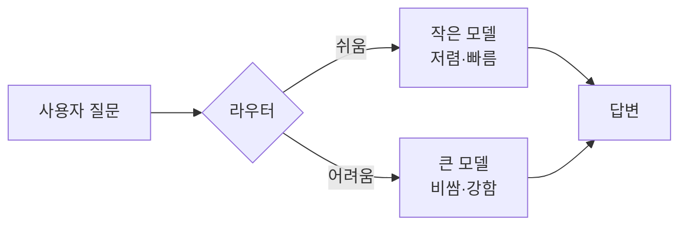
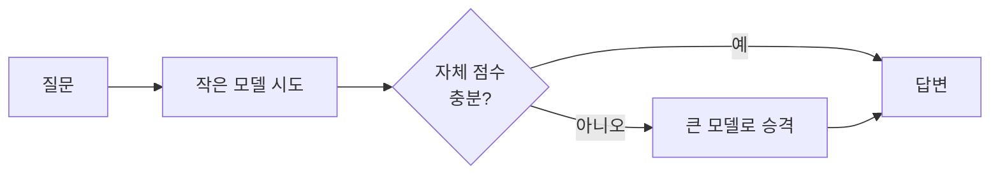

# 모델 라우팅

> 질문마다 난이도를 보고 작고 싼 모델과 크고 비싼 모델 중 어디로 보낼지 정해, 품질은 지키면서 비용을 줄이는 방법.

## 쉽게 말하면
병원 접수대와 같다. 감기는 동네 의원에서, 큰 수술은 대학병원에서 본다. 모든 환자를 대학병원에 보내면 비싸고 대기도 길다. 접수대(라우터)가 증상을 보고 알맞은 곳으로 안내하는 것이 모델 라우팅이다.

## 자세히
- **왜 하나**: 같은 질문도 모델에 따라 비용이 수십 배 차이 난다. 쉬운 질문이 많은 서비스라면 대부분을 작은 모델이 풀 수 있다.
- **방식 1 — 학습된 라우터**: RouteLLM(LMSYS, ICLR 2025)은 Chatbot Arena의 사람 선호 데이터로 라우터를 학습한다. 라우터 4종: 유사도 가중 순위, 행렬 분해, BERT 분류기, 인과적 LLM 분류기.
- **방식 2 — LLM이 라우터**: 작은 모델이 질문을 읽고 목적지를 고른다. 호출이 한 번 더 늘어난다.
- **방식 3 — 캐스케이드**: 싼 모델로 먼저 답하고, 점수가 낮으면 큰 모델로 올린다. 절감 폭은 크지만 지연이 늘 수 있다.
- **방식 4 — 규칙**: 길이·키워드·작업 종류(분류/요약은 작은 모델, 추론/코딩은 큰 모델)로 나눈다. 가장 단순하고 시작하기 좋다.
- **RouteLLM 보고 수치**(LMSYS 블로그, 2024-07): GPT-4 단독 대비 MT Bench 비용 85% 이상, MMLU 45%, GSM8K 35% 절감하면서 GPT-4 성능의 95% 유지. 상용 라우터 대비 같은 성능에서 40% 이상 저렴하다고 주장(저자 측정).
- **주의**: 절감률은 벤치마크 기준이다. 내 서비스 질문 분포에서는 직접 [평가 세트](#eval-set)로 재야 한다.

## 그림으로 보기

## 예시
- 고객 문의 챗봇: "배송 언제 와요?"는 작은 모델, "약관 해석 + 환불 예외 판단"은 큰 모델.
- 에이전트 파이프라인: 분류·추출 단계는 작은 모델, 계획·최종 판단 단계만 큰 모델(서브에이전트에 모델을 달리 지정).

## 헷갈리는 것과 비교
| 개념 | 차이 |
|---|---|
| [라우팅 패턴](#routing-pattern) | 입력을 종류별 처리 경로로 나누는 일반 설계. 모델 라우팅은 그중 "모델 선택"에 특화 |
| [증류](#distillation) | 큰 모델 능력을 작은 모델에 옮겨 담는 학습. 라우팅은 학습 없이 배치만 바꿈 |
| [프롬프트 캐싱](#prompt-caching) | 같은 입력 부분의 재계산 비용 절감. 라우팅과 함께 쓸 수 있음 |

## 더 읽을거리
- [RouteLLM 블로그(LMSYS)](https://www.lmsys.org/blog/2024-07-01-routellm/) — 라우터 4종과 비용 절감 수치.
- [RouteLLM 논문(arXiv 2406.18665)](https://arxiv.org/html/2406.18665v4) — 선호 데이터로 라우터를 학습하는 방법.
- [LLM Routing 정리(PremAI 블로그)](https://blog.premai.io/llm-routing-ai-costs-optimisation-without-sacrificing-quality) — 라우팅 전략 비교.
