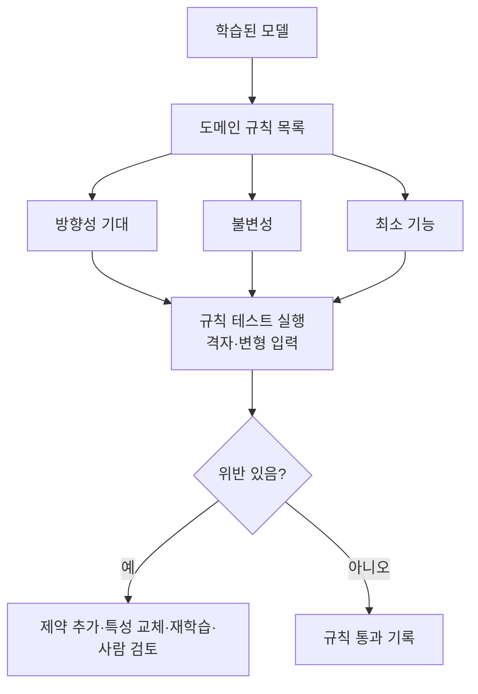

# 모델 상식 규칙

> 학습이 끝난 모델이 도메인 상식과 어긋나는 행동을 하지 않는지 **규칙으로 점검**하는 방법. 예: "소득이 높아지면 승인 확률이 내려가면 안 된다", "이름만 바꿔도 결과가 같아야 한다".

## 쉽게 말하면
계산기를 새로 샀을 때 1+1이 2인지, 순서를 바꿔도 결과가 같은지 몇 번 눌러 보는 것과 같다. 정확도 점수가 높아도 이런 기본 행동을 어기는 모델은 현장에서 신뢰받지 못한다.

## 자세히
출처: Ribeiro 외, "Beyond Accuracy: Behavioral Testing of NLP models with CheckList"(arXiv 2005.04118, ACL 2020, 초록 열어서 읽음), 앞서 이 세션에서 직접 실행한 XGBoost 단조 제약 확인.
- **발상(CheckList 초록)**: 검증 세트 정확도가 모델 성능을 과대평가하는 경우가 많다. 소프트웨어 공학의 **행동 테스트**를 가져와 능력과 테스트 유형의 행렬로 시험을 설계하고, 많은 테스트 사례를 빠르게 만드는 도구를 제공한다. 상용·최신 모델에서 세 과제에 걸쳐 치명적 실패를 찾았고, 이미 많이 시험한 상용 감성 분석 모델에서도 새 버그를 찾았다. 사용자 연구에서 CheckList를 쓴 실무자는 약 2배 많은 테스트를 만들고 약 3배 많은 버그를 찾았다고 한다. 초록에는 구체적 테스트 유형 이름이 나오지 않아 아래 유형은 일반적 분류다.
- **상식 규칙의 유형(일반 설명, 초록에서 확인한 것이 아님)**:
  - **방향성 기대**: 특정 입력이 커지면 출력이 한 방향이어야 함(소득↑ → 위험↓).
  - **불변성**: 무관한 변화(이름, 성별 표기 방식 등)에 결과가 바뀌면 안 됨.
  - **최소 기능**: 가장 기본적인 사례를 맞히는지.
- **직접 확인한 예(이 세션)**: 증가·감소 추세에 진동을 섞은 합성 데이터로 XGBoost를 학습하고, 한 특성만 움직였을 때 방향을 어기는 격자 구간을 셌다. 제약 없는 모델은 한 특성에서 70개, 다른 특성에서 60개 구간(200개 격자 중)이 방향을 어겼다. 단조 제약을 적용하면 0개였다([XGBoost 단조 제약 설정](#monotone-constraints-xgboost)). 합성 데이터 한 번의 실행 결과다.
- **쓰임**: 학습 전에 제약으로 막거나(단조 제약), 학습 후에 규칙 테스트로 점검한다. 규칙은 도메인 전문가가 정하고, 위반 시 모델 재학습·특성 교체·사람 검토 같은 조치를 정한다.
- **한계**: 규칙 자체가 틀리거나 맥락에서 예외일 수 있고(예: 소득이 매우 높아도 부채 구조에 따라 위험), 규칙이 모든 위험을 덮는 것은 아니다.

## 그림으로 보기

## 예시
- 신용 모델: 소득을 올렸는데 승인 점수가 내려가는 입력 쌍을 자동 생성해 위반 비율 보고.
- 채용 모델: 이름의 성별을 바꿔도 점수가 달라지면 불변성 위반.

## 헷갈리는 것과 비교
| 개념 | 차이 |
|---|---|
| 모델 상식 규칙 | 학습 후 행동을 규칙으로 점검 |
| [단조 제약](#monotonic-constraints) | 학습 중 방향을 강제 |
| [XGBoost 단조 제약 설정](#monotone-constraints-xgboost) | 구현 방법 |
| 검증 세트 정확도 | 평균 성능, 규칙 위반을 드러내지 못할 수 있음 |

## 더 읽을거리
- [Beyond Accuracy: Behavioral Testing of NLP models with CheckList (arXiv 2005.04118)](https://arxiv.org/abs/2005.04118) — 행동 테스트 방법론(초록 확인)
