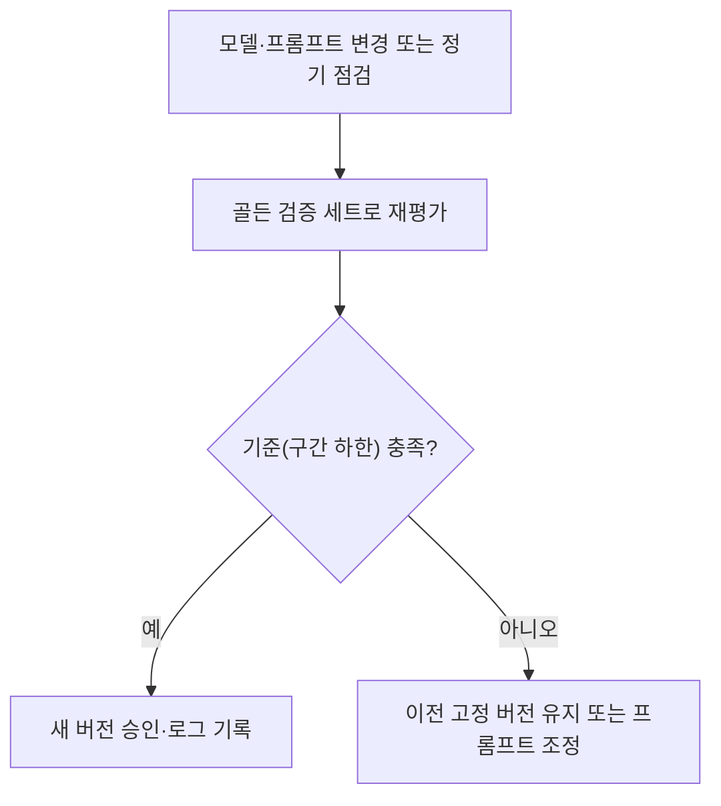
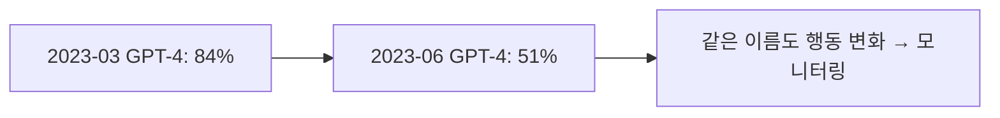

# 모델 버전 변경 시 재검증

> LLM으로 라벨을 붙이거나 판단을 맡기는 시스템은 **모델 버전이 바뀌면(또는 같은 이름의 서비스가 조용히 갱신되면) 라벨 품질을 다시 확인**해야 한다. 같은 이름의 모델도 몇 달 사이에 행동이 크게 달라질 수 있다.

## 쉽게 말하면
같은 식당이 요리사를 바꾸거나 레시피를 개량하면 맛이 달라진다. 간판이 같다고 어제 평가가 오늘도 맞을 거라고 가정하면 안 된다. 요리사가 바뀐 날엔 시식 점검을 다시 한다.

## 자세히
- **근거 연구(Chen·Zaharia·Zou, arXiv 2307.09009, 초록 확인)**: GPT-3.5와 GPT-4의 **2023년 3월 판과 6월 판**을 7개 과제(수학, 민감·위험 질문, 의견 조사, 다단계 지식 질문, 코드 생성, 미국 의사면허 문제, 시각 추론)로 비교했다.
  | 항목 | 변화(3월→6월) |
  |---|---|
  | GPT-4 소수/합성수 판별 정확도 | 84% → **51%** |
  | GPT-3.5 같은 과제 | 개선 |
  | 민감·의견 질문 | GPT-4가 답변을 덜 함 |
  | 다단계 질문 | GPT-4 개선, GPT-3.5 하락 |
  | 코드 생성 | 두 모델 모두 형식 오류 증가 |
  | 지시 따르기 | GPT-4 하락(여러 변화의 공통 요인이라 저자 해석) |
  저자는 소수 판별 하락의 일부를 GPT-4가 단계별 사고 프롬프트를 덜 따르게 된 탓으로 본다. 결론: "같은 LLM 서비스의 행동이 비교적 짧은 시간에 크게 바뀔 수 있으므로 **지속적 모니터링**이 필요".
- **재검증이 필요한 계기**
  1. 모델 이름·버전 변경(예: 후속 모델로 교체, 폐기 예정 모델 교체).
  2. 같은 별칭(alias)이 가리키는 스냅샷 변경 — 가능하면 **날짜가 박힌 고정 버전**을 사용하고 기록.
  3. 프롬프트·규칙서·후처리 변경.
  4. 입력 분포 변화([성능 하락 원인 분류](#performance-drop-root-cause)).
- **재검증 절차(제안)**
  1. 고정된 **골든 검증 세트**(사람이 확정한 50~200건)를 보관.
  2. 새 버전으로 돌려 [신뢰구간](#independent-test-ci)과 함께 정확도·일치도 비교. 이전 점수와의 차이는 [짝지은 비교](#paired-bootstrap-model-comparison)로 판단.
  3. 오류를 유형별로 분류해 어떤 입력에서 달라졌는지 본다(형식 오류 증가 같은 비의미적 변화 포함).
  4. 기준 미달이면 이전 고정 버전 유지 또는 프롬프트 조정.
  5. 결과와 모델 버전·날짜·프롬프트 해시를 로그에 남긴다.
- **운영 팁**: 모델 응답 형식(JSON 등)이 달라지는 경우가 흔하므로 파서 오류율을 별도 지표로 감시.
- **한계**: 위 연구는 2023년 두 시점의 비교이며, 최근 제공자는 버전 고정·종료 일정을 더 명시한다(제공자별 정책 확인 필요).

## 그림으로 보기



## 예시
```python
import json, hashlib
log = {"model": "gpt-x-2026-xx-xx", "prompt_sha": hashlib.sha1(prompt.encode()).hexdigest()[:8],
       "golden_acc": acc, "ci": [lo, hi], "parse_error_rate": perr}
open("eval_log.jsonl", "a").write(json.dumps(log, ensure_ascii=False) + "\n")
```
- 월 1회 자동 점검: 골든 100건을 호출해 정확도 구간 하한이 0.90 미만이면 알림.

## 헷갈리는 것과 비교
| 개념 | 설명 |
|---|---|
| 모델 드리프트(제공자 쪽 변화) | 같은 이름 서비스의 행동 변화 |
| 데이터 드리프트 | 입력 분포 변화 |
| 회귀 테스트 | 변경 후 기존 정답 유지 확인 |
| [규칙서 품질 보증](#guideline-quality-assurance) | 규칙 문서 쪽 점검 |

## 더 읽을거리
- [How is ChatGPT's Behavior Changing over Time? (arXiv 2307.09009)](https://arxiv.org/abs/2307.09009) — 2023 3월·6월 판 비교(초록 열어 확인).
