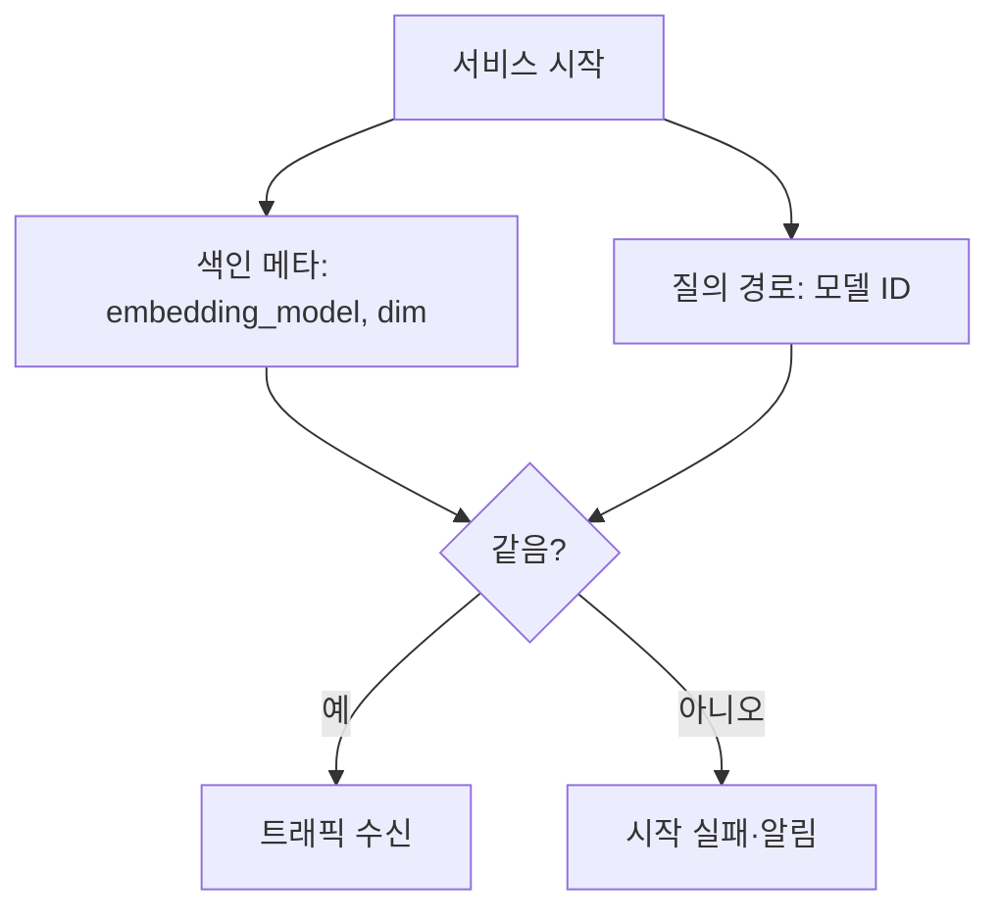
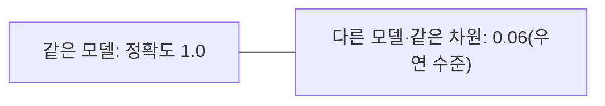

# 모델 버전 시작 시 검사

> RAG 서비스가 **시작할 때(또는 첫 질의 전에) "색인을 만든 임베딩 모델"과 "질의 경로가 쓰는 임베딩 모델"이 같은지 확인하는 검사**다. 모델이 다르면 에러 없이 검색이 우연 수준으로 나빠지므로, 시작 시점에 시끄럽게 실패하게 만든다.

## 쉽게 말하면
도서관 분류표가 새 방식으로 바뀌었는데 사서가 옛 분류표로 책을 찾으면 엉뚱한 서가로 간다. 그래서 출근하자마자 "오늘 쓰는 분류표 버전이 서가에 붙은 버전과 같은가?"를 먼저 확인한다.

## 자세히
(이 세션에서 numpy로 만든 **장난감 실험**이다. 단어별 무작위 벡터를 합쳐 정규화하는 두 개의 가짜 임베딩 모델 A(seed 1)·B(seed 2)를 만들었다. 둘 다 **차원이 32로 같고** 같은 어휘 16개를 쓴다. 실제 임베딩 모델의 거동이 아니라 "서로 다른 벡터 공간" 효과를 단순화한 것이다.)
- **실험(실행 결과)**: 문서 16개를 만들고 질의 16개(각각 정답 문서 1개)로 top-1 검색 정확도를 쟀다.
  | 색인 모델 | 질의 모델 | top-1 정확도 |
  |---|---|---|
  | A | A (같음) | **1.000** |
  | A | B (다름, 같은 차원) | **0.0625** (무작위 기대치 약 0.062) |
  → 같은 차원이면 **오류 없이 실행**되지만 정확도가 **우연 수준으로 붕괴**했다. 차원이 다르면 보통 즉시 오류가 나지만, 같은 차원의 다른 모델은 조용히 틀린다. → [임베딩 모델 불일치](#embedding-model-mismatch)
- **시작 시 검사 패턴(이 노드가 만들어 시험)**
  ```python
  index_meta = {"embedding_model": "model-A", "dim": 32}   # 색인에 함께 저장
  def startup_check(query_model_id, dim):
      if index_meta["embedding_model"] != query_model_id:
          raise RuntimeError("index built with …, query path uses …")
      if index_meta["dim"] != dim:
          raise RuntimeError("dimension mismatch")
  ```
  시험 결과: `model-A` → OK, `model-B` → **BLOCKED(모델 불일치 메시지)**.
- **구현 요점(제안)**: ① 색인을 만들 때 **모델 이름·버전·차원**을 색인(또는 별도 메타 표)에 기록한다. → [벡터에 모델 버전 기록](#embedding-vector-model-tagging) ② 서비스 시작·배포 헬스체크에서 질의 경로의 모델 ID와 대조한다. ③ 불일치면 **트래픽을 받지 않게** 하고 알림을 보낸다. ④ 제공자가 같은 이름 뒤에서 모델을 바꾸는 경우(조용한 교체)는 메타 비교만으론 못 잡으므로 소규모 정답 질의로 주기적 recall 점검을 병행한다. → [임베딩 모델 교체 위험](#embedding-model-churn)
- **한계**: 실제 임베딩 API에서 모델 ID가 정확히 노출되는지, 제공자가 버전을 어떻게 표시하는지는 이 노드에서 확인하지 않았다.

## 그림으로 보기



## 예시
- 임베딩 모델을 교체해 새 색인을 만들었는데 질의 서버 설정은 옛 모델 → 시작 시 검사가 즉시 실패시켜 배포를 막음.
- 교육 활동: 서로 다른 두 "임베딩"으로 색인·질의를 교차해 정확도 변화를 표로 만들어 보기.

## 헷갈리는 것과 비교
| 개념 | 차이 |
|---|---|
| 시작 시 모델 검사 | 배포 시점에 모델 ID 일치 확인 |
| 주기적 recall 점검 | 운영 중 품질 저하 탐지 |
| [임베딩 모델 불일치](#embedding-model-mismatch) | 검사가 막으려는 문제 |
| [블루-그린 재색인](#blue-green-reindex) | 모델 교체를 안전하게 수행하는 절차 |

## 더 읽을거리
- [Embedding models in production: versioning and index drift (tianpan.co)](https://tianpan.co/blog/2026/04/09/embedding-models-production-versioning-index-drift) — 버전이 다른 벡터는 비교할 수 없고 모델 정보를 기록하라는 권고(직접 확인, 개인 블로그). 표의 수치는 이 노드의 장난감 실험이다.
